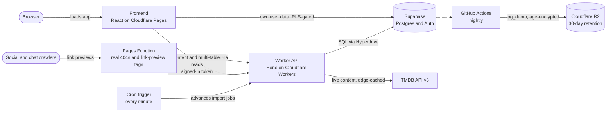

<!-- CODE CLASS README EXAMPLE -->

> [!NOTE]
> This README is a version for the technical documentation module. It belongs to the original watchpapa.tv repository, which is not part of this repository. Links to files such as `CONTEXT.md`, `Documentation/` and the migrations point to that original repository. Some of these links may not work.

# watchpapa.tv

watchpapa.tv helps you follow movies and TV shows. It shows every upcoming episode and premiere on one calendar and keeps a rating diary of everything you watch.

     

Visit the live site at [watchpapa.tv](https://watchpapa.tv). Krzysztof Durski created and owns the project.

<!-- TABLE OF CONTENTS -->
## Table of contents

- [About the project](#about-the-project)
- [Usage](#usage)
- [Documentation](#documentation)
- [Change log](#change-log)
- [Roadmap](#roadmap)
- [Contributing](#contributing)
- [Licence and terms of use](#licence-and-terms-of-use)
- [Acknowledgements](#acknowledgements)
- [AI usage](#ai-usage)

<!-- ABOUT THE PROJECT -->
## About the project

Keeping up with shows is hard. You finish a series and then must remember when the next episode arrives. A second show releases weekly on a different day. A film you want to see opens in autumn.

With watchpapa.tv you can follow all of these titles and see their release dates on one personal calendar. You can also rate, log and organise what you watch.

The site reads its movie and TV information live from The Movie Database (TMDB). Titles, dates, posters and cast stay current. watchpapa.tv stores only your own data, which is your ratings, follows and watchlists.

The project is live in production and under active development.

### Features

- **Releases calendar.** The calendar shows a month grid on desktop and an agenda list or week view on a phone. You cannot newly follow a finished show or an already released film, so the calendar shows only titles worth waiting for.
- **Detail pages.** Every movie, show, season, episode and person has a page. You can rate a title, log a watch, add it to a watchlist and see where to stream it in your regions. Logging several watches creates a rewatch diary.
- **Discovery.** You can search movies, shows and people in one list. You can also browse daily trending titles, personal recommendations, collections, filmographies and age certifications.
- **My Services.** This page filters popular, top-rated and suggested titles to the streaming services you pay for. It needs a Pro plan or higher.
- **Library and profile.** You can keep several named watchlists and choose five favourites. A public profile shows your favourites and stats. You can also observe other people to see their activity, and you can share image cards.
- **Import and export.** You can import your history from a Letterboxd file or a watchpapa file in comma-separated values (CSV) format. The import runs in the background, so you can close the tab.
- **Language and region.** You choose a content language, translated or original titles, and the regions for release dates and streaming availability.
- **Opt-in adult content.** Adult content is off by default. It needs your date of birth and uses filtering beyond TMDB's own flag.
- **Plans and rewards.** Free, Premium, Pro and Pro+ plans exist, with referrals, reward codes and upgrades granted by administrators. Payments are not available yet.

### How it works

The React frontend and the application programming interface (API) both run on Cloudflare. The API is a Cloudflare Worker. It reads movie and TV data from TMDB on request and caches the data at the edge. Supabase stores user data in a PostgreSQL database. Row-level security (RLS) lets each user read and write only their own rows.

Four design decisions shape the project.

- No content database. Language and region travel as query parameters, so the edge cache keeps one copy per locale.
- Built for the Workers Free plan. Every endpoint that sends many requests to other services has a cap. The caps keep each request within the plan's limits.
- Stateless sign-in checks. The Worker verifies Supabase tokens locally. It reads a user's role from the database on every request.
- Rules live in the database. RLS protects every table. Database triggers enforce plan limits, so the interface is not the only guard.

### Built with

* [React 19](https://react.dev/) and [React Router 7](https://reactrouter.com/)
* [Vite 8](https://vite.dev/)
* [Tailwind CSS 4](https://tailwindcss.com/)
* [TipTap](https://tiptap.dev/) for the announcements editor
* [react-easy-crop](https://github.com/ValentinH/react-easy-crop) for avatars
* [Hono 4](https://hono.dev/) on [Cloudflare Workers](https://developers.cloudflare.com/workers/)
* [Supabase](https://supabase.com/) for the database, sign-in and file storage
* [postgres.js](https://github.com/porsager/postgres) over Cloudflare Hyperdrive
* [jose](https://github.com/panva/jose) for token verification
* [TMDB API v3](https://developer.themoviedb.org/) for movie, show and people data
* [Resend](https://resend.com/) for sign-in emails
* [Cloudflare Pages](https://pages.cloudflare.com/) for hosting
* [Cloudflare R2](https://developers.cloudflare.com/r2/) for encrypted backups
* [Vitest](https://vitest.dev/), [Playwright](https://playwright.dev/) and Node's built-in test runner

(<a href="#readme-top">back to top</a>)

<!-- USAGE EXAMPLES -->
## Usage

### Follow titles and use the calendar

1. Create an account and choose a username.
2. Search for a show or movie and open its page.
3. Select **Follow**.
4. Open **Calendar** to see the upcoming episodes and premieres of your followed titles.

> [!NOTE]
> Each plan has a follow limit. If you exceed the limit, the calendar stays blocked until you unfollow some titles or upgrade.

### Rate and log what you watch

1. Open a title.
2. Rate it, log a watch or add it to a watchlist.

Rating a title or logging a watch removes it from your watchlists. The site keeps your rewatches in a diary and keeps a history of your own rating. The share button creates image cards.

Community ratings appear after 10 people rate a title. Until then, the page shows the TMDB average.

### Import your history

1. Open **Import**.
2. Upload a Letterboxd export or a watchpapa CSV file. Your browser reads the file.
3. Choose how to handle conflicts and which watchlist to use.
4. Select the button that starts the import.

The import runs as a background job, so you can close the tab. A status pill shows the progress. You can export all your data as a CSV file from the same page.

### Choose your language, region and services

1. Open **Settings**.
2. Choose a content language and select translated or original titles.
3. Choose the regions for release dates and **Where to watch**.
4. Select your streaming services.

You can also reorder or hide any row on the home page.

> [!WARNING]
> Adult content is off by default. You must enter a date of birth before you can turn it on.

(<a href="#readme-top">back to top</a>)

<!-- DOCUMENTATION -->
## Documentation

| I want to | Read |
|---|---|
| Look up a route, table or convention | [CONTEXT.md](https://github.com/watchpapa/watchpapa/blob/production/CONTEXT.md) |
| Deploy, set secrets or restore a backup | [Documentation/deployment.md](https://github.com/watchpapa/watchpapa/blob/production/Documentation/deployment.md) |
| See the database tables, policies and functions | [Documentation/database/schema.md](https://github.com/watchpapa/watchpapa/blob/production/Documentation/database/schema.md) |
| Understand plans, referrals and reward codes | [Documentation/subscription_system.md](https://github.com/watchpapa/watchpapa/blob/production/Documentation/subscription_system.md) |
| Review the threat model and security controls | [Documentation/security/security.md](https://github.com/watchpapa/watchpapa/blob/production/Documentation/security/security.md) |
| Browse all documents | [Documentation/README.md](https://github.com/watchpapa/watchpapa/blob/production/Documentation/README.md) |

(<a href="#readme-top">back to top</a>)

<!-- CHANGE LOG -->
## Change log

[Documentation/releases.md](https://github.com/watchpapa/watchpapa/blob/production/Documentation/releases.md) lists what each release added.

(<a href="#readme-top">back to top</a>)

<!-- ROADMAP -->
## Roadmap

- [x] Live TMDB content through a Cloudflare Worker
- [x] Releases calendar, ratings, watchlists and rewatch diary
- [x] Letterboxd and CSV import as background jobs
- [x] Language, region, streaming-service and adult-content preferences
- [x] My Services page, collections and certifications
- [x] Plans, reward codes, referrals and bulk tier rewards
- [x] Link previews, structured data and real 404 pages
- [x] Encrypted nightly database backups with a tested restore
- [ ] Payments for paid plans

(<a href="#readme-top">back to top</a>)

<!-- CONTRIBUTING -->
## Contributing

watchpapa.tv is a personal project under an all-rights-reserved licence. The project does not accept outside contributions without written permission. To offer help, contact the owner through the [contact page](https://watchpapa.tv/contact) first. If the owner agrees, follow [contributing.md](contributing.md). It covers setup, configuration, development, deployment and troubleshooting.

To report a bug or ask a question, [open an issue](https://github.com/watchpapa/watchpapa/issues) or use the contact page.

(<a href="#readme-top">back to top</a>)

<!-- LICENCE -->
## Licence and terms of use

Copyright © 2026 Krzysztof Durski. All rights reserved. See [`LICENCE`](https://github.com/watchpapa/watchpapa/blob/production/LICENCE) for details.

(<a href="#readme-top">back to top</a>)

<!-- ACKNOWLEDGEMENTS -->
## Acknowledgements

- TMDB provides the movie, TV and people data and images. "This product uses the TMDB API but is not endorsed or certified by TMDB."
- JustWatch provides the streaming availability data through TMDB.
- The [Have I Been Pwned](https://haveibeenpwned.com/Passwords) range API powers the breached-password check.
- The project builds on [Cloudflare Workers and Pages](https://developers.cloudflare.com/), [Supabase](https://supabase.com/), [Hono](https://hono.dev/) and [React](https://react.dev/).

(<a href="#readme-top">back to top</a>)

<!-- AI USAGE -->
## AI usage

AI tools (Cursor and Claude Code) helped with brainstorming, implementation, debugging and documentation. The author made the architecture, planning and technical decisions. The author reviewed and adapted all AI output before committing it. Commits that AI assisted carry a `Co-authored-by` line that names the tool.

(<a href="#readme-top">back to top</a>)

