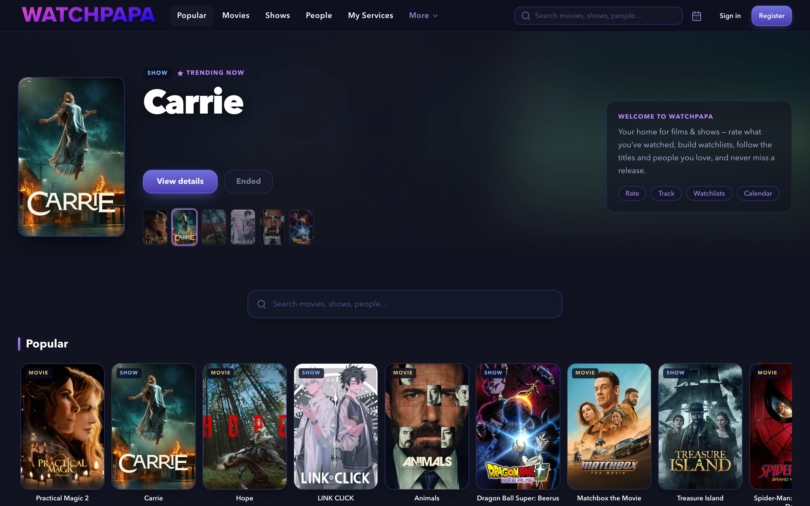
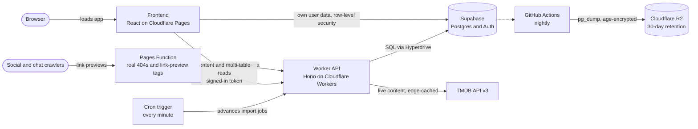

<!-- CODE CLASS README EXAMPLE -->

> [!NOTE]
> This README is a version for the technical documentation module. It belongs to the original watchpapa.tv repository, which is not part of this repository. Links to files such as `CONTEXT.md`, `Documentation/` and the migrations point to that original repository. Some of these links may not work.

# watchpapa.tv

     

watchpapa.tv helps you follow movies and TV shows. It shows every upcoming episode and premiere on one calendar and keeps a rating diary of everything you watch.

Visit the live site at [watchpapa.tv](https://watchpapa.tv). Krzysztof Durski created and owns the project.

<!-- TABLE OF CONTENTS -->
## Table of contents

- [About the project](#about-the-project)
- [Getting started](#getting-started)
- [Documentation](#documentation)
- [Change log](#change-log)
- [Roadmap](#roadmap)
- [Contributing](#contributing)
- [License and terms of use](#license-and-terms-of-use)
- [Acknowledgements](#acknowledgements)
- [AI usage](#ai-usage)

<!-- ABOUT THE PROJECT -->
## About the project

Keeping up with shows is hard. With watchpapa.tv you follow every title that you are waiting for and see all release dates on one personal calendar. You can also rate, log and organize what you watch.

The site reads its movie and TV information live from The Movie Database (TMDB). watchpapa.tv stores only your own data, which is your ratings, follows and watchlists. The project is live in production and under active development.

To learn more about the features, the design decisions and the tools behind the site, read [About watchpapa.tv](docs/about.md).

### How it works

The React frontend and the application programming interface (API) both run on Cloudflare. The API is a Cloudflare Worker. It reads movie and TV data from TMDB on request. Supabase stores user data in a PostgreSQL database.

*Figure 1. The parts of watchpapa.tv and the data that flows between them.*

(<a href="#readme-top">back to top</a>)

<!-- GETTING STARTED -->
## Getting started

You can try watchpapa.tv in about 20 minutes. You need:

- An email address that you can open. watchpapa.tv sends you a code to verify it.
- An age of at least 16 years.

1. Open [watchpapa.tv](https://watchpapa.tv).
2. Follow the [tutorial](docs/tutorial.md). It starts with creating your account and guides you to a followed show, a rated movie and your first recommendations.

To set up a local copy for development, read the [contributing guide](docs/contributing.md).

(<a href="#readme-top">back to top</a>)

<!-- DOCUMENTATION -->
## Documentation

| I want to | Read |
|---|---|
| Learn the site step by step | [Tutorial](docs/tutorial.md) |
| Solve a specific task | [How-to guides](docs/how-to.md) |
| Understand what the site is and why it works this way | [About watchpapa.tv](docs/about.md) |
| Understand follows, watchlists and ratings | [About follows, watchlists and ratings](docs/conceptual.md) |
| Set up a local copy and make a change | [Contributing guide](docs/contributing.md) |
| Look up a route, table or convention | [CONTEXT.md](https://github.com/watchpapa/watchpapa/blob/production/CONTEXT.md) |
| Deploy, set secrets or restore a backup | [Documentation/deployment.md](https://github.com/watchpapa/watchpapa/blob/production/Documentation/deployment.md) |
| See the database tables, policies and functions | [Documentation/database/schema.md](https://github.com/watchpapa/watchpapa/blob/production/Documentation/database/schema.md) |
| Understand plans, referrals and reward codes | [Documentation/subscription_system.md](https://github.com/watchpapa/watchpapa/blob/production/Documentation/subscription_system.md) |
| Review the threat model and security controls | [Documentation/security/security.md](https://github.com/watchpapa/watchpapa/blob/production/Documentation/security/security.md) |
| Browse all documents | [Documentation/README.md](https://github.com/watchpapa/watchpapa/blob/production/Documentation/README.md) |

(<a href="#readme-top">back to top</a>)

<!-- CHANGE LOG -->
## Change log

[Documentation/releases.md](https://github.com/watchpapa/watchpapa/blob/production/Documentation/releases.md) lists what each release added.

(<a href="#readme-top">back to top</a>)

<!-- ROADMAP -->
## Roadmap

- [x] Live TMDB content through a Cloudflare Worker
- [x] Releases calendar, ratings, watchlists and rewatch diary
- [x] Letterboxd and CSV import as background jobs
- [x] Language, region, streaming-service and adult-content preferences
- [x] My Services page, collections and certifications
- [x] Plans, reward codes, referrals and bulk tier rewards
- [x] Link previews, structured data and real 404 pages
- [x] Encrypted nightly database backups with a tested restore
- [ ] Payments for paid plans

(<a href="#readme-top">back to top</a>)

<!-- CONTRIBUTING -->
## Contributing

watchpapa.tv is a personal project under an all-rights-reserved license. The project does not accept outside contributions without written permission. To offer help, contact the owner through the [contact page](https://watchpapa.tv/contact) first. If the owner agrees, follow [contributing.md](docs/contributing.md). It covers setup, configuration, development, deployment and troubleshooting.

To report a bug or ask a question, [open an issue](https://github.com/watchpapa/watchpapa/issues) or use the contact page.

(<a href="#readme-top">back to top</a>)

<!-- LICENSE -->
## License and terms of use

Copyright © 2026 Krzysztof Durski. All rights reserved. See [`LICENSE`](https://github.com/watchpapa/watchpapa/blob/production/LICENSE) for details.

(<a href="#readme-top">back to top</a>)

<!-- ACKNOWLEDGEMENTS -->
## Acknowledgements

- TMDB provides the movie, TV and people data and images. "This product uses the TMDB API but is not endorsed or certified by TMDB."
- JustWatch provides the streaming availability data through TMDB.
- The [Have I Been Pwned](https://haveibeenpwned.com/Passwords) range API powers the breached-password check.
- The project builds on [Cloudflare Workers and Pages](https://developers.cloudflare.com/), [Supabase](https://supabase.com/), [Hono](https://hono.dev/) and [React](https://react.dev/).

(<a href="#readme-top">back to top</a>)

<!-- AI USAGE -->
## AI usage

AI tools (Cursor and Claude Code) helped with brainstorming, implementation, debugging and documentation. The author made the architecture, planning and technical decisions. The author reviewed and adapted all AI output before committing it. Commits that AI assisted carry a `Co-authored-by` line that names the tool.

(<a href="#readme-top">back to top</a>)

