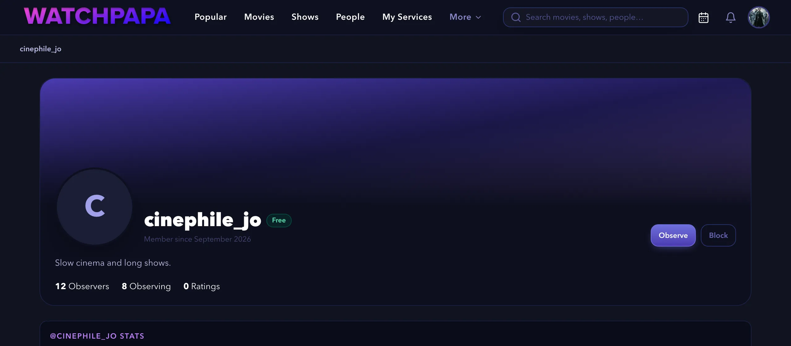
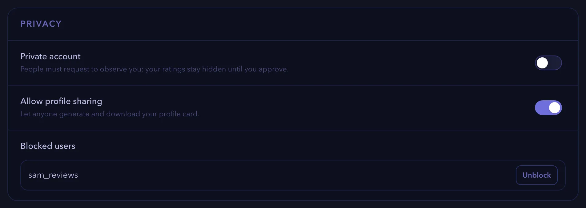
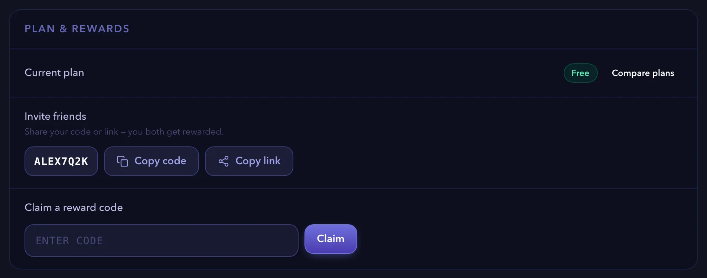
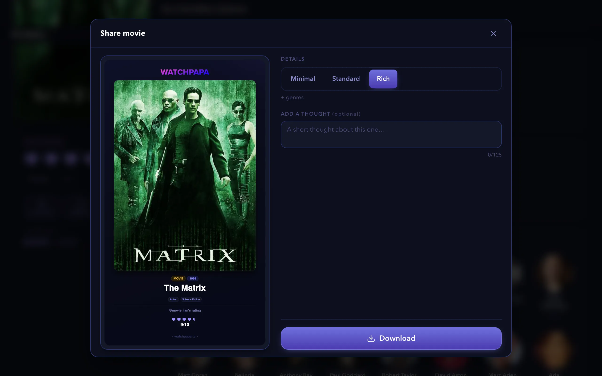
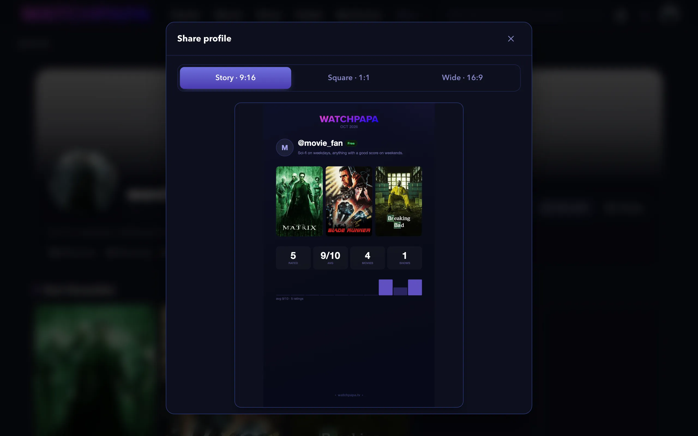

# How-to guides for people, privacy and plans

These guides show you how to observe people, control your privacy, invite friends, claim reward codes and share cards. Each guide lists what you need, gives numbered steps and ends with links to related tasks.

Screenshots show a demo account with real titles from The Movie Database (TMDB).

> [!NOTE]
> Some features depend on your plan. The Free plan allows three followed shows, one followed movie and one watchlist. Premium and Pro allow more. The [Plans & Perks](https://watchpapa.tv/subscription) page lists every limit.

This page is part of the [how-to guides](../how-to.md).

## Table of contents

- [Observing other people](#observing-other-people)
- [Making your account private](#making-your-account-private)
- [Controlling profile sharing](#controlling-profile-sharing)
- [Blocking a person](#blocking-a-person)
- [Unblocking a person](#unblocking-a-person)
- [Inviting a friend](#inviting-a-friend)
- [Claiming a reward code](#claiming-a-reward-code)
- [Sharing a title](#sharing-a-title)
- [Sharing your profile card](#sharing-your-profile-card)

---

## Observing other people

When you observe a person, you see their ratings in your activity feed and on the title pages that you open. This guide shows you how to find a person, observe them and handle requests to observe you. It does not cover blocking people.

### Before you begin

- Sign in to watchpapa.tv.
- Know the username of the person you want to observe, or part of it.

### Steps

1. Select your avatar and then **Find People**. On a phone, select the **You** tab first.
2. Enter a username in the **Search usernames** field. Results appear as you type.
3. Select the name of a person to open their profile.
4. Select **Observe**.

   

   *Figure 1. A profile with the Observe and Block buttons.*

   The button changes to **Observing**.

> [!NOTE]
> If the person has a private account, the button reads **Request to observe**. Select it. The button changes to **Requested**, and the person must accept before you see their ratings. To cancel the request, select **Requested** again.

> [!TIP]
> In the search results, the button next to a name reads **Observe** or **Request**. You can select it without opening the profile.

> [!NOTE]
> To stop observing a person, open their profile and select **Observing** again.

5. To read the ratings of the people you observe, select your avatar and then **Activity**.

> [!NOTE]
> If you observe nobody yet, the page shows "Nothing here yet". Select **Find people** to start.

6. If your account is private, a number appears next to **Observe Requests** in your account menu. Select **Observe Requests**.
7. Select **Accept** to allow the request, or **Deny** to refuse it.

### Summary

Congratulations. You observe people whose taste you like, and you decide who can observe you.

### Next steps

- [Make your account private](#making-your-account-private)
- [Rate a title](how-to-tracking.md#rating-a-title)

(<a href="#how-to-guides-for-people-privacy-and-plans">back to top</a>)

---

## Privacy and blocking

Privacy settings decide who can observe you and see your ratings. This guide shows you how to make your account private, how to control profile sharing, and how to block and unblock a person. It does not cover deleting your account.

### Before you begin

- Sign in to watchpapa.tv.

### Making your account private

1. Select your avatar and then **Settings**. On a phone, select the **You** tab first.
2. In the list of sections, select **Privacy**.
3. Turn on **Private account**. People must request to observe you, and your ratings stay hidden until you accept.

   

   *Figure 2. The Privacy section of Settings.*

> [!NOTE]
> You answer requests on the **Observe Requests** page. Read [Observing other people](#observing-other-people).

### Controlling profile sharing

1. Open the **Privacy** section of Settings, as in [Making your account private](#making-your-account-private).
2. To let other people create your profile card, turn on **Allow profile sharing**. Turn it off so that only you can create the card.

### Blocking a person

1. Open the profile of the person. Use **Find People** to locate the profile, as in [Observing other people](#observing-other-people).
2. Select **Block**.
3. In the "Block this user?" message, select **OK**. The button changes to **Unblock**, and any observe relationship between you ends.

> [!NOTE]
> To keep the person, select **Cancel** in the message. Nothing changes.

### Unblocking a person

1. Select **Unblock** on the profile of the person. You can also open the **Privacy** section of Settings, find the name under **Blocked users** and select **Unblock**.

> [!NOTE]
> If you blocked nobody, **Blocked users** shows "No blocked users".

### Summary

Congratulations. You control who can observe you, who can share your profile card and who you blocked.

### Next steps

- [Share your profile card](#sharing-your-profile-card)
- [Edit your profile](how-to-account.md#editing-your-profile)

(<a href="#how-to-guides-for-people-privacy-and-plans">back to top</a>)

---

## Invites and reward codes

You earn upgrades by inviting friends and by claiming reward codes. This guide shows you how to share your invite link and how to claim a code. It does not cover buying a plan. watchpapa.tv has no payments yet.

### Before you begin

- Sign in to watchpapa.tv.
- For a reward code, have the code ready. A code comes from a promotion.

### Inviting a friend

1. Select your avatar and then **Settings**. On a phone, select the **You** tab first.
2. In the list of sections, select **Plan & rewards**.
3. Find **Invite friends**. Your personal code appears there, for example `ALEX7Q2K`.
4. Select **Copy link** to copy the invite link. Select **Copy code** to copy only the code.

   

   *Figure 3. The Plan & rewards section.*

> [!TIP]
> For a shortcut, open your account menu and select **Invite friends**. The menu copies your invite link and shows "Link copied!".

5. Send the link or the code to a friend.

> [!NOTE]
> When your friend opens the link, the sign-up form already contains your code. If your friend has only the code, your friend enters it in the **Referral or gift code** field at sign-up. Each account can use one code, and only at sign-up.

> [!NOTE]
> You both receive an upgrade of 30 days after your friend follows at least three shows or upcoming movies and signs in on at least two different days. The upgrade is automatic. The **Plans & Perks** page explains which plan you get.

### Claiming a reward code

1. Open the **Plan & rewards** section of Settings, as in [Inviting a friend](#inviting-a-friend).
2. Enter the code in the **Claim a reward code** field.
3. Select **Claim**. A message tells you which plan you received and for how many days.

> [!NOTE]
> If the code is wrong or expired, the section shows "Reward code not found or no longer active". If the code has no uses left, it says "This reward code has no uses remaining". If you used the code before, it says "You have already claimed this reward code". Each code works once per account.

> [!NOTE]
> When a temporary upgrade ends, you return to Premium if you are an Early Adopter, or to Free. watchpapa.tv deletes nothing. If you follow more titles than your plan allows, the releases calendar pauses until you unfollow enough titles. Extra watchlists stay but you cannot create new ones.

### Summary

Congratulations. You shared your invite link and, if you had one, claimed a reward code. The **Current plan** row shows your plan and, for a timed upgrade, the end date.

### Next steps

- [Follow a show or a movie](how-to-tracking.md#following-a-show-or-a-movie)
- [Create a watchlist](how-to-tracking.md#creating-and-using-watchlists)

(<a href="#how-to-guides-for-people-privacy-and-plans">back to top</a>)

---

## Share cards

A share card is an image that shows a title or your profile. You can post it in stories, posts or chats. This guide shows you how to create a card for a title and for your profile. It does not cover sharing a link.

### Before you begin

- Sign in to watchpapa.tv.
- For a profile card, add favorite titles and ratings first, so that the card has content.

### Sharing a title

1. Open the page of a movie or a show.
2. In the rating card, select **Share**. The **Share movie** window opens (**Share show** for a show).
3. Under **Details**, choose how much the card shows.
   - **Minimal** shows the poster, the title and your rating.
   - **Standard** adds the year.
   - **Rich** adds the genres.
4. Optional: enter a short text of up to 125 characters in **Add a thought**.

   

   *Figure 4. The Share movie window.*

5. Select **Download** to save the image.

> [!NOTE]
> If your device supports sharing, a **Share** button appears next to **Download**. Select it to send the card directly to another app.

> [!NOTE]
> If you rated the title, the card shows your rating.

> [!NOTE]
> Season and episode pages have no **Share** button. Open the show page instead.

### Sharing your profile card

1. Select your avatar and then **View profile**.
2. Select **Share** in the header of your profile. The **Share profile** window opens.
3. Choose a format.
   - **Story · 9:16** fits phone stories.
   - **Square · 1:1** fits most posts.
   - **Wide · 16:9** fits wide screens.
4. Select **Share** to send the card to another app, or select **Download** to save the image.

   

   *Figure 5. The Share profile window.*

> [!NOTE]
> The card contains your avatar, bio, favorite titles and rating statistics.

> [!NOTE]
> Only you can share your profile, unless you turn on **Allow profile sharing** in the **Privacy** section of Settings. With that switch on, other people see a **Share** button on your profile too.

### Summary

Congratulations. You created a share card for a title and for your profile. The cards use the same artwork as the app, so they look alike in every format.

### Next steps

- [Edit your profile](how-to-account.md#editing-your-profile)
- [Control who can share your profile](#controlling-profile-sharing)

(<a href="#how-to-guides-for-people-privacy-and-plans">back to top</a>)

