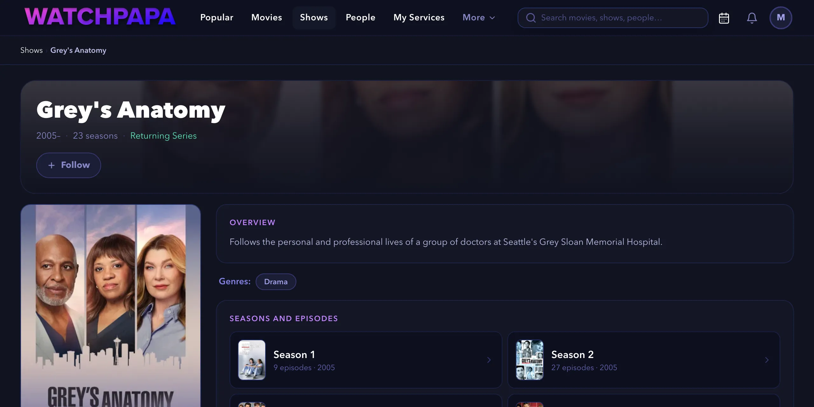
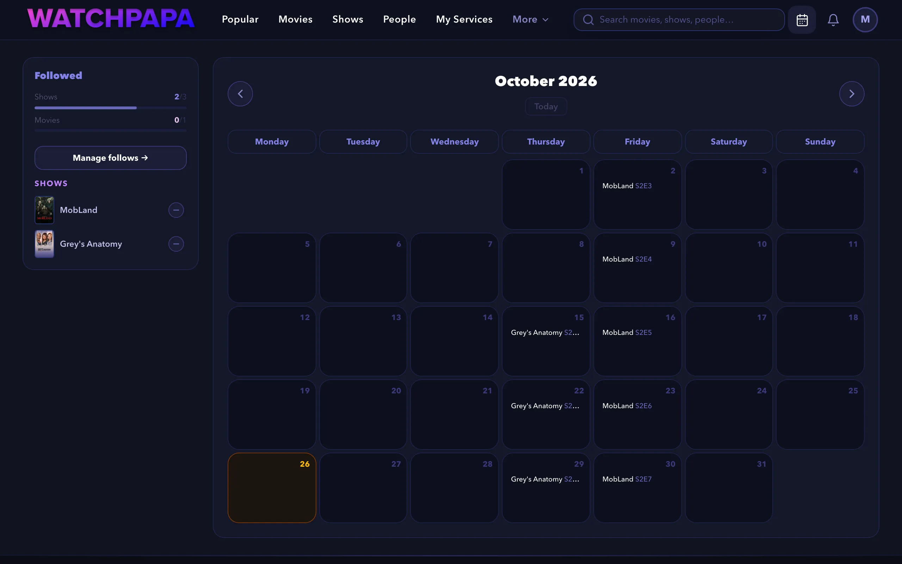
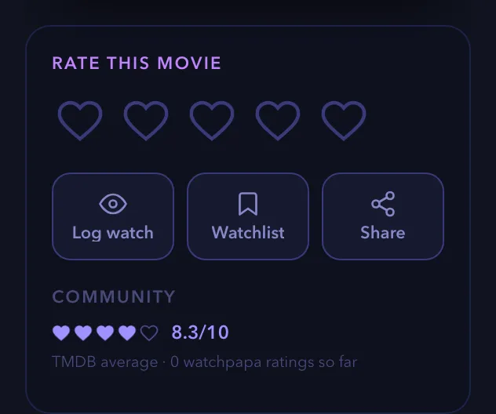
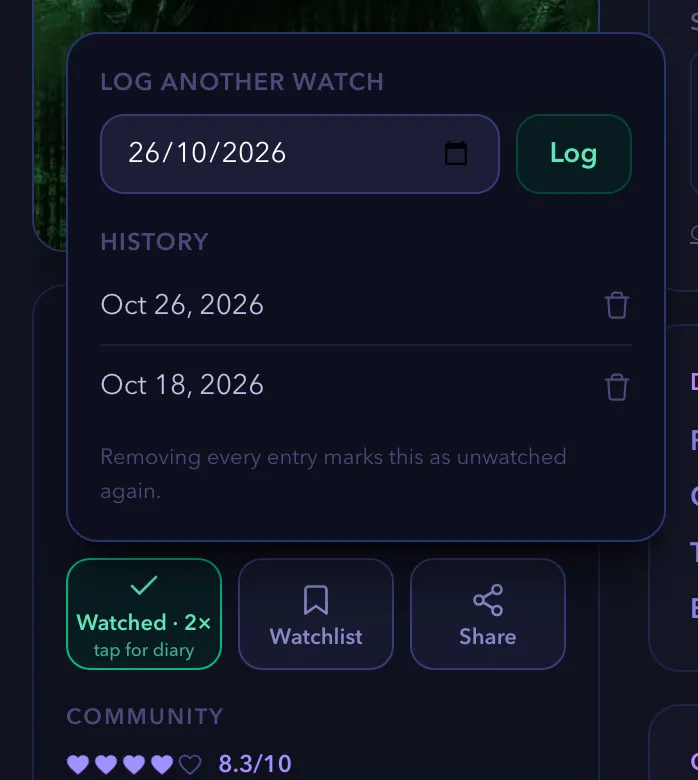
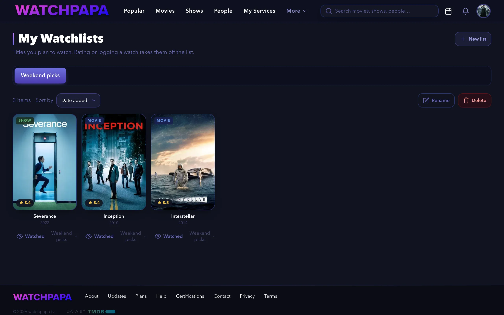

# How-to guides for tracking what you watch

These guides show you how to follow shows and movies, read the releases calendar, rate titles, log watches and keep watchlists. Each guide lists what you need, gives numbered steps and ends with links to related tasks.

Screenshots show a demo account with real titles from The Movie Database (TMDB).

> [!NOTE]
> Some features depend on your plan. The Free plan allows three followed shows, one followed movie and one watchlist. Premium and Pro allow more. The [Plans & Perks](https://watchpapa.tv/subscription) page lists every limit.

This page is part of the [how-to guides](../how-to.md).

## Table of contents

- [Following a show or a movie](#following-a-show-or-a-movie)
- [Reading the releases calendar](#reading-the-releases-calendar)
- [Checking your follow limit](#checking-your-follow-limit)
- [Unfollowing a title](#unfollowing-a-title)
- [Rating a title](#rating-a-title)
- [Changing or clearing a rating](#changing-or-clearing-a-rating)
- [Logging a watch](#logging-a-watch)
- [Logging another watch](#logging-another-watch)
- [Removing a watch](#removing-a-watch)
- [Creating and using watchlists](#creating-and-using-watchlists)

---

## Follows and the releases calendar

When you follow a show or a movie, its upcoming releases appear on your releases calendar. This guide shows you how to follow a show or a movie, read the calendar and unfollow a title. It does not cover importing a watch history.

### Before you begin

- Sign in to watchpapa.tv. If you have no account, read [Creating an account](how-to-account.md#creating-an-account).
- Know the name of a show that is still releasing episodes, or of a movie that is not released yet.

> [!NOTE]
> The Free plan lets you follow three shows and one movie. The Premium plan allows 10 follows in total. The Pro plan allows 100 shows and 100 movies.

### Following a show or a movie

1. Select the search field at the top. On a small screen, select the **Search** tab.
2. Enter a title, such as "Grey's Anatomy", and select it in the list.
3. On the title page, select **Follow**.

   

   *Figure 1. A show page with the Follow button.*

   The button changes to **Following** and shows a check mark.

> [!NOTE]
> You can also select **Follow** on a title card in lists such as **Popular**.

> [!NOTE]
> If you are not signed in, **Follow** opens a prompt to create an account or sign in.

> [!NOTE]
> A follow tracks only upcoming releases. For a show that has ended or a movie that is released, the button is locked and shows **Ended**, **Canceled** or **Released**.

> [!NOTE]
> If you reach your plan's limit, the follow does not save. Unfollow a title or read the **Plan & rewards** page.

### Reading the releases calendar

1. Select the calendar icon at the top right. On a narrow window, open your account menu and select **Releases Radar**. On a phone, select the **Radar** tab.
2. Find your title. Each episode sits on its air date with a code such as `S2E3` (season two, episode three). A movie appears the same way, under its title.

   

   *Figure 2. The releases calendar with the Followed panel.*

3. Select an entry to open its page.
4. Use the arrows next to the month name to change months. Select **Today** to return.

> [!NOTE]
> On a phone, the calendar shows a list. Select **Week** to see one week at a time, and select **List** to go back.

> [!NOTE]
> If a show releases several episodes of a season on one day, the calendar shows one **Season** entry. Select it to open the season page.

> [!NOTE]
> If you follow more titles than your plan allows, the calendar shows "You're over your follow limit" and stays blocked. Select **Manage follows** and unfollow titles until you are under the limit. This can happen after a temporary upgrade ends.

### Checking your follow limit

1. In the **Followed** panel at the left of the calendar, read the bars. **2/3** next to **Shows** means two of three follows used.

### Unfollowing a title

1. In the **Followed** panel, select the minus button next to the title. **Undo** stays available for five seconds.

> [!TIP]
> You can also unfollow from the title page. Select **Following** to turn it back to **Follow**.

### Summary

Congratulations. You followed a show or a movie, found its upcoming releases on the releases calendar and learned how to unfollow. The calendar updates whenever you follow or unfollow a title.

### Next steps

- [Rate a title](#rating-a-title)
- Open **Follows** in your account menu to manage all your follows in one place.

(<a href="#how-to-guides-for-tracking-what-you-watch">back to top</a>)

---

## Ratings and watches

A rating records what you think of a title. A watch log records when you saw it. This guide shows you how to rate a movie or a show, change or clear the rating, and log more than one watch. It does not cover watchlists or sharing.

### Before you begin

- Sign in to watchpapa.tv. If you have no account, read [Creating an account](how-to-account.md#creating-an-account).
- Choose a title that is already released. For a title that is not released yet, the page shows **Not yet released** instead of the hearts.

### Rating a title

1. Open a title page, as in [Following a show or a movie](#following-a-show-or-a-movie). This guide uses *The Matrix*.
2. Find the card with the heading **Rate this movie**. It shows five empty hearts.

   

   *Figure 3. The rating card before a rating.*

> [!NOTE]
> Shows work the same way, with the label **Rate this show**. Season and episode pages show the hearts only. They have no **Log watch**, **Watchlist** or **Share** buttons.

3. Point at the hearts. A score shows at the top right of the card. Each heart has two halves: the left half sets an odd score and the right half an even score, so five hearts cover one to 10. On a phone, tap a heart.
4. Select the half heart that matches your score. For 7 out of 10, select the left half of the fourth heart.

> [!NOTE]
> Your first rating also logs a first watch with today's date. It also removes the title from your watchlists.

> [!NOTE]
> If you are not signed in, selecting a heart opens a prompt to create an account.

### Changing or clearing a rating

Once you rate a title, the hearts lock so that a stray tap cannot replace your score.

1. Open the title page and find the rating card.
2. To change the rating, select **Change** and then select a new score. To cancel the change, select **Cancel**.
3. To remove the rating, select **Clear**.

### Logging a watch

1. Open the title page and find the rating card.
2. Select **Log watch**. The button logs today's date and changes to **Watched**.

### Logging another watch

1. On the title page, select **Watched** to open the **Rewatch diary**.
2. Under **Log another watch**, choose the date. It cannot be in the future.
3. Select **Log**. The button now reads **Watched** followed by the number of watches, for example **Watched · 2×**.

   

   *Figure 4. The Rewatch diary with two logged watches.*

### Removing a watch

1. On the title page, select **Watched** to open the **Rewatch diary**.
2. Select the trash can next to the date in the **History** list.

> [!NOTE]
> If you remove every entry, the title counts as unwatched again. Logging a watch also removes the title from any watchlist that holds it.

### Summary

Congratulations. You rated a title, logged your first watch and added a rewatch. watchpapa.tv saves both to your account, and every change to a rating keeps a history.

### Next steps

- [Create a watchlist for titles you plan to watch](#creating-and-using-watchlists)
- [Get recommendations based on your ratings](how-to-finding.md#getting-recommendations)
- [Follow a show or a movie](#following-a-show-or-a-movie)

(<a href="#how-to-guides-for-tracking-what-you-watch">back to top</a>)

---

## Creating and using watchlists

A watchlist holds titles that you plan to watch. This guide shows you how to add a title to a list, create more lists, and sort, rename and delete them. It does not cover recommendations or following titles.

### Before you begin

- Sign in to watchpapa.tv.
- Know your plan's limit. The Free plan allows one watchlist, Premium allows three, and Pro and Pro+ allow 10.

### Steps

1. Open the page of a movie or a show, as in [Following a show or a movie](#following-a-show-or-a-movie).
2. In the rating card, select **Watchlist**.

   watchpapa.tv adds the title to your first list, or creates **My Watchlist** if you have none. The button changes to **Watchlisted**, and a bar shows the list name.

> [!NOTE]
> With several lists, select the list name in the bar, then select a list to add or remove the title. A title can be on several lists.

> [!NOTE]
> To remove a title from a list, select **Watchlisted**. In the bar that appears, select the list name and then select the list to clear its check mark.

> [!NOTE]
> If you are not signed in, **Watchlist** opens a prompt to create an account.

3. To open your lists, select your avatar and then **Watchlists**. On a phone, select the **You** tab first. Each list has its own tab.

   

   *Figure 5. The My Watchlists page.*

4. To create another list, select **New list**.
5. Enter a name of up to 60 characters.
6. Select **Create**.

> [!NOTE]
> If you reached the limit of your plan, a message tells you how many watchlists your plan allows. Delete a list that you no longer need, or read the **Plan & rewards** page.

7. To change the order of the titles, select **Sort by** and choose **Date added** or **Rating**.
8. To mark a title as seen, select **Watched** below its poster. watchpapa.tv logs a watch and takes the title off the list.
9. To remove a title without logging a watch, select the trash can on its poster and then **Remove**. On a computer, the trash can appears when you point at the poster.
10. To rename a list, select **Rename**, enter the new name and select **Save**.
11. To delete a list, select **Delete**. Then confirm in the **Delete this watchlist?** window.

> [!NOTE]
> Deleting a list removes the list and its entries. Your ratings and watch history stay.

### Summary

Congratulations. You added a title to a watchlist and learned how to manage your lists. Rating a title or logging a watch takes it off the list automatically.

### Next steps

- [Rate a title](#rating-a-title)
- [Find where to stream a title](how-to-finding.md#finding-where-to-stream-a-title)

(<a href="#how-to-guides-for-tracking-what-you-watch">back to top</a>)

