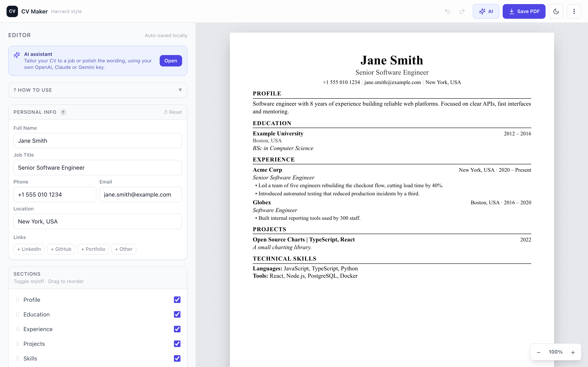

<!-- CODE CLASS README EXAMPLE -->

<a id="readme-top"></a>

# CV Maker

A free, in-browser builder for Harvard-style CVs. Your data never leaves your device unless you choose to use the optional AI assistant.

  

Live version: [cvmaker.codepapa.xyz](https://cvmaker.codepapa.xyz)



<!-- TABLE OF CONTENTS -->
## Table of Contents

- [About The Project](#about-the-project)
- [Getting Started](#getting-started)
- [Usage](#usage)
- [Configuration](#configuration)
- [Development](#development)
- [Deployment](#deployment)
- [Roadmap](#roadmap)
- [Contributing](#contributing)
- [License](#license)

<!-- ABOUT THE PROJECT -->
## About The Project

CV Maker is for job seekers who want a clean, ATS-friendly, one-column CV without creating an account or paying for a template. You fill in forms on the left, and a live A4 preview on the right shows the finished CV. The site is fully static: there is no server and no sign-in, and everything is saved in your browser's `localStorage`.

Main features:

- **Live A4 preview** that fits the screen, with zoom controls and print-accurate page breaks
- **Sections you control**: personal info, profile, experience, education, projects, skills, languages, certifications, volunteering and custom sections. Switch them on or off and drag to reorder them.
- **Export** to PDF (browser print) or Word (`.docx`)
- **Backup and restore** as a JSON file
- **Default CV**: save a copy of your CV and load it again to start each tailored version from it
- **Undo / redo** with header arrows and keyboard shortcuts
- **Dark mode** and a responsive layout (an Edit / Preview toggle on small screens)
- **Optional AI assistant** that tailors your CV to a job posting using your own API key (see [AI assistant](#ai-assistant))

### Built With

* [React 18](https://react.dev/)
* [Vite 5](https://vitejs.dev/)
* [Tailwind CSS 3](https://tailwindcss.com/)
* [React Router 6](https://reactrouter.com/)
* [dnd-kit](https://dndkit.com/) for drag-to-reorder
* [docx](https://docx.js.org/) for Word export
* [mammoth](https://github.com/mwilliamson/mammoth.js) and [pdf.js](https://mozilla.github.io/pdf.js/) for reading Word and PDF files you attach in the AI assistant
* [Cloudflare Pages](https://pages.cloudflare.com/) for hosting

<p align="right">(<a href="#readme-top">back to top</a>)</p>

<!-- GETTING STARTED -->
## Getting Started

To get a local copy up and running, follow these steps.

### Prerequisites

* Node.js 18 or newer (the minimum Vite 5 supports; tested on Node 26) and npm
  ```sh
  node --version   # should print v18.x or higher
  ```

### Installation

1. Clone the repo
   ```sh
   git clone https://github.com/krzysztof-durski/cv_maker.git
   cd cv_maker
   ```
2. Install NPM packages
   ```sh
   npm install
   ```
3. Start the dev server
   ```sh
   npm run dev
   ```
   Expected output:
   ```text
   VITE v5.4.21  ready in 92 ms

   ➜  Local:   http://localhost:5173/
   ```
   Open that address in your browser.

No API keys or environment variables are needed to run the app.

<p align="right">(<a href="#readme-top">back to top</a>)</p>

<!-- USAGE EXAMPLES -->
## Usage

### Build a CV

1. Open the app. It starts with an empty CV, and the preview fills in as you type.
2. Edit the sections in the left panel. The preview updates as you type, and your work is saved automatically.
3. Use the **Sections** list to switch sections on or off and drag them into the order you want.
4. Export when you are done:
   - **PDF**: select **Save PDF** in the header, then choose "Save as PDF" in the print dialog. The file name is built from your name and role.
   - **Word**: open the header's overflow menu and select **Export as Word (.docx)** for a file you can keep editing.

### Back up and restore

Your CV lives only in this browser. Use **Save backup** in the header's overflow menu to download it as `my-cv-backup-codepapa-DD-MM-YYYY.json`, and **Restore backup** to load it again, for example on another device.

> [!WARNING]
> Clearing your browser data deletes your CV. Download a backup before you do.

### AI assistant

The assistant is optional and uses your own API key. It can tailor your CV to a job posting, reword text, or give suggestions. It supports:

| Provider | Key from |
|---|---|
| OpenAI (ChatGPT) | [platform.openai.com](https://platform.openai.com/) |
| Anthropic (Claude) | [console.anthropic.com](https://console.anthropic.com/) |
| Google (Gemini) | [aistudio.google.com](https://aistudio.google.com/) |

1. Open **AI settings**, choose a provider, paste your key and select **Test key & load models**.
2. Open the assistant, paste a job posting or ask a question.
3. Review each suggested change and tick the ones you want. Nothing is applied until you accept it, and one-step undo is available afterwards.

How it protects your CV:

- Requests go straight from your browser to the provider you chose. There is no backend.
- Keys are held in `sessionStorage` by default, and in `localStorage` only if you select "remember". They are never part of your CV data, so backups cannot leak them.
- The assistant cannot change facts about existing entries, such as employer names, schools, dates or contact details.
- A list entry is never deleted just because the model leaves it out of an answer. Removals have to be explicit and appear in the review.

> [!IMPORTANT]
> Using the assistant sends your CV text to the provider you selected, and the provider may bill your account. Skip the assistant if you do not want that.

<p align="right">(<a href="#readme-top">back to top</a>)</p>

<!-- CONFIGURATION -->
## Configuration

There are no environment variables. Settings live in these places:

| What | Where | Notes |
|---|---|---|
| CV data | `localStorage` key `cv_maker_data` | Missing fields are filled in from the defaults on load |
| AI keys and settings | `cv_maker_ai_*` keys | `sessionStorage` by default, `localStorage` if "remember" is on |
| Default CV and section labels | [src/utils/defaultData.js](https://github.com/krzysztof-durski/cv_maker/blob/main/src/utils/defaultData.js) | Single source of truth for the data shape |
| Response headers and CSP | `public/_headers` | See the note below |
| SPA routing | `public/_redirects` | Sends every path to `index.html` |

> [!NOTE]
> The Content-Security-Policy in `public/_headers` limits where the page can send data. If you add another AI provider, add its API origin to `connect-src`. If you edit the inline dark-mode script in `index.html`, regenerate its `sha256` hash in `script-src`. The command is in the comments at the top of `public/_headers`.

<p align="right">(<a href="#readme-top">back to top</a>)</p>

<!-- DEVELOPMENT -->
## Development

| Command | What it does |
|---|---|
| `npm run dev` | Start the Vite dev server with hot reload |
| `npm run build` | Create a production build in `dist/` |
| `npm run preview` | Serve the production build locally |
| `npm test` | Run the unit tests with Node's built-in test runner (`node --test`). Expected: 86 tests, all passing |

Project layout:

```text
src/
├── ai/            AI logic with no UI: prompts, providers, parsing, diffing (unit tested)
├── components/
│   ├── ai/        Assistant UI and settings
│   ├── editor/    Left-hand form panel (hidden when printing)
│   └── preview/   A4 preview, styled inline so printing stays accurate
├── hooks/         Local storage, undo history, dark mode, default CV
├── pages/         Editor, About, Help, Privacy, Terms
└── utils/         Default data, Word export, PDF file names
```

Things to keep in mind:

- State is owned by `EditorPage` and passed down as props. The AI assistant is the one exception and uses its own context.
- Print styles in `src/index.css` flatten the layout wrappers by id (`#app-shell`, `#app-main`, `#cv-preview-*`) so the CV flows across pages. Keep those ids if you refactor the layout.
- Preview components use inline styles instead of Tailwind classes for print fidelity.

<p align="right">(<a href="#readme-top">back to top</a>)</p>

<!-- DEPLOYMENT -->
## Deployment

The app is a static site, so any static host works. The live site uses Cloudflare Pages.

1. Build the site:
   ```sh
   npm run build
   ```
2. Upload the `dist/` folder to Cloudflare Pages. The `_headers` and `_redirects` files in `public/` are copied into `dist/` and take effect automatically.

<p align="right">(<a href="#readme-top">back to top</a>)</p>

<!-- ROADMAP -->
## Roadmap

- [x] Live A4 preview with zoom and print-safe page breaks
- [x] PDF and Word export, JSON backup and restore
- [x] Undo / redo
- [x] Optional AI assistant with model switching, parallel conversations and rewind
- [ ] Verify the AI success path with real OpenAI keys (CORS on a valid-key response)
- [ ] Verify the Content-Security-Policy on a live Cloudflare Pages deploy

<p align="right">(<a href="#readme-top">back to top</a>)</p>

<!-- CONTRIBUTING -->
## Contributing

Contributions are what make the open source community such an amazing place to learn, inspire, and create. Any contributions you make are **greatly appreciated**.

If you have a suggestion that would make this better, please fork the repo and create a pull request. You can also simply open an issue with the tag "enhancement".
Don't forget to give the project a star! Thanks again!

1. Fork the Project
2. Create your Feature Branch (`git checkout -b feature/AmazingFeature`)
3. Commit your Changes (`git commit -m 'Add some AmazingFeature'`)
4. Push to the Branch (`git push origin feature/AmazingFeature`)
5. Open a Pull Request

Please run `npm test` and `npm run build` before opening a pull request. To report a bug or ask a question, [open an issue](https://github.com/krzysztof-durski/cv_maker/issues).

<p align="right">(<a href="#readme-top">back to top</a>)</p>

<!-- LICENSE -->
## License

Distributed under the MIT License. See [`LICENSE`](https://github.com/krzysztof-durski/cv_maker/blob/main/LICENSE) for more information.

<p align="right">(<a href="#readme-top">back to top</a>)</p>
