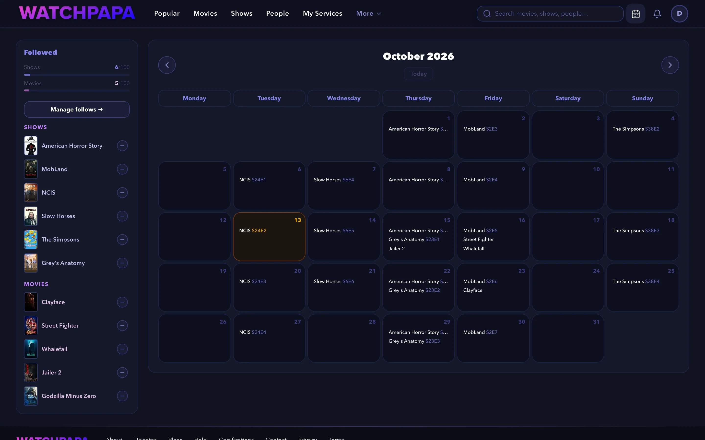

# About watchpapa.tv

watchpapa.tv is a website that helps you follow movies and TV shows. It shows every upcoming episode and premiere on one calendar and keeps a rating diary of everything you watch. This document explains what the site is, who it is for and why it works the way it does. It does not explain how to use it. For that, read the [tutorial](tutorial.md).

## What the site is

watchpapa.tv is a personal watch tracker. You follow the titles that you are waiting for, save the ones that you plan to watch and rate the ones that you watched. The site then brings these records together: a calendar of what is coming, lists of what is next and a diary of what you have seen.

The site reads its movie and TV information live from The Movie Database (TMDB). Titles, dates, posters and cast stay current without any work from you. watchpapa.tv stores only your own records, which are your ratings, follows and watchlists. The site shows where a title streams, but it does not stream anything itself.

## Why it exists

Keeping up with shows is hard. You finish a series and then must remember when the next episode arrives. A second show releases weekly on a different day. A film that you want to see opens in autumn. Remembering all of this is work that a computer does better, so watchpapa.tv collects every release date on one personal calendar.

## Who it is for

The site is for anyone who follows several shows or films at once and wants one place to track them. You do not need technical knowledge. If you want to learn how follows, watchlists and ratings fit together, read [About follows, watchlists and ratings](conceptual.md).

## What it offers

- **A releases calendar** with the upcoming episodes and premieres of the titles that you follow.
- **A page for every title**, where you rate it, log a watch, save it to a watchlist and see where to stream it.
- **Discovery** through search, daily trending titles, personal recommendations, collections and filmographies.
- **A library and a profile** with several named watchlists, five favorites and a public profile.
- **Observing other people** to see their ratings, and privacy controls over your own.
- **Import and export** of your history from a Letterboxd or CSV file.
- **Your language and region** for titles, release dates and streaming availability.
- **Plans and rewards** with different limits. Payments for paid plans are not available yet.

Adult content is off by default. It needs your date of birth before you can turn it on.

## How it is built

The website and its application programming interface (API) both run on Cloudflare. The API is a Worker, which is a small program that runs on Cloudflare's servers. The Worker reads movie data from TMDB when you ask for it. Supabase stores user data in a PostgreSQL database.

Four design decisions shape the project:

- **No content database.** The site never copies movies, shows or people, so the information cannot go stale.
- **Built for a free hosting plan.** Every part that sends many requests to other services has a cap, so each request stays within the plan's limits.
- **Rules live in the database.** Row-level security (RLS) lets each person read and write only their own records, and database triggers enforce plan limits. The interface is not the only guard.
- **Stateless sign-in checks.** The Worker verifies a sign-in token itself and does not keep session data.

The [README](../README.md) shows the architecture in a diagram. The [contributing guide](contributing.md) describes the project layout.

### Tools

* [React 19](https://react.dev/) and [React Router 7](https://reactrouter.com/)
* [Vite 8](https://vite.dev/)
* [Tailwind CSS 4](https://tailwindcss.com/)
* [TipTap](https://tiptap.dev/) for the announcements editor
* [react-easy-crop](https://github.com/ValentinH/react-easy-crop) for avatars
* [Hono 4](https://hono.dev/) on [Cloudflare Workers](https://developers.cloudflare.com/workers/)
* [Supabase](https://supabase.com/) for the database, sign-in and file storage
* [postgres.js](https://github.com/porsager/postgres) over Cloudflare Hyperdrive
* [jose](https://github.com/panva/jose) for token verification
* [TMDB API v3](https://developer.themoviedb.org/) for movie, show and people data
* [Resend](https://resend.com/) for sign-in emails
* [Cloudflare Pages](https://pages.cloudflare.com/) for hosting
* [Cloudflare R2](https://developers.cloudflare.com/r2/) for encrypted backups
* [Vitest](https://vitest.dev/), [Playwright](https://playwright.dev/) and Node's built-in test runner

## Status and ownership

The site is live at [watchpapa.tv](https://watchpapa.tv) and under active development. Krzysztof Durski created and owns the project. It is a personal project under an all-rights-reserved license.

## Where to go next

- [Tutorial](tutorial.md): follow a show, save a movie, rate it and get recommendations
- [About follows, watchlists and ratings](conceptual.md): why the site keeps three kinds of records
- [How-to guides](how-to.md): steps for specific tasks
- [Contributing guide](contributing.md): set up a local copy and make a change
