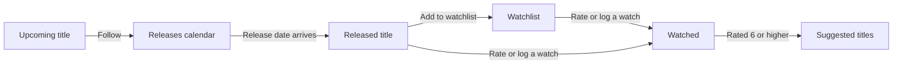

# About follows, watchlists and ratings

watchpapa.tv records your relationship to a movie or show in three ways: a follow, a watchlist entry and a rating. This document explains what each one means, why the site keeps them apart and how they affect each other. It also explains who can see your ratings. It does not give steps. To do something, use the [tutorial](tutorial.md) or the [how-to guides](how-to.md).

## What the three records are

A follow looks ahead, a watchlist plans and a rating looks back. Each record answers one question about a title:

| Record | Question it answers | Where you see it |
|---|---|---|
| Follow | Am I waiting for this? | Releases calendar |
| Watchlist entry | Do I plan to watch this? | Watchlists page |
| Rating or watch log | Did I watch this, and what did I think? | Title page and profile |

## Why the site separates them

Keeping up with shows is a memory problem. You must remember when the next episode arrives, which show airs on which day and when a film opens. A single list cannot hold all of that, because "waiting for," "planning to watch" and "already watched" are different states with different needs. A title moves from one state to the next, and watchpapa.tv keeps the records in step so that you do not have to.

## What each record means

### Follows

A follow tells watchpapa.tv that you are waiting for a title. Every followed title appears on your releases calendar on its release date.

The site accepts a new follow only while something is still to come, which means a show that has not ended or a movie that has not been released. The reason is the job of a follow: it tells you when something arrives. A finished show has nothing to announce, so a follow on it would only use up one of your limited follows. A follow that you already have stays, even if the show later ends or the movie is released.

Your plan sets how many follows you can have. The database enforces this limit, not only the interface.

### Watchlists

A watchlist holds titles that you intend to watch. You can keep several named lists, and your plan sets how many. A follow waits for a date, and a watchlist holds a decision.

When you rate a title or log a watch, the site removes the title from every watchlist. The reason is that a watchlist should show only what is left to watch. The site keeps it true without any tidying from you.

### Ratings and watches

A rating records what you think of a title. A watch log records when you saw it. They are separate because you can watch a title without rating it, and you can watch it more than once. Several logged watches form a rewatch diary.

A score runs from one to 10. Your first rating also counts as your first watch. The site keeps a history of your ratings, so a change does not erase what you thought before.

The community rating of a title appears after 10 people rate it. Until then, the page shows the average from The Movie Database (TMDB).

### Recommendations

The titles that you rate 6 out of 10 or higher become the starting point for the **Suggested For You** row. The row never suggests a title that you already rated, listed or followed, because a suggestion should show you something new.

## The path of a title

The diagram shows how a title moves between the records.

*Figure 1. The path of a title through follows, watchlists and ratings. Each box is a state, and each arrow names the action that moves the title.*

The left side of the diagram looks ahead. An upcoming title that you follow reaches the calendar and then becomes a released title. The right side looks back. A released title goes straight to "Watched," or it waits on a watchlist first. Every watched title that you rate 6 or higher feeds the suggestions, and these lead you to new titles to follow or save.

## Who can see your ratings

Your ratings are visible to other people according to your account setting. Accounts are public unless you turn on **Private account**.

- **Observing.** When you observe a person, you see their ratings in your activity feed and on the title pages that you open. Observing is one-way. The other person does not have to observe you back.
- **Private accounts.** A private account hides its ratings until the owner accepts an observe request. A request stays pending until the owner accepts or denies it.
- **Blocking.** Blocking a person removes any observe relationship between the two of you.

The database, not only the interface, decides who can read a rating. A rule in the interface alone could be bypassed, and a rule in the database cannot.

## What this means for you

- You do not maintain your lists by hand. Rating a title updates your watchlists, and the calendar fills itself from your follows.
- Your plan limits follows and watchlists. At a limit, you must give up one record before you can add another.
- You control your audience. A private account and a block each limit who sees your ratings.
- The site stores only your own records: your follows, watchlists, ratings and watches. Movie and show details come live from TMDB.

## Summary

## Further reading

