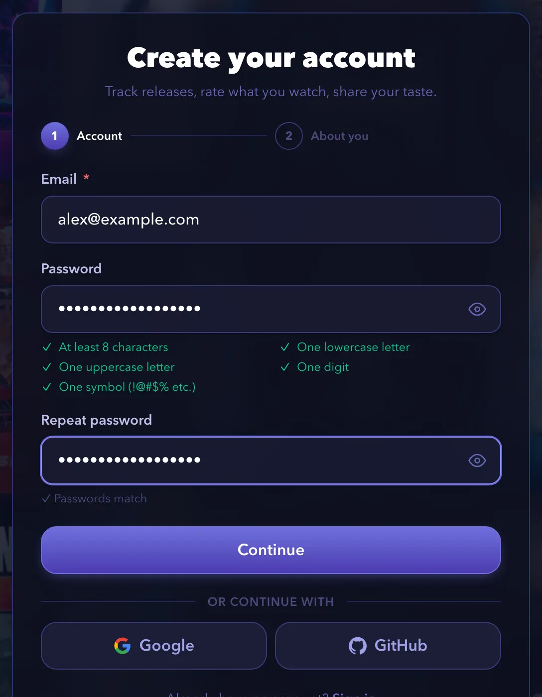
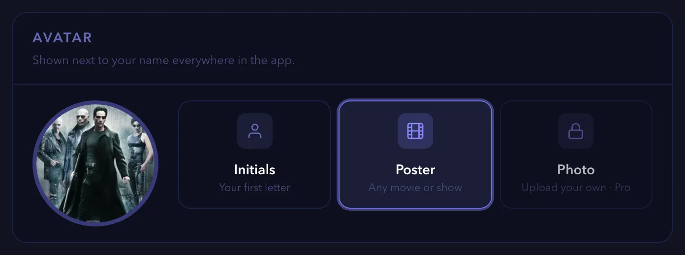
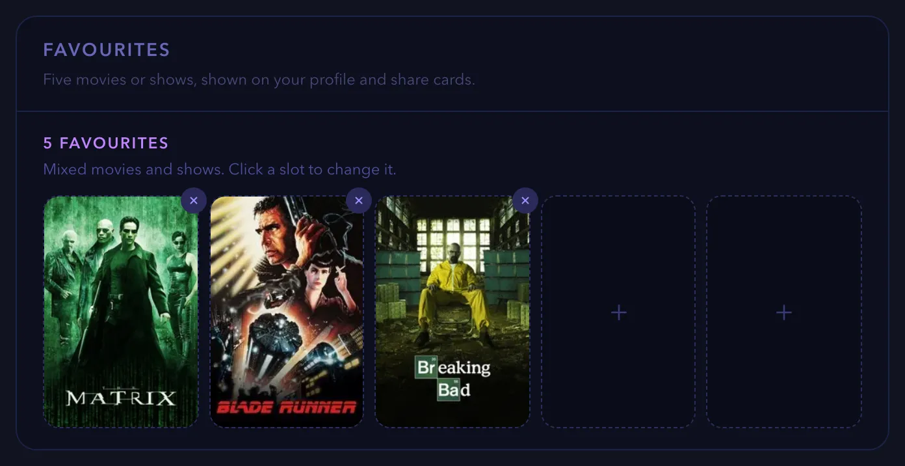

# How-to guides for your account

These guides show you how to create and manage your account: sign up, sign in, reset a password, edit your profile and delete your account. Each guide lists what you need, gives numbered steps and ends with links to related tasks.

Screenshots show a demo account with real titles from The Movie Database (TMDB).

> [!NOTE]
> Some features depend on your plan. The Free plan allows three followed shows, one followed movie and one watchlist. Premium and Pro allow more. The [Plans & Perks](https://watchpapa.tv/subscription) page lists every limit.

This page is part of the [how-to guides](how-to.md).

## Table of contents

- [Creating an account](#creating-an-account)
- [Signing in and out](#signing-in-and-out)
- [Resetting a forgotten password](#resetting-a-forgotten-password)
- [Editing your profile](#editing-your-profile)
  - [Opening the Edit profile page](#opening-the-edit-profile-page)
  - [Choosing an avatar](#choosing-an-avatar)
  - [Setting your favorite titles](#setting-your-favorite-titles)
  - [Choosing your profile banner](#choosing-your-profile-banner)
  - [Writing your bio](#writing-your-bio)
  - [Changing your username](#changing-your-username)
- [Deleting your account](#deleting-your-account)

---

## Creating an account

A free account lets you follow shows, rate what you watch and keep a personal releases calendar. This guide takes about three minutes. It covers sign-up with an email address and a password, and sign-up with Google or GitHub. It does not cover signing in later or resetting a password.

### Before you begin

- Have an email address that you can open right now. watchpapa.tv sends you a code to verify it.
- You must be at least 16 years old.

### Steps

1. Open [watchpapa.tv](https://watchpapa.tv).
2. Select **Register** at the top right. On a phone, open the menu first.
3. Enter your email address.
4. Enter a password that meets the five rules in the checklist below the field.
   - At least eight characters
   - One lowercase letter
   - One uppercase letter
   - One digit
   - One symbol, such as `!` or `@`
5. Repeat the password in **Repeat password**.
6. Select **Continue**.

   

   *Figure 1. Step one of the sign-up form.*

> [!NOTE]
> If your password appears on a list of known data breaches, the form shows the message "This password has appeared in a known data breach." Choose a different password.

> [!TIP]
> To sign up with an existing account, select **Google** or **GitHub** below **or continue with** instead of entering a password. After you sign in with the provider, the **Almost there** page opens. Enter a username, enter your date of birth, accept the terms and select **Finish setup**. Skip the remaining steps in this guide.

7. Enter a username of four to 50 letters, numbers, underscores or hyphens.
8. Enter your date of birth.

> [!NOTE]
> If you are younger than 16, the form shows "You must be at least 16 years old to register." You cannot create an account.

9. Optional: enter a referral or gift code.

> [!IMPORTANT]
> You can enter a referral code only while you register. The app has no way to add a code later. If you opened a referral link, the code is already filled in.

10. Select **I agree to the Terms and Privacy Policy**.
11. Optional: select the product updates checkbox for occasional emails.
12. Select **Create account**.

> [!NOTE]
> If the email address already has an account, the form returns to step one and shows "This email is already in use. Try signing in instead." Select **Sign in** and use that account.

13. In your inbox, copy the six-digit code from watchpapa.tv.
14. Enter the code on the **Check your inbox** page.
15. Select **Verify email**.

> [!NOTE]
> If the code does not arrive, wait 30 seconds. Then select **Resend code**. If you entered the wrong address, select **Not you?** and correct it.

The home page opens. A circle at the top right shows the first letter of your username.

### Summary

Congratulations. You now have a verified watchpapa.tv account and you are signed in. Your account can follow three shows and one movie. Adult content stays off until you turn it on in Settings.

### Next steps

- [Edit your profile](#editing-your-profile)
- [Follow a show or a movie](how-to-tracking.md#following-a-show-or-a-movie)
- [Rate a title](how-to-tracking.md#rating-a-title)

(<a href="#how-to-guides-for-your-account">back to top</a>)

---

## Signing in and out

Sign in to use your follows, ratings and watchlists on any device. This guide shows you how to sign in with an email address or with Google or GitHub, and how to sign out. It does not cover creating an account or resetting a password.

### Before you begin

- Have a verified account. If you have no account, read [Creating an account](#creating-an-account).

### Steps

1. Open [watchpapa.tv](https://watchpapa.tv).
2. Select **Sign in** at the top right. On a phone, select the **Sign in** tab.
3. Enter your email address.
4. Enter your password. Select the eye icon to show it.
5. Select **Sign in**.

   The home page opens.

> [!NOTE]
> If you created your account with Google or GitHub, select **Google** or **GitHub** below **or continue with** instead of entering a password. You return to watchpapa.tv after the provider confirms who you are.

> [!NOTE]
> If the form shows "Wrong email or password.", check both entries for typing errors. If you forgot the password, read [Resetting a forgotten password](#resetting-a-forgotten-password).

> [!NOTE]
> If you never verified your email, the **Check your inbox** page opens. Enter the code from your email and select **Verify email**. If the code expired, select **Resend code**.

6. To sign out, select your avatar at the top right. On a phone, select the **You** tab.
7. Select **Sign out** at the bottom of the menu.

> [!NOTE]
> The first time you visit, a banner asks about session storage. If you select **Accept cookies**, you stay signed in across tabs and browser restarts. If you select **Decline**, your session ends when you close the tab, so you must sign in again.

### Summary

Congratulations. You can now sign in and out of watchpapa.tv on any device.

### Next steps

- [Reset a forgotten password](#resetting-a-forgotten-password)
- [Edit your profile](#editing-your-profile)

(<a href="#how-to-guides-for-your-account">back to top</a>)

---

## Resetting a forgotten password

If you forget your password, watchpapa.tv emails you a code and a link. Use either one to choose a new password. This guide takes about two minutes. It does not cover changing a password that you remember.

### Before you begin

- Have access to the email address of your account.
- If you signed up with Google or GitHub, you do not need a password. Sign in with that provider instead.

### Steps

1. Open the sign-in page, as in [Signing in and out](#signing-in-and-out).
2. Select **Forgot password?** below the password field.
3. Enter your email address.
4. Select **Send reset code**.

> [!NOTE]
> The page shows the same message whether or not an account exists for that address: "If an account exists for that email, a reset code and link are on their way."

5. In your inbox, copy the six-digit code from watchpapa.tv.
6. Enter the code on the **Check your inbox** page.
7. Select **Continue**.

> [!NOTE]
> To skip steps six and seven, select the link in the email. The **Choose a new password** page opens directly.

> [!NOTE]
> If the code does not arrive, select **Resend code**. If you entered the wrong address, select **Change** next to it and correct it.

> [!NOTE]
> If the home page opens after you enter the code, you are already signed in. Open `watchpapa.tv/reset-password` in the same browser tab to continue.

8. On the **Choose a new password** page, enter a password that meets the sign-up rules.
9. Enter the new password again in **Repeat new password**.
10. Select **Update password**.

> [!NOTE]
> If the new password appears on a list of known data breaches, the page asks you to choose a different one.

> [!NOTE]
> If you open `watchpapa.tv/reset-password` without a code or a link, the page shows **Reset link needed**. Select **Request a new reset code** to start again.

The page shows "Password updated. Taking you to sign in…" and the sign-in page opens. watchpapa.tv signs you out of this browser, so you sign in again with the new password.

### Summary

Congratulations. You chose a new password for your account. Use it the next time you sign in.

### Next steps

- [Sign in with your new password](#signing-in-and-out)

(<a href="#how-to-guides-for-your-account">back to top</a>)

---

## Editing your profile

Your profile is the page that other people see. This guide shows you how to choose an avatar, set up to five favorite titles, pick a banner and write a short bio. It also shows you how to change your username. It does not cover privacy settings. For those, read [Making your account private](how-to-people.md#making-your-account-private).

### Before you begin

- Sign in to watchpapa.tv.
- Decide which title you want as your avatar. You can search for any movie or show.

Each task is independent. Avatar, favorites, banner and bio start on the **Edit profile** page. Your username starts in Settings.

### Opening the Edit profile page

1. Select your avatar at the top right. On a phone, select the **You** tab.
2. Select **Edit profile**. The page opens with four sections: **Avatar**, **Profile banner**, **Bio** and **Favourites**.

### Choosing an avatar

1. In the **Avatar** section, choose one of the options.

   

   *Figure 2. The three avatar options.*

   - **Initials** shows the first letter of your username.
   - **Poster** shows the poster of any movie or show. Select **Poster**, enter a title in the search field and select the result.
   - **Photo** shows a picture that you upload.

> [!NOTE]
> **Photo** needs a Pro plan. On other plans, the option is locked and shows "Upload your own · Pro". Select it to open the plans page.

2. If you chose **Photo**, select a JPEG, PNG or WebP file of 8 MB or less.
3. Move the **Zoom** slider to crop the picture.
4. Select **Save avatar**.

> [!NOTE]
> A larger file or a different file type shows an error message.

### Setting your favorite titles

You can set up to five favorites. They appear on your profile and on your profile card.

1. In the **Favourites** section, select an empty slot. A **Pick a title** window opens.
2. Enter the name of a movie or show and select it in the results.

   

   *Figure 3. The Favourites section with five slots.*

3. To replace a favorite, select its slot and pick another title.
4. To remove a favorite, select the **×** at the corner of its poster.

> [!NOTE]
> You can mix movies and shows.

### Choosing your profile banner

1. In the **Profile banner** section, select **Auto** to use your first favorite, or select the poster of another favorite.
2. To change the crop, select **Crop**.
3. Move the **Zoom** slider.
4. Select **Save banner**.

> [!NOTE]
> If you have no favorites yet, the section shows "Add a favourite first". Complete [Setting your favorite titles](#setting-your-favorite-titles) first.

### Writing your bio

1. In the **Bio** section, enter up to 200 characters. A counter shows how many you used.
2. Select **Save bio**. The button briefly reads **Saved**.
3. To see the result, select **Back to profile**.

### Changing your username

1. Select your avatar and then **Settings**.
2. In the **Profile** section, select **Change** next to **Username**.
3. Enter the new username and select **Save**.

> [!NOTE]
> You can change your username only once every 90 days. After a change, the hint shows the date of your next change.

> [!NOTE]
> If another person uses the name already, the form shows "Username already taken." Choose another name.

### Summary

Congratulations. Your profile now shows your avatar, banner, bio and favorite titles. Changes save when you select the save button of a section, or at once for avatar, favorites and banner.

### Next steps

- [Share your profile card](how-to-people.md#sharing-your-profile-card)
- [Make your account private](how-to-people.md#making-your-account-private)

(<a href="#how-to-guides-for-your-account">back to top</a>)

---

## Deleting your account

Deleting your account removes your profile, ratings, watchlists and follows. This guide shows you how to download a copy of your data first and then delete the account. It does not cover signing out.

> [!IMPORTANT]
> Deleting an account cannot be undone.

### Before you begin

- Sign in to watchpapa.tv.
- Decide whether you want a copy of your data. The copy is optional.

### Steps

1. Select your avatar and then **Settings**.
2. Optional: download a copy of your data as a comma-separated values (CSV) file. In the **Your data** section, select **Download CSV** next to **Export**. The file holds your movie ratings and watchlist items.

> [!NOTE]
> The export covers movies only. Ratings and watchlist entries for shows are not in the file.

3. In the list of sections, select **Account**. It appears in red.
4. Select **Delete my account**.
5. In the **Delete your account?** window, select **Yes, delete everything**.

> [!NOTE]
> To keep your account, select **Cancel** or close the window.

> [!NOTE]
> If the deletion fails, the window shows an error message. Try again later, or write to us through the [contact page](https://watchpapa.tv/contact).

6. In the **Account deleted** message, select **OK**. The sign-in page opens.

The message says "Your remaining data will be permanently removed within 30 days." The delay covers encrypted backups.

> [!TIP]
> If you want fewer emails, not a deleted account, turn off **Product updates & announcements** in the **Preferences** section of Settings.

### Summary

You deleted your account. watchpapa.tv no longer shows your profile, and your data leaves the backups within 30 days.

### Next steps

- [Create a new account](#creating-an-account)

(<a href="#how-to-guides-for-your-account">back to top</a>)

