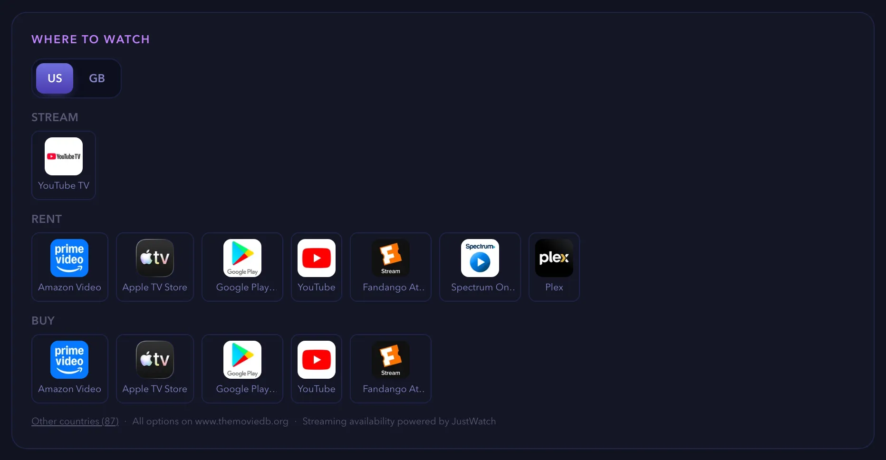
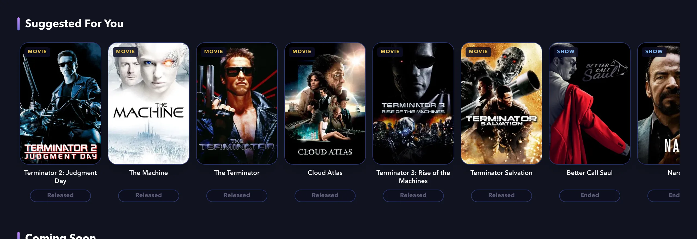
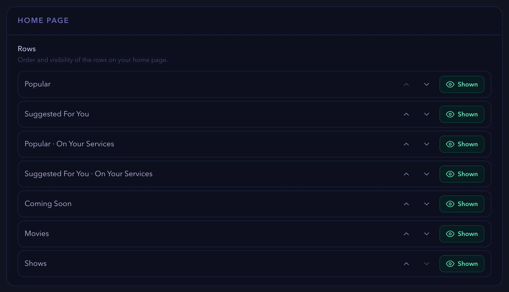

# How-to guides for finding what to watch

These guides show you how to find where a title streams, get recommendations, set your language and region and customize the home page. Each guide lists what you need, gives numbered steps and ends with links to related tasks.

Screenshots show a demo account with real titles from The Movie Database (TMDB).

> [!NOTE]
> Some features depend on your plan. The Free plan allows three followed shows, one followed movie and one watchlist. Premium and Pro allow more. The [Plans & Perks](https://watchpapa.tv/subscription) page lists every limit.

This page is part of the [how-to guides](how-to.md).

## Table of contents

- [Finding where to stream a title](#finding-where-to-stream-a-title)
- [Getting recommendations](#getting-recommendations)
- [Changing your language and region](#changing-your-language-and-region)
- [Customizing the home page](#customizing-the-home-page)

---

## Finding where to stream a title

The **Where to watch** panel shows which services stream, rent or sell a title in your countries. This guide shows you how to read the panel, compare countries and choose your own watch regions. It does not cover buying a plan for a streaming service.

### Before you begin

- Choose a movie or a show. You do not need an account to read the panel.

### Steps

1. Open the page of a movie or a show.
2. Scroll down to the **Where to watch** panel.
3. Read the groups. Each group lists services with their logos.
   - **Stream** lists services that include the title in their subscription.
   - **Free** and **Free with ads** list services that cost nothing.
   - **Rent** and **Buy** list services that charge for the title.

   

   *Figure 1. The Where to watch panel.*

4. Select a country tab, such as **US** or **GB**, to compare services in another country.

> [!NOTE]
> If you have not chosen any watch regions, the panel shows a **Region** list instead of tabs. Choose a country in the list. Without an account, the panel remembers your choice during the visit.

> [!NOTE]
> If the title is not available in your regions, the panel shows "Not available in" and the names of your regions. Select **See where it's available** to see the countries that have it.

5. For other countries, select **Other countries** below the panel. Search for a country or use the arrows.
6. To choose your regions, select your avatar and then **Settings**. In the **Streaming** section, find **Watch regions**.
7. Select **+ Add a region** and choose a country. Repeat for up to five countries.

> [!NOTE]
> To remove a region, select the **×** on its label.

> [!NOTE]
> If you set a **Country** in the **Content & region** section, watchpapa.tv uses it as your default streaming region.

> [!NOTE]
> With a Pro plan, you can also choose your own streaming services under **My streaming services**. watchpapa.tv then highlights them on every title and fills the **My Services** page. On other plans, the section shows **Upgrade to Pro to pick your services**.

### Summary

Congratulations. You can now see where a title streams in your countries. The data comes from JustWatch through TMDB, so availability can change.

### Next steps

- [Change your language and region](#changing-your-language-and-region)
- [Create a watchlist](how-to-tracking.md#creating-and-using-watchlists)

(<a href="#how-to-guides-for-finding-what-to-watch">back to top</a>)

---

## Getting recommendations

The **Suggested For You** row on the home page shows titles that match your taste. This guide shows you how to make the row appear and how to improve it. It does not cover the **Popular** row, which shows trending titles.

### Before you begin

- Sign in to watchpapa.tv.
- Rate at least a few titles. Read [Rating a title](how-to-tracking.md#rating-a-title).

### Steps

1. Rate titles that you like at least 6 out of 10. watchpapa.tv uses up to 10 of them as the starting point.

> [!NOTE]
> Titles that you rated 5 or lower do not shape the suggestions. Ratings of seasons and episodes do not count either.

> [!NOTE]
> A title that you marked as watched on a watchlist, without a rating, also counts as a starting point. watchpapa.tv uses up to 10 of them.

2. Select **Popular** in the top navigation to open the home page. On a phone, select the **Home** tab.
3. Scroll to the **Suggested For You** row.

   

   *Figure 2. The Suggested For You row.*

4. Scroll the row sideways. Select the arrow at the right end to load more titles.
5. Select a title to open its page. From there you can follow it, rate it or add it to a watchlist.

> [!NOTE]
> watchpapa.tv never suggests a title that you already rated, put on a watchlist or followed.

> [!NOTE]
> If the row does not appear, you have not rated any title with 6 out of 10 or more yet. The row also disappears when you hide it. To bring it back, select **Hidden** next to **Suggested For You** in the **Home page** section of Settings.

> [!NOTE]
> With a Pro plan and chosen streaming services, a second row named **Suggested For You · On Your Services** shows only titles on your services.

> [!NOTE]
> If you turned on **Show adult content** in Settings, suggestions can include adult titles.

### Summary

Congratulations. Your home page now suggests titles based on what you rated. The row changes as you rate more titles.

### Next steps

- [Customize the home page](#customizing-the-home-page)
- [Find where to stream a suggested title](#finding-where-to-stream-a-title)

(<a href="#how-to-guides-for-finding-what-to-watch">back to top</a>)

---

## Changing your language and region

Your content language decides in which language titles, overviews and genres appear. Your country decides regional release dates. This guide shows you how to change both. It does not cover choosing several watch regions. For that, read [Finding where to stream a title](#finding-where-to-stream-a-title).

### Before you begin

- Sign in to watchpapa.tv.

### Steps

1. Select your avatar and then **Settings**. On a phone, select the **You** tab first.
2. In the list of sections, select **Content & region**.
3. Open the **Content language** list and choose a language.

   The choice saves at once. Titles, overviews and genres change where TMDB has a translation.

> [!NOTE]
> If you choose a language other than English, a **Titles** row appears. Select **Everything in** and the language name to translate every title and its details. Select **Original** and the language name to keep the original title of films made in that language and show everything else in English.

4. Open the **Country** list and choose your country. The default is **Not set**.

> [!NOTE]
> The country sets the regional release dates that you see. It is also your default streaming region.

> [!NOTE]
> To change the language back, choose **English (United States)** in the **Content language** list.

### Summary

Congratulations. watchpapa.tv now shows titles in your language and release dates for your country.

### Next steps

- [Choose your watch regions](#finding-where-to-stream-a-title)
- [Customize the home page](#customizing-the-home-page)

(<a href="#how-to-guides-for-finding-what-to-watch">back to top</a>)

---

## Customizing the home page

You can change the order of the rows on your home page and hide rows that you do not use. This guide shows you how to do both and how to adjust the related preferences. It does not cover the content of the rows.

### Before you begin

- Sign in to watchpapa.tv.

### Steps

1. Select your avatar and then **Settings**. On a phone, select the **You** tab first.
2. In the list of sections, select **Home page**. The **Rows** list shows every row in its current order.

   

   *Figure 3. The Home page section with the list of rows.*

3. Use the arrows next to a row to move it. The first row appears at the top.
4. Select **Shown** next to a row to hide it. The button changes to **Hidden**. Select it again to show the row.

   watchpapa.tv saves each change at once.

> [!NOTE]
> The rows **Popular · On Your Services** and **Suggested For You · On Your Services** need a Pro plan and chosen streaming services. Without them, these rows have nothing to show.

> [!NOTE]
> When watchpapa.tv adds a new row, it appears at the end of your list.

5. In the list of sections, select **Preferences** to adjust related settings.

> [!NOTE]
> **Show adult content** appears only if your date of birth shows that you are 18 or older. When you turn it on, two more switches appear: **Adult tab in navigation** and **Blur NSFW posters**.

> [!NOTE]
> With a Pro plan, a **Phone bottom bar — middle button** list appears. Choose **My Services** or **Search** for the button between **Browse** and **Radar** on your phone.

### Summary

Congratulations. Your home page now shows the rows that you want in the order that you want.

### Next steps

- [Get recommendations](#getting-recommendations)
- [Change your language and region](#changing-your-language-and-region)

(<a href="#how-to-guides-for-finding-what-to-watch">back to top</a>)

