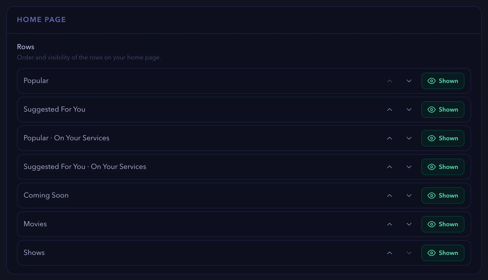
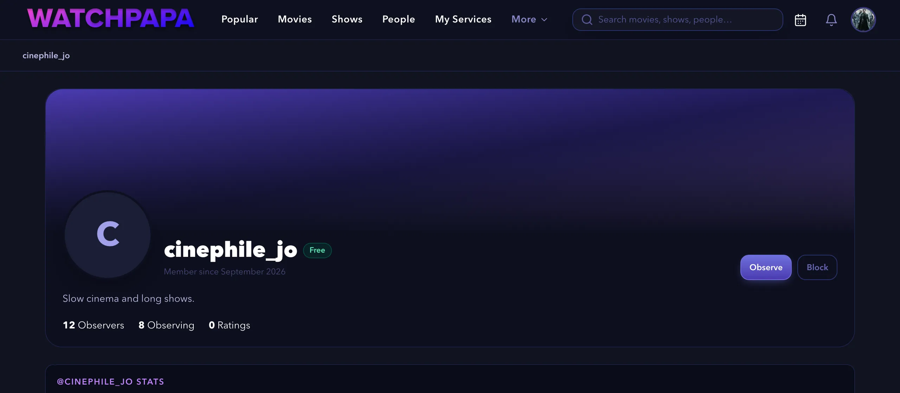
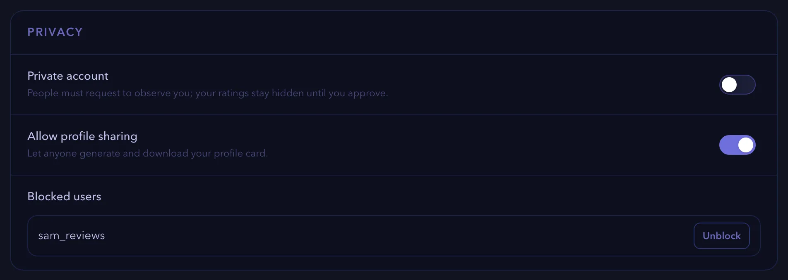
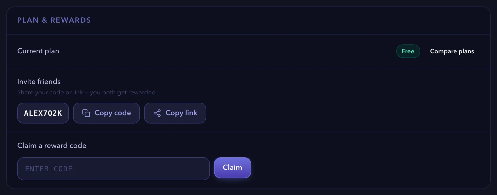
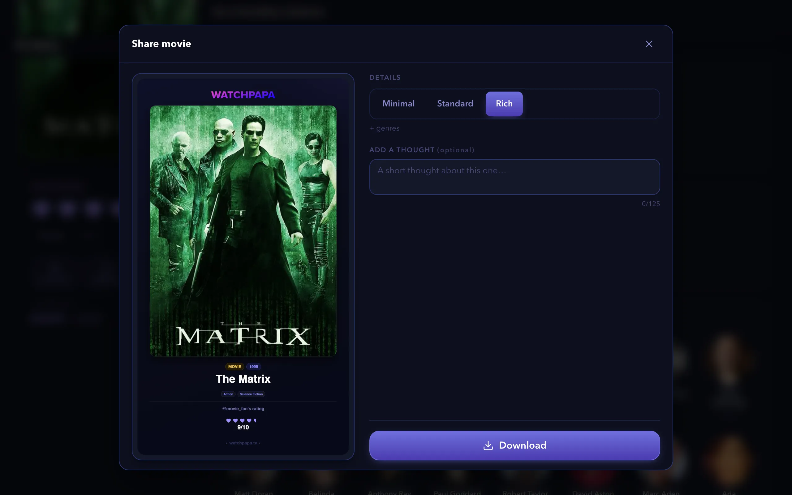
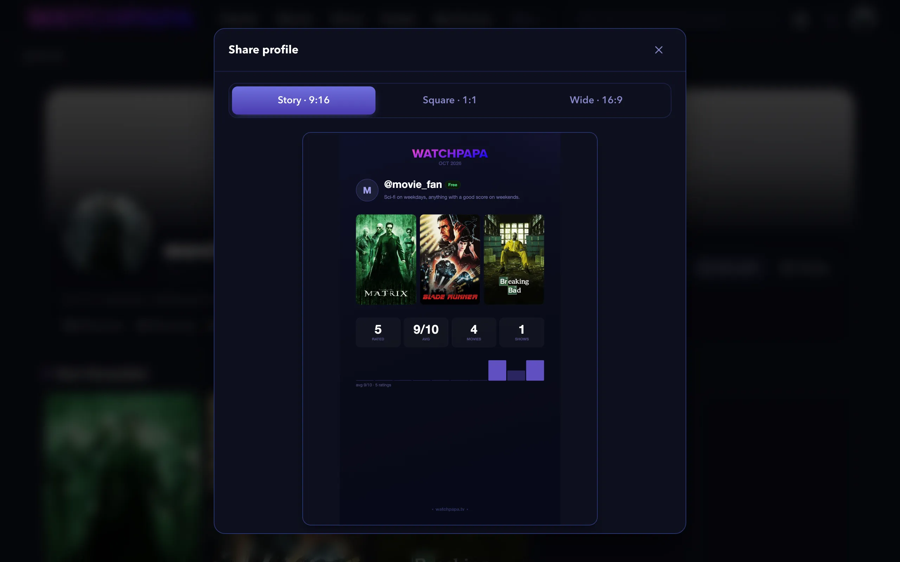

# How-to guides

These guides show you how to complete common tasks on watchpapa.tv. Each guide lists what you need, gives numbered steps and ends with links to related tasks. Notes inside the steps cover the variations: other devices, other plans and error messages.

Screenshots show a demo account with real titles from The Movie Database (TMDB).

> [!NOTE]
> Some features depend on your plan. The Free plan allows three followed shows, one followed movie and one watchlist. Premium and Pro allow more. The [Plans & Perks](https://watchpapa.tv/subscription) page lists every limit.

## Table of contents

**Your account**

- [Creating an account](#creating-an-account)
- [Signing in and out](#signing-in-and-out)
- [Resetting a forgotten password](#resetting-a-forgotten-password)
- [Editing your profile](#editing-your-profile)
  - [Opening the Edit profile page](#opening-the-edit-profile-page)
  - [Choosing an avatar](#choosing-an-avatar)
  - [Setting your favorite titles](#setting-your-favorite-titles)
  - [Choosing your profile banner](#choosing-your-profile-banner)
  - [Writing your bio](#writing-your-bio)
  - [Changing your username](#changing-your-username)
- [Deleting your account](#deleting-your-account)

**Tracking what you watch**

- [Following a show or a movie](#following-a-show-or-a-movie)
- [Reading the releases calendar](#reading-the-releases-calendar)
- [Checking your follow limit](#checking-your-follow-limit)
- [Unfollowing a title](#unfollowing-a-title)
- [Rating a title](#rating-a-title)
- [Changing or clearing a rating](#changing-or-clearing-a-rating)
- [Logging a watch](#logging-a-watch)
- [Logging another watch](#logging-another-watch)
- [Removing a watch](#removing-a-watch)
- [Creating and using watchlists](#creating-and-using-watchlists)

**Finding what to watch**

- [Finding where to stream a title](#finding-where-to-stream-a-title)
- [Getting recommendations](#getting-recommendations)
- [Changing your language and region](#changing-your-language-and-region)
- [Customizing the home page](#customizing-the-home-page)

**People, privacy and plans**

- [Observing other people](#observing-other-people)
- [Making your account private](#making-your-account-private)
- [Controlling profile sharing](#controlling-profile-sharing)
- [Blocking a person](#blocking-a-person)
- [Unblocking a person](#unblocking-a-person)
- [Inviting a friend](#inviting-a-friend)
- [Claiming a reward code](#claiming-a-reward-code)
- [Sharing a title](#sharing-a-title)
- [Sharing your profile card](#sharing-your-profile-card)

---

## Creating an account

A free account lets you follow shows, rate what you watch and keep a personal releases calendar. This guide takes about three minutes. It covers sign-up with an email address and a password, and sign-up with Google or GitHub. It does not cover signing in later or resetting a password.

### Before you begin

- Have an email address that you can open right now. watchpapa.tv sends you a code to verify it.
- You must be at least 16 years old.

### Steps

1. Open [watchpapa.tv](https://watchpapa.tv).
2. Select **Register** at the top right. On a phone, open the menu first.
3. Enter your email address.
4. Enter a password that meets the five rules in the checklist below the field.
   - At least eight characters
   - One lowercase letter
   - One uppercase letter
   - One digit
   - One symbol, such as `!` or `@`
5. Repeat the password in **Repeat password**.
6. Select **Continue**.

   

   *Figure 1. Step one of the sign-up form.*

> [!NOTE]
> If your password appears on a list of known data breaches, the form shows the message "This password has appeared in a known data breach." Choose a different password.

> [!TIP]
> To sign up with an existing account, select **Google** or **GitHub** below **or continue with** instead of entering a password. After you sign in with the provider, the **Almost there** page opens. Enter a username, enter your date of birth, accept the terms and select **Finish setup**. Skip the remaining steps in this guide.

7. Enter a username of four to 50 letters, numbers, underscores or hyphens.
8. Enter your date of birth.

> [!NOTE]
> If you are younger than 16, the form shows "You must be at least 16 years old to register." You cannot create an account.

9. Optional: enter a referral or gift code.

> [!IMPORTANT]
> You can enter a referral code only while you register. The app has no way to add a code later. If you opened a referral link, the code is already filled in.

10. Select **I agree to the Terms and Privacy Policy**.
11. Optional: select the product updates checkbox for occasional emails.
12. Select **Create account**.

> [!NOTE]
> If the email address already has an account, the form returns to step one and shows "This email is already in use. Try signing in instead." Select **Sign in** and use that account.

13. In your inbox, copy the six-digit code from watchpapa.tv.
14. Enter the code on the **Check your inbox** page.
15. Select **Verify email**.

> [!NOTE]
> If the code does not arrive, wait 30 seconds. Then select **Resend code**. If you entered the wrong address, select **Not you?** and correct it.

The home page opens. A circle at the top right shows the first letter of your username.

### Summary

Congratulations. You now have a verified watchpapa.tv account and you are signed in. Your account can follow three shows and one movie. Adult content stays off until you turn it on in Settings.

### Next steps

- [Edit your profile](#editing-your-profile)
- [Follow a show or a movie](#following-a-show-or-a-movie)
- [Rate a title](#rating-a-title)

(<a href="#how-to-guides">back to top</a>)

---

## Signing in and out

Sign in to use your follows, ratings and watchlists on any device. This guide shows you how to sign in with an email address or with Google or GitHub, and how to sign out. It does not cover creating an account or resetting a password.

### Before you begin

- Have a verified account. If you have no account, read [Creating an account](#creating-an-account).

### Steps

1. Open [watchpapa.tv](https://watchpapa.tv).
2. Select **Sign in** at the top right. On a phone, select the **Sign in** tab.
3. Enter your email address.
4. Enter your password. Select the eye icon to show it.
5. Select **Sign in**.

   The home page opens.

> [!NOTE]
> If you created your account with Google or GitHub, select **Google** or **GitHub** below **or continue with** instead of entering a password. You return to watchpapa.tv after the provider confirms who you are.

> [!NOTE]
> If the form shows "Wrong email or password.", check both entries for typing errors. If you forgot the password, read [Resetting a forgotten password](#resetting-a-forgotten-password).

> [!NOTE]
> If you never verified your email, the **Check your inbox** page opens. Enter the code from your email and select **Verify email**. If the code expired, select **Resend code**.

6. To sign out, select your avatar at the top right. On a phone, select the **You** tab.
7. Select **Sign out** at the bottom of the menu.

> [!NOTE]
> The first time you visit, a banner asks about session storage. If you select **Accept cookies**, you stay signed in across tabs and browser restarts. If you select **Decline**, your session ends when you close the tab, so you must sign in again.

### Summary

Congratulations. You can now sign in and out of watchpapa.tv on any device.

### Next steps

- [Reset a forgotten password](#resetting-a-forgotten-password)
- [Edit your profile](#editing-your-profile)

(<a href="#how-to-guides">back to top</a>)

---

## Resetting a forgotten password

If you forget your password, watchpapa.tv emails you a code and a link. Use either one to choose a new password. This guide takes about two minutes. It does not cover changing a password that you remember.

### Before you begin

- Have access to the email address of your account.
- If you signed up with Google or GitHub, you do not need a password. Sign in with that provider instead.

### Steps

1. Open the sign-in page, as in [Signing in and out](#signing-in-and-out).
2. Select **Forgot password?** below the password field.
3. Enter your email address.
4. Select **Send reset code**.

> [!NOTE]
> The page shows the same message whether or not an account exists for that address: "If an account exists for that email, a reset code and link are on their way."

5. In your inbox, copy the six-digit code from watchpapa.tv.
6. Enter the code on the **Check your inbox** page.
7. Select **Continue**.

> [!NOTE]
> To skip steps six and seven, select the link in the email. The **Choose a new password** page opens directly.

> [!NOTE]
> If the code does not arrive, select **Resend code**. If you entered the wrong address, select **Change** next to it and correct it.

> [!NOTE]
> If the home page opens after you enter the code, you are already signed in. Open `watchpapa.tv/reset-password` in the same browser tab to continue.

8. On the **Choose a new password** page, enter a password that meets the sign-up rules.
9. Enter the new password again in **Repeat new password**.
10. Select **Update password**.

> [!NOTE]
> If the new password appears on a list of known data breaches, the page asks you to choose a different one.

> [!NOTE]
> If you open `watchpapa.tv/reset-password` without a code or a link, the page shows **Reset link needed**. Select **Request a new reset code** to start again.

The page shows "Password updated. Taking you to sign in…" and the sign-in page opens. watchpapa.tv signs you out of this browser, so you sign in again with the new password.

### Summary

Congratulations. You chose a new password for your account. Use it the next time you sign in.

### Next steps

- [Sign in with your new password](#signing-in-and-out)

(<a href="#how-to-guides">back to top</a>)

---

## Editing your profile

Your profile is the page that other people see. This guide shows you how to choose an avatar, set up to five favorite titles, pick a banner and write a short bio. It also shows you how to change your username. It does not cover privacy settings. For those, read [Making your account private](#making-your-account-private).

### Before you begin

- Sign in to watchpapa.tv.
- Decide which title you want as your avatar. You can search for any movie or show.

Each task is independent. Avatar, favorites, banner and bio start on the **Edit profile** page. Your username starts in Settings.

### Opening the Edit profile page

1. Select your avatar at the top right. On a phone, select the **You** tab.
2. Select **Edit profile**. The page opens with four sections: **Avatar**, **Profile banner**, **Bio** and **Favourites**.

### Choosing an avatar

1. In the **Avatar** section, choose one of the options.

   

   *Figure 2. The three avatar options.*

   - **Initials** shows the first letter of your username.
   - **Poster** shows the poster of any movie or show. Select **Poster**, enter a title in the search field and select the result.
   - **Photo** shows a picture that you upload.

> [!NOTE]
> **Photo** needs a Pro plan. On other plans, the option is locked and shows "Upload your own · Pro". Select it to open the plans page.

2. If you chose **Photo**, select a JPEG, PNG or WebP file of 8 MB or less.
3. Move the **Zoom** slider to crop the picture.
4. Select **Save avatar**.

> [!NOTE]
> A larger file or a different file type shows an error message.

### Setting your favorite titles

You can set up to five favorites. They appear on your profile and on your profile card.

1. In the **Favourites** section, select an empty slot. A **Pick a title** window opens.
2. Enter the name of a movie or show and select it in the results.

   

   *Figure 3. The Favourites section with five slots.*

3. To replace a favorite, select its slot and pick another title.
4. To remove a favorite, select the **×** at the corner of its poster.

> [!NOTE]
> You can mix movies and shows.

### Choosing your profile banner

1. In the **Profile banner** section, select **Auto** to use your first favorite, or select the poster of another favorite.
2. To change the crop, select **Crop**.
3. Move the **Zoom** slider.
4. Select **Save banner**.

> [!NOTE]
> If you have no favorites yet, the section shows "Add a favourite first". Complete [Setting your favorite titles](#setting-your-favorite-titles) first.

### Writing your bio

1. In the **Bio** section, enter up to 200 characters. A counter shows how many you used.
2. Select **Save bio**. The button briefly reads **Saved**.
3. To see the result, select **Back to profile**.

### Changing your username

1. Select your avatar and then **Settings**.
2. In the **Profile** section, select **Change** next to **Username**.
3. Enter the new username and select **Save**.

> [!NOTE]
> You can change your username only once every 90 days. After a change, the hint shows the date of your next change.

> [!NOTE]
> If another person uses the name already, the form shows "Username already taken." Choose another name.

### Summary

Congratulations. Your profile now shows your avatar, banner, bio and favorite titles. Changes save when you select the save button of a section, or at once for avatar, favorites and banner.

### Next steps

- [Share your profile card](#sharing-your-profile-card)
- [Make your account private](#making-your-account-private)

(<a href="#how-to-guides">back to top</a>)

---

## Deleting your account

Deleting your account removes your profile, ratings, watchlists and follows. This guide shows you how to download a copy of your data first and then delete the account. It does not cover signing out.

> [!IMPORTANT]
> Deleting an account cannot be undone.

### Before you begin

- Sign in to watchpapa.tv.
- Decide whether you want a copy of your data. The copy is optional.

### Steps

1. Select your avatar and then **Settings**.
2. Optional: download a copy of your data as a comma-separated values (CSV) file. In the **Your data** section, select **Download CSV** next to **Export**. The file holds your movie ratings and watchlist items.

> [!NOTE]
> The export covers movies only. Ratings and watchlist entries for shows are not in the file.

3. In the list of sections, select **Account**. It appears in red.
4. Select **Delete my account**.
5. In the **Delete your account?** window, select **Yes, delete everything**.

> [!NOTE]
> To keep your account, select **Cancel** or close the window.

> [!NOTE]
> If the deletion fails, the window shows an error message. Try again later, or write to us through the [contact page](https://watchpapa.tv/contact).

6. In the **Account deleted** message, select **OK**. The sign-in page opens.

The message says "Your remaining data will be permanently removed within 30 days." The delay covers encrypted backups.

> [!TIP]
> If you want fewer emails, not a deleted account, turn off **Product updates & announcements** in the **Preferences** section of Settings.

### Summary

You deleted your account. watchpapa.tv no longer shows your profile, and your data leaves the backups within 30 days.

### Next steps

- [Create a new account](#creating-an-account)

(<a href="#how-to-guides">back to top</a>)

---

## Follows and the releases calendar

When you follow a show or a movie, its upcoming releases appear on your releases calendar. This guide shows you how to follow a show or a movie, read the calendar and unfollow a title. It does not cover importing a watch history.

### Before you begin

- Sign in to watchpapa.tv. If you have no account, read [Creating an account](#creating-an-account).
- Know the name of a show that is still releasing episodes, or of a movie that is not released yet.

> [!NOTE]
> The Free plan lets you follow three shows and one movie. The Premium plan allows 10 follows in total. The Pro plan allows 100 shows and 100 movies.

### Following a show or a movie

1. Select the search field at the top. On a small screen, select the **Search** tab.
2. Enter a title, such as "Grey's Anatomy", and select it in the list.
3. On the title page, select **Follow**.

   

   *Figure 4. A show page with the Follow button.*

   The button changes to **Following** and shows a check mark.

> [!NOTE]
> You can also select **Follow** on a title card in lists such as **Popular**.

> [!NOTE]
> If you are not signed in, **Follow** opens a prompt to create an account or sign in.

> [!NOTE]
> A follow tracks only upcoming releases. For a show that has ended or a movie that is released, the button is locked and shows **Ended**, **Canceled** or **Released**.

> [!NOTE]
> If you reach your plan's limit, the follow does not save. Unfollow a title or read the **Plan & rewards** page.

### Reading the releases calendar

1. Select the calendar icon at the top right. On a narrow window, open your account menu and select **Releases Radar**. On a phone, select the **Radar** tab.
2. Find your title. Each episode sits on its air date with a code such as `S2E3` (season two, episode three). A movie appears the same way, under its title.

   

   *Figure 5. The releases calendar with the Followed panel.*

3. Select an entry to open its page.
4. Use the arrows next to the month name to change months. Select **Today** to return.

> [!NOTE]
> On a phone, the calendar shows a list. Select **Week** to see one week at a time, and select **List** to go back.

> [!NOTE]
> If a show releases several episodes of a season on one day, the calendar shows one **Season** entry. Select it to open the season page.

> [!NOTE]
> If you follow more titles than your plan allows, the calendar shows "You're over your follow limit" and stays blocked. Select **Manage follows** and unfollow titles until you are under the limit. This can happen after a temporary upgrade ends.

### Checking your follow limit

1. In the **Followed** panel at the left of the calendar, read the bars. **2/3** next to **Shows** means two of three follows used.

### Unfollowing a title

1. In the **Followed** panel, select the minus button next to the title. **Undo** stays available for five seconds.

> [!TIP]
> You can also unfollow from the title page. Select **Following** to turn it back to **Follow**.

### Summary

Congratulations. You followed a show or a movie, found its upcoming releases on the releases calendar and learned how to unfollow. The calendar updates whenever you follow or unfollow a title.

### Next steps

- [Rate a title](#rating-a-title)
- Open **Follows** in your account menu to manage all your follows in one place.

(<a href="#how-to-guides">back to top</a>)

---

## Ratings and watches

A rating records what you think of a title. A watch log records when you saw it. This guide shows you how to rate a movie or a show, change or clear the rating, and log more than one watch. It does not cover watchlists or sharing.

### Before you begin

- Sign in to watchpapa.tv. If you have no account, read [Creating an account](#creating-an-account).
- Choose a title that is already released. For a title that is not released yet, the page shows **Not yet released** instead of the hearts.

### Rating a title

1. Open a title page, as in [Following a show or a movie](#following-a-show-or-a-movie). This guide uses *The Matrix*.
2. Find the card with the heading **Rate this movie**. It shows five empty hearts.

   

   *Figure 6. The rating card before a rating.*

> [!NOTE]
> Shows work the same way, with the label **Rate this show**. Season and episode pages show the hearts only. They have no **Log watch**, **Watchlist** or **Share** buttons.

3. Point at the hearts. A score shows at the top right of the card. Each heart has two halves: the left half sets an odd score and the right half an even score, so five hearts cover one to 10. On a phone, tap a heart.
4. Select the half heart that matches your score. For 7 out of 10, select the left half of the fourth heart.

> [!NOTE]
> Your first rating also logs a first watch with today's date. It also removes the title from your watchlists.

> [!NOTE]
> If you are not signed in, selecting a heart opens a prompt to create an account.

### Changing or clearing a rating

Once you rate a title, the hearts lock so that a stray tap cannot replace your score.

1. Open the title page and find the rating card.
2. To change the rating, select **Change** and then select a new score. To cancel the change, select **Cancel**.
3. To remove the rating, select **Clear**.

### Logging a watch

1. Open the title page and find the rating card.
2. Select **Log watch**. The button logs today's date and changes to **Watched**.

### Logging another watch

1. On the title page, select **Watched** to open the **Rewatch diary**.
2. Under **Log another watch**, choose the date. It cannot be in the future.
3. Select **Log**. The button now reads **Watched** followed by the number of watches, for example **Watched · 2×**.

   

   *Figure 7. The Rewatch diary with two logged watches.*

### Removing a watch

1. On the title page, select **Watched** to open the **Rewatch diary**.
2. Select the trash can next to the date in the **History** list.

> [!NOTE]
> If you remove every entry, the title counts as unwatched again. Logging a watch also removes the title from any watchlist that holds it.

### Summary

Congratulations. You rated a title, logged your first watch and added a rewatch. watchpapa.tv saves both to your account, and every change to a rating keeps a history.

### Next steps

- [Create a watchlist for titles you plan to watch](#creating-and-using-watchlists)
- [Get recommendations based on your ratings](#getting-recommendations)
- [Follow a show or a movie](#following-a-show-or-a-movie)

(<a href="#how-to-guides">back to top</a>)

---

## Creating and using watchlists

A watchlist holds titles that you plan to watch. This guide shows you how to add a title to a list, create more lists, and sort, rename and delete them. It does not cover recommendations or following titles.

### Before you begin

- Sign in to watchpapa.tv.
- Know your plan's limit. The Free plan allows one watchlist, Premium allows three, and Pro and Pro+ allow 10.

### Steps

1. Open the page of a movie or a show, as in [Following a show or a movie](#following-a-show-or-a-movie).
2. In the rating card, select **Watchlist**.

   watchpapa.tv adds the title to your first list, or creates **My Watchlist** if you have none. The button changes to **Watchlisted**, and a bar shows the list name.

> [!NOTE]
> With several lists, select the list name in the bar, then select a list to add or remove the title. A title can be on several lists.

> [!NOTE]
> To remove a title from a list, select **Watchlisted**. In the bar that appears, select the list name and then select the list to clear its check mark.

> [!NOTE]
> If you are not signed in, **Watchlist** opens a prompt to create an account.

3. To open your lists, select your avatar and then **Watchlists**. On a phone, select the **You** tab first. Each list has its own tab.

   

   *Figure 8. The My Watchlists page.*

4. To create another list, select **New list**.
5. Enter a name of up to 60 characters.
6. Select **Create**.

> [!NOTE]
> If you reached the limit of your plan, a message tells you how many watchlists your plan allows. Delete a list that you no longer need, or read the **Plan & rewards** page.

7. To change the order of the titles, select **Sort by** and choose **Date added** or **Rating**.
8. To mark a title as seen, select **Watched** below its poster. watchpapa.tv logs a watch and takes the title off the list.
9. To remove a title without logging a watch, select the trash can on its poster and then **Remove**. On a computer, the trash can appears when you point at the poster.
10. To rename a list, select **Rename**, enter the new name and select **Save**.
11. To delete a list, select **Delete**. Then confirm in the **Delete this watchlist?** window.

> [!NOTE]
> Deleting a list removes the list and its entries. Your ratings and watch history stay.

### Summary

Congratulations. You added a title to a watchlist and learned how to manage your lists. Rating a title or logging a watch takes it off the list automatically.

### Next steps

- [Rate a title](#rating-a-title)
- [Find where to stream a title](#finding-where-to-stream-a-title)

(<a href="#how-to-guides">back to top</a>)

---

## Finding where to stream a title

The **Where to watch** panel shows which services stream, rent or sell a title in your countries. This guide shows you how to read the panel, compare countries and choose your own watch regions. It does not cover buying a plan for a streaming service.

### Before you begin

- Choose a movie or a show. You do not need an account to read the panel.

### Steps

1. Open the page of a movie or a show.
2. Scroll down to the **Where to watch** panel.
3. Read the groups. Each group lists services with their logos.
   - **Stream** lists services that include the title in their subscription.
   - **Free** and **Free with ads** list services that cost nothing.
   - **Rent** and **Buy** list services that charge for the title.

   

   *Figure 9. The Where to watch panel.*

4. Select a country tab, such as **US** or **GB**, to compare services in another country.

> [!NOTE]
> If you have not chosen any watch regions, the panel shows a **Region** list instead of tabs. Choose a country in the list. Without an account, the panel remembers your choice during the visit.

> [!NOTE]
> If the title is not available in your regions, the panel shows "Not available in" and the names of your regions. Select **See where it's available** to see the countries that have it.

5. For other countries, select **Other countries** below the panel. Search for a country or use the arrows.
6. To choose your regions, select your avatar and then **Settings**. In the **Streaming** section, find **Watch regions**.
7. Select **+ Add a region** and choose a country. Repeat for up to five countries.

> [!NOTE]
> To remove a region, select the **×** on its label.

> [!NOTE]
> If you set a **Country** in the **Content & region** section, watchpapa.tv uses it as your default streaming region.

> [!NOTE]
> With a Pro plan, you can also choose your own streaming services under **My streaming services**. watchpapa.tv then highlights them on every title and fills the **My Services** page. On other plans, the section shows **Upgrade to Pro to pick your services**.

### Summary

Congratulations. You can now see where a title streams in your countries. The data comes from JustWatch through TMDB, so availability can change.

### Next steps

- [Change your language and region](#changing-your-language-and-region)
- [Create a watchlist](#creating-and-using-watchlists)

(<a href="#how-to-guides">back to top</a>)

---

## Getting recommendations

The **Suggested For You** row on the home page shows titles that match your taste. This guide shows you how to make the row appear and how to improve it. It does not cover the **Popular** row, which shows trending titles.

### Before you begin

- Sign in to watchpapa.tv.
- Rate at least a few titles. Read [Rating a title](#rating-a-title).

### Steps

1. Rate titles that you like at least 6 out of 10. watchpapa.tv uses up to 10 of them as the starting point.

> [!NOTE]
> Titles that you rated 5 or lower do not shape the suggestions. Ratings of seasons and episodes do not count either.

> [!NOTE]
> A title that you marked as watched on a watchlist, without a rating, also counts as a starting point. watchpapa.tv uses up to 10 of them.

2. Select **Popular** in the top navigation to open the home page. On a phone, select the **Home** tab.
3. Scroll to the **Suggested For You** row.

   

   *Figure 10. The Suggested For You row.*

4. Scroll the row sideways. Select the arrow at the right end to load more titles.
5. Select a title to open its page. From there you can follow it, rate it or add it to a watchlist.

> [!NOTE]
> watchpapa.tv never suggests a title that you already rated, put on a watchlist or followed.

> [!NOTE]
> If the row does not appear, you have not rated any title with 6 out of 10 or more yet. The row also disappears when you hide it. To bring it back, select **Hidden** next to **Suggested For You** in the **Home page** section of Settings.

> [!NOTE]
> With a Pro plan and chosen streaming services, a second row named **Suggested For You · On Your Services** shows only titles on your services.

> [!NOTE]
> If you turned on **Show adult content** in Settings, suggestions can include adult titles.

### Summary

Congratulations. Your home page now suggests titles based on what you rated. The row changes as you rate more titles.

### Next steps

- [Customize the home page](#customizing-the-home-page)
- [Find where to stream a suggested title](#finding-where-to-stream-a-title)

(<a href="#how-to-guides">back to top</a>)

---

## Changing your language and region

Your content language decides in which language titles, overviews and genres appear. Your country decides regional release dates. This guide shows you how to change both. It does not cover choosing several watch regions. For that, read [Finding where to stream a title](#finding-where-to-stream-a-title).

### Before you begin

- Sign in to watchpapa.tv.

### Steps

1. Select your avatar and then **Settings**. On a phone, select the **You** tab first.
2. In the list of sections, select **Content & region**.
3. Open the **Content language** list and choose a language.

   The choice saves at once. Titles, overviews and genres change where TMDB has a translation.

> [!NOTE]
> If you choose a language other than English, a **Titles** row appears. Select **Everything in** and the language name to translate every title and its details. Select **Original** and the language name to keep the original title of films made in that language and show everything else in English.

4. Open the **Country** list and choose your country. The default is **Not set**.

> [!NOTE]
> The country sets the regional release dates that you see. It is also your default streaming region.

> [!NOTE]
> To change the language back, choose **English (United States)** in the **Content language** list.

### Summary

Congratulations. watchpapa.tv now shows titles in your language and release dates for your country.

### Next steps

- [Choose your watch regions](#finding-where-to-stream-a-title)
- [Customize the home page](#customizing-the-home-page)

(<a href="#how-to-guides">back to top</a>)

---

## Customizing the home page

You can change the order of the rows on your home page and hide rows that you do not use. This guide shows you how to do both and how to adjust the related preferences. It does not cover the content of the rows.

### Before you begin

- Sign in to watchpapa.tv.

### Steps

1. Select your avatar and then **Settings**. On a phone, select the **You** tab first.
2. In the list of sections, select **Home page**. The **Rows** list shows every row in its current order.

   

   *Figure 11. The Home page section with the list of rows.*

3. Use the arrows next to a row to move it. The first row appears at the top.
4. Select **Shown** next to a row to hide it. The button changes to **Hidden**. Select it again to show the row.

   watchpapa.tv saves each change at once.

> [!NOTE]
> The rows **Popular · On Your Services** and **Suggested For You · On Your Services** need a Pro plan and chosen streaming services. Without them, these rows have nothing to show.

> [!NOTE]
> When watchpapa.tv adds a new row, it appears at the end of your list.

5. In the list of sections, select **Preferences** to adjust related settings.

> [!NOTE]
> **Show adult content** appears only if your date of birth shows that you are 18 or older. When you turn it on, two more switches appear: **Adult tab in navigation** and **Blur NSFW posters**.

> [!NOTE]
> With a Pro plan, a **Phone bottom bar — middle button** list appears. Choose **My Services** or **Search** for the button between **Browse** and **Radar** on your phone.

### Summary

Congratulations. Your home page now shows the rows that you want in the order that you want.

### Next steps

- [Get recommendations](#getting-recommendations)
- [Change your language and region](#changing-your-language-and-region)

(<a href="#how-to-guides">back to top</a>)

---

## Observing other people

When you observe a person, you see their ratings in your activity feed and on the title pages that you open. This guide shows you how to find a person, observe them and handle requests to observe you. It does not cover blocking people.

### Before you begin

- Sign in to watchpapa.tv.
- Know the username of the person you want to observe, or part of it.

### Steps

1. Select your avatar and then **Find People**. On a phone, select the **You** tab first.
2. Enter a username in the **Search usernames** field. Results appear as you type.
3. Select the name of a person to open their profile.
4. Select **Observe**.

   

   *Figure 12. A profile with the Observe and Block buttons.*

   The button changes to **Observing**.

> [!NOTE]
> If the person has a private account, the button reads **Request to observe**. Select it. The button changes to **Requested**, and the person must accept before you see their ratings. To cancel the request, select **Requested** again.

> [!TIP]
> In the search results, the button next to a name reads **Observe** or **Request**. You can select it without opening the profile.

> [!NOTE]
> To stop observing a person, open their profile and select **Observing** again.

5. To read the ratings of the people you observe, select your avatar and then **Activity**.

> [!NOTE]
> If you observe nobody yet, the page shows "Nothing here yet". Select **Find people** to start.

6. If your account is private, a number appears next to **Observe Requests** in your account menu. Select **Observe Requests**.
7. Select **Accept** to allow the request, or **Deny** to refuse it.

### Summary

Congratulations. You observe people whose taste you like, and you decide who can observe you.

### Next steps

- [Make your account private](#making-your-account-private)
- [Rate a title](#rating-a-title)

(<a href="#how-to-guides">back to top</a>)

---

## Privacy and blocking

Privacy settings decide who can observe you and see your ratings. This guide shows you how to make your account private, how to control profile sharing, and how to block and unblock a person. It does not cover deleting your account.

### Before you begin

- Sign in to watchpapa.tv.

### Making your account private

1. Select your avatar and then **Settings**. On a phone, select the **You** tab first.
2. In the list of sections, select **Privacy**.
3. Turn on **Private account**. People must request to observe you, and your ratings stay hidden until you accept.

   

   *Figure 13. The Privacy section of Settings.*

> [!NOTE]
> You answer requests on the **Observe Requests** page. Read [Observing other people](#observing-other-people).

### Controlling profile sharing

1. Open the **Privacy** section of Settings, as in [Making your account private](#making-your-account-private).
2. To let other people create your profile card, turn on **Allow profile sharing**. Turn it off so that only you can create the card.

### Blocking a person

1. Open the profile of the person. Use **Find People** to locate the profile, as in [Observing other people](#observing-other-people).
2. Select **Block**.
3. In the "Block this user?" message, select **OK**. The button changes to **Unblock**, and any observe relationship between you ends.

> [!NOTE]
> To keep the person, select **Cancel** in the message. Nothing changes.

### Unblocking a person

1. Select **Unblock** on the profile of the person. You can also open the **Privacy** section of Settings, find the name under **Blocked users** and select **Unblock**.

> [!NOTE]
> If you blocked nobody, **Blocked users** shows "No blocked users".

### Summary

Congratulations. You control who can observe you, who can share your profile card and who you blocked.

### Next steps

- [Share your profile card](#sharing-your-profile-card)
- [Edit your profile](#editing-your-profile)

(<a href="#how-to-guides">back to top</a>)

---

## Invites and reward codes

You earn upgrades by inviting friends and by claiming reward codes. This guide shows you how to share your invite link and how to claim a code. It does not cover buying a plan. watchpapa.tv has no payments yet.

### Before you begin

- Sign in to watchpapa.tv.
- For a reward code, have the code ready. A code comes from a promotion.

### Inviting a friend

1. Select your avatar and then **Settings**. On a phone, select the **You** tab first.
2. In the list of sections, select **Plan & rewards**.
3. Find **Invite friends**. Your personal code appears there, for example `ALEX7Q2K`.
4. Select **Copy link** to copy the invite link. Select **Copy code** to copy only the code.

   

   *Figure 14. The Plan & rewards section.*

> [!TIP]
> For a shortcut, open your account menu and select **Invite friends**. The menu copies your invite link and shows "Link copied!".

5. Send the link or the code to a friend.

> [!NOTE]
> When your friend opens the link, the sign-up form already contains your code. If your friend has only the code, your friend enters it in the **Referral or gift code** field at sign-up. Each account can use one code, and only at sign-up.

> [!NOTE]
> You both receive an upgrade of 30 days after your friend follows at least three shows or upcoming movies and signs in on at least two different days. The upgrade is automatic. The **Plans & Perks** page explains which plan you get.

### Claiming a reward code

1. Open the **Plan & rewards** section of Settings, as in [Inviting a friend](#inviting-a-friend).
2. Enter the code in the **Claim a reward code** field.
3. Select **Claim**. A message tells you which plan you received and for how many days.

> [!NOTE]
> If the code is wrong or expired, the section shows "Reward code not found or no longer active". If the code has no uses left, it says "This reward code has no uses remaining". If you used the code before, it says "You have already claimed this reward code". Each code works once per account.

> [!NOTE]
> When a temporary upgrade ends, you return to Premium if you are an Early Adopter, or to Free. watchpapa.tv deletes nothing. If you follow more titles than your plan allows, the releases calendar pauses until you unfollow enough titles. Extra watchlists stay but you cannot create new ones.

### Summary

Congratulations. You shared your invite link and, if you had one, claimed a reward code. The **Current plan** row shows your plan and, for a timed upgrade, the end date.

### Next steps

- [Follow a show or a movie](#following-a-show-or-a-movie)
- [Create a watchlist](#creating-and-using-watchlists)

(<a href="#how-to-guides">back to top</a>)

---

## Share cards

A share card is an image that shows a title or your profile. You can post it in stories, posts or chats. This guide shows you how to create a card for a title and for your profile. It does not cover sharing a link.

### Before you begin

- Sign in to watchpapa.tv.
- For a profile card, add favorite titles and ratings first, so that the card has content.

### Sharing a title

1. Open the page of a movie or a show.
2. In the rating card, select **Share**. The **Share movie** window opens (**Share show** for a show).
3. Under **Details**, choose how much the card shows.
   - **Minimal** shows the poster, the title and your rating.
   - **Standard** adds the year.
   - **Rich** adds the genres.
4. Optional: enter a short text of up to 125 characters in **Add a thought**.

   

   *Figure 15. The Share movie window.*

5. Select **Download** to save the image.

> [!NOTE]
> If your device supports sharing, a **Share** button appears next to **Download**. Select it to send the card directly to another app.

> [!NOTE]
> If you rated the title, the card shows your rating.

> [!NOTE]
> Season and episode pages have no **Share** button. Open the show page instead.

### Sharing your profile card

1. Select your avatar and then **View profile**.
2. Select **Share** in the header of your profile. The **Share profile** window opens.
3. Choose a format.
   - **Story · 9:16** fits phone stories.
   - **Square · 1:1** fits most posts.
   - **Wide · 16:9** fits wide screens.
4. Select **Share** to send the card to another app, or select **Download** to save the image.

   

   *Figure 16. The Share profile window.*

> [!NOTE]
> The card contains your avatar, bio, favorite titles and rating statistics.

> [!NOTE]
> Only you can share your profile, unless you turn on **Allow profile sharing** in the **Privacy** section of Settings. With that switch on, other people see a **Share** button on your profile too.

### Summary

Congratulations. You created a share card for a title and for your profile. The cards use the same artwork as the app, so they look alike in every format.

### Next steps

- [Edit your profile](#editing-your-profile)
- [Control who can share your profile](#controlling-profile-sharing)

(<a href="#how-to-guides">back to top</a>)

