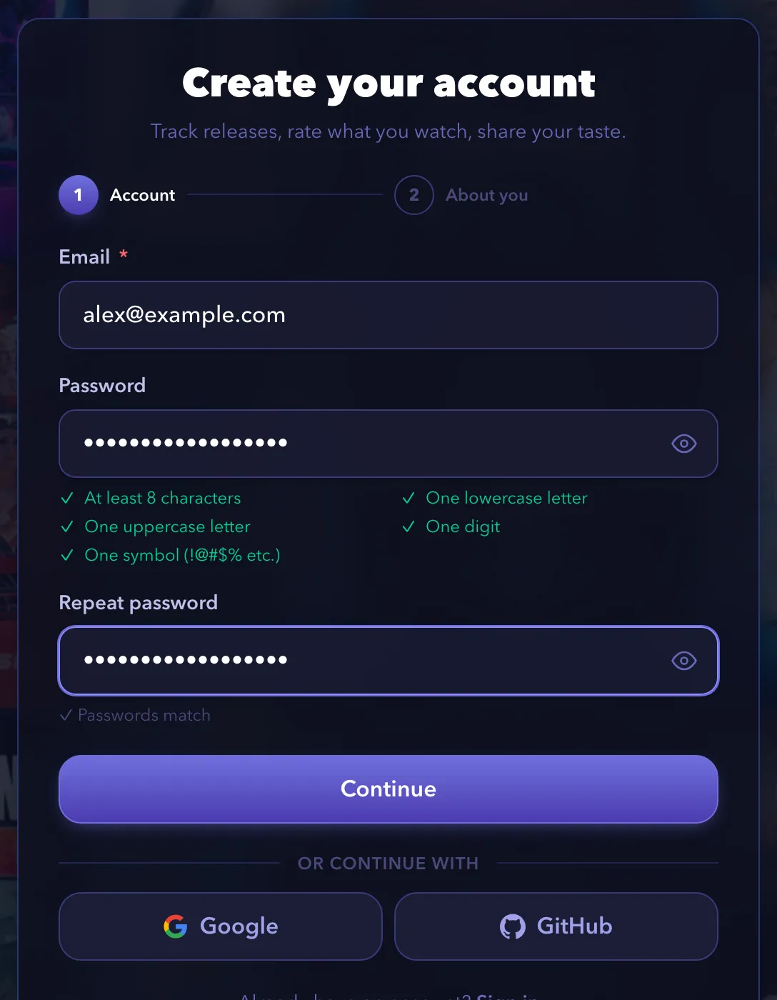
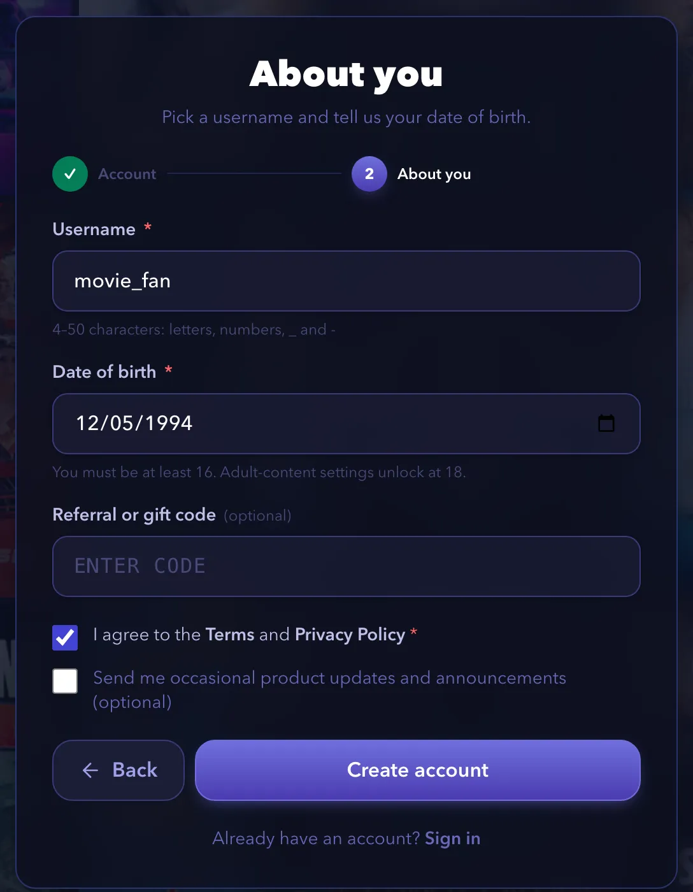
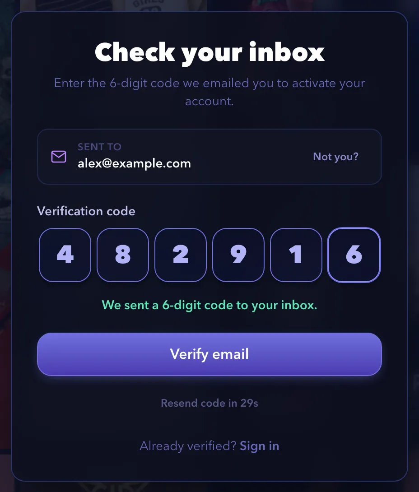
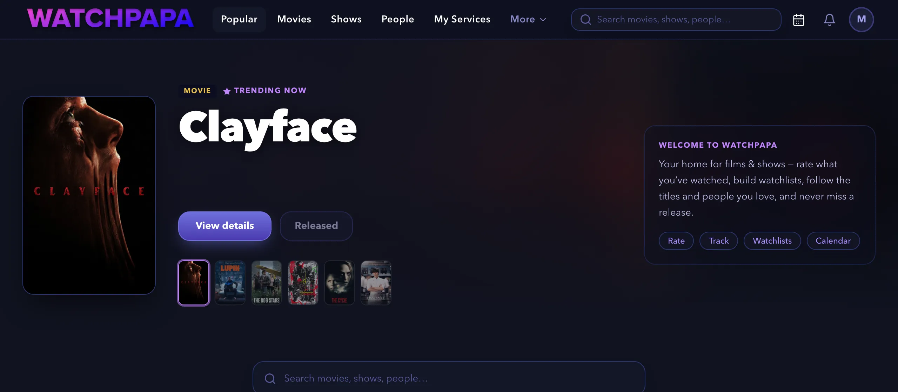
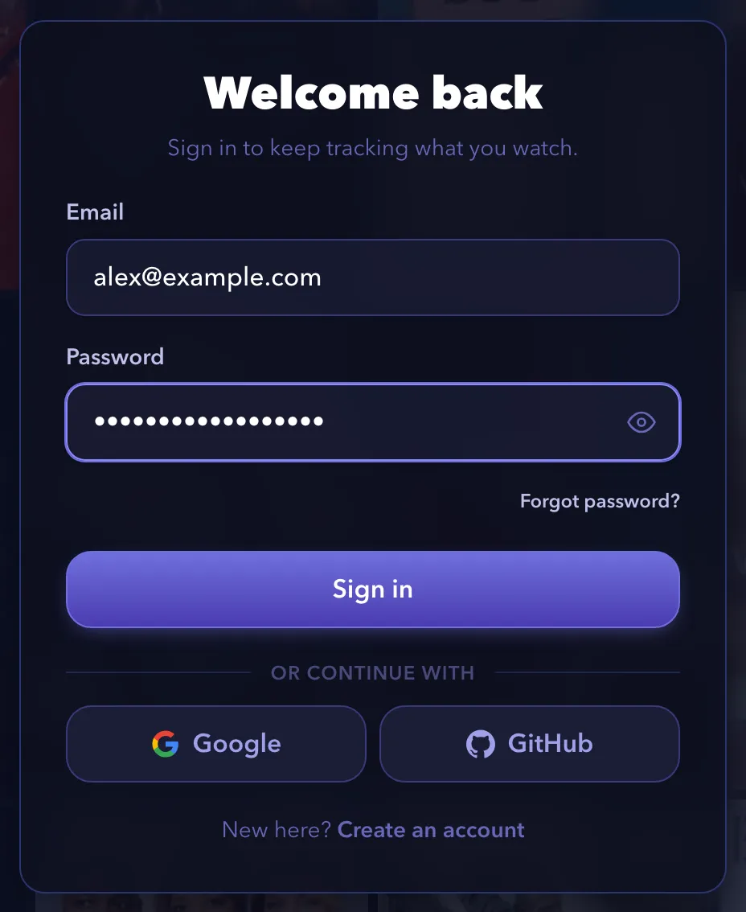
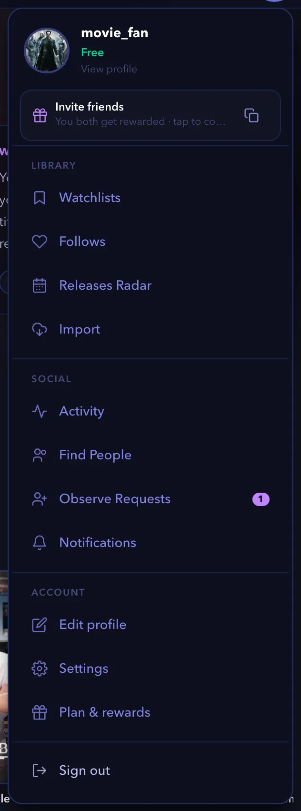
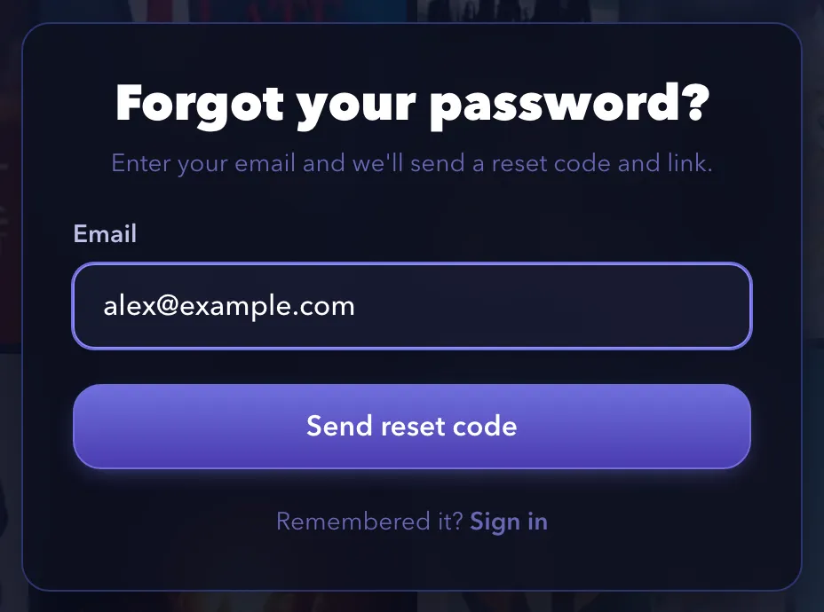
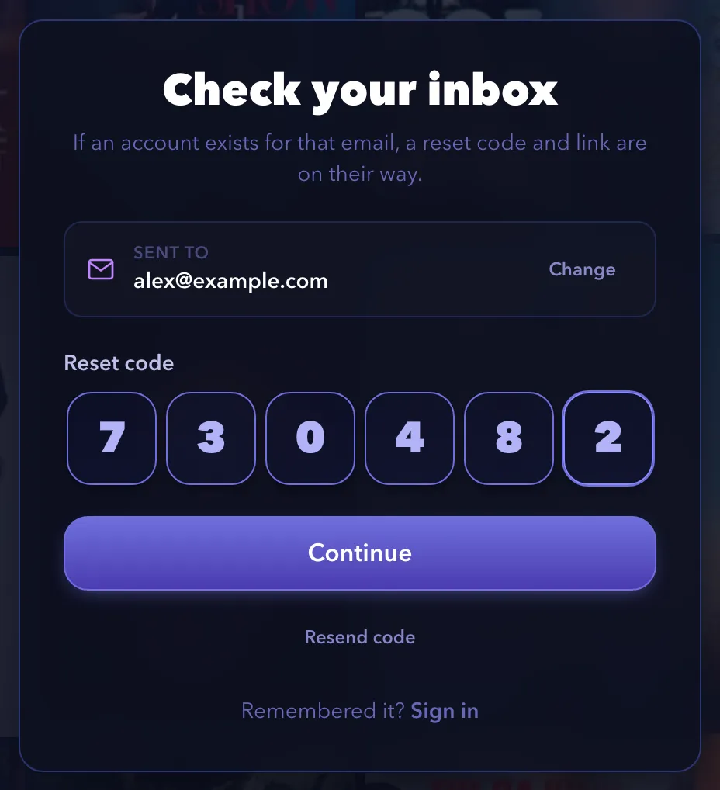
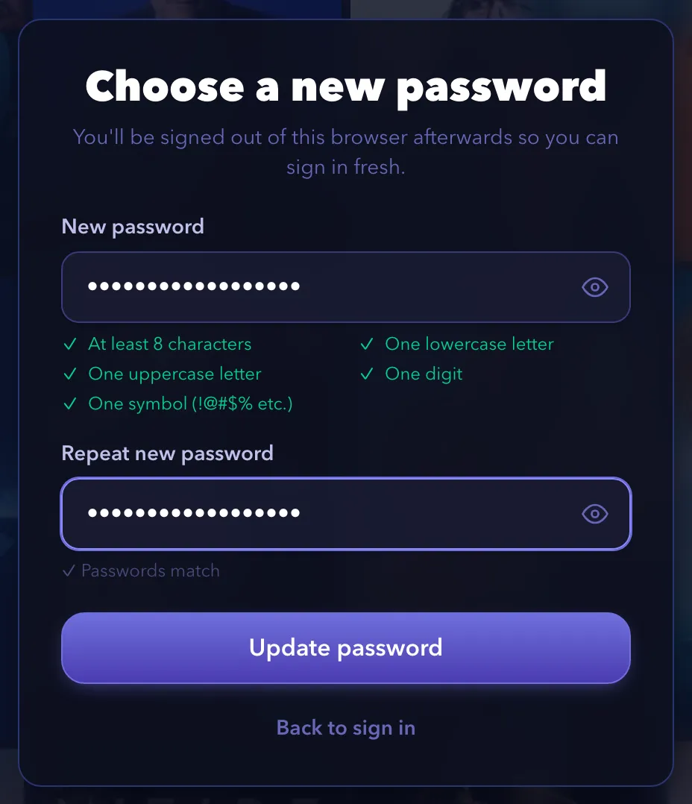

# How-to guides

These guides show you how to complete common tasks on watchpapa.tv. Each guide lists what you need, gives numbered steps and ends with links to related tasks. Notes inside the steps cover the variations: other devices, other plans and error messages.

Screenshots show a demo account with real titles from The Movie Database (TMDB).

> [!NOTE]
> Some features depend on your plan. The Free plan allows three followed shows, one followed movie and one watchlist. Premium and Pro allow more. The [Plans & Perks](https://watchpapa.tv/subscription) page lists every limit.

## Table of contents

**Your account**

- [Creating an account](#creating-an-account)
- [Signing in and out](#signing-in-and-out)
- [Resetting a forgotten password](#resetting-a-forgotten-password)

---

## Creating an account

A free account lets you follow shows, rate what you watch and keep a personal releases calendar. This guide takes about three minutes. It covers sign-up with an email address and a password, and sign-up with Google or GitHub. It does not cover signing in later or resetting a password.

### Before you begin

- Have an email address that you can open right now. watchpapa.tv sends you a code to verify it.
- You must be at least 16 years old.

### Steps

1. Open [watchpapa.tv](https://watchpapa.tv).
2. Select **Register** at the top right. On a phone, open the menu first and then select **Register**.
3. Enter your email address.
4. Enter a password. A checklist under the field shows five rules. Each rule turns green when you meet it.
   - At least eight characters
   - One lowercase letter
   - One uppercase letter
   - One digit
   - One symbol, such as `!` or `@`
5. Enter the same password in **Repeat password**. The message **Passwords match** appears when both entries agree.
6. Select **Continue**.

   

   > [!NOTE]
   > If your password appears on a list of known data breaches, the form shows the message "This password has appeared in a known data breach." Choose a different password.

   > [!TIP]
   > To sign up with an existing account, select **Google** or **GitHub** below **or continue with** instead of entering a password. After you sign in with the provider, the **Almost there** page opens. Enter a username, enter your date of birth, accept the terms and select **Finish setup**. Skip the remaining steps in this guide.

7. Enter a username. Use four to 50 characters. You can use letters, numbers, underscores and hyphens.
8. Enter your date of birth.

   > [!NOTE]
   > If you are younger than 16, the form shows "You must be at least 16 years old to register." You cannot create an account.

9. Enter a referral or gift code. This field is optional.

   > [!IMPORTANT]
   > You can enter a referral code only while you register. The app has no way to add a code later. If you opened a referral link, the code is already filled in.

10. Select the checkbox next to **I agree to the Terms and Privacy Policy**. You cannot continue without it.
11. Leave the product updates checkbox clear, unless you want occasional emails. This checkbox is optional.
12. Select **Create account**.

    

    > [!NOTE]
    > If the email address already has an account, the form returns to step one and shows "This email is already in use. Try signing in instead." Select **Sign in** and use that account.

13. Open your email inbox and find the message from watchpapa.tv. It contains a six-digit code.
14. Enter the code on the **Check your inbox** page.
15. Select **Verify email**.

    

    > [!NOTE]
    > If the code does not arrive, wait 30 seconds. Then select **Resend code**. If you entered the wrong address, select **Not you?** and correct it.

The home page opens, and your avatar appears in a circle at the top right. Until you choose a picture, the circle shows the first letter of your username.

### Summary

Congratulations. You now have a verified watchpapa.tv account and you are signed in. Your account can follow three shows and one movie. Adult content stays off until you turn it on in Settings.

### Next steps

- [Edit your profile](#editing-your-profile)
- [Follow a show or movie and read the releases calendar](#following-a-show-or-movie-and-reading-the-releases-calendar)
- [Rate a title and log a watch](#rating-a-title-and-logging-a-watch)

(<a href="#how-to-guides">back to top</a>)

---

## Signing in and out

Sign in to use your follows, ratings and watchlists on any device. This guide shows you how to sign in with an email address or with Google or GitHub, and how to sign out. It does not cover creating an account or resetting a password.

### Before you begin

- Have a verified account. If you have no account, read [Creating an account](#creating-an-account).

### Steps

1. Open [watchpapa.tv](https://watchpapa.tv).
2. Select **Sign in** at the top right. On a phone, select the **Sign in** tab at the bottom of the screen.
3. Enter your email address.
4. Enter your password. To check what you typed, select the eye icon at the right end of the field.
5. Select **Sign in**.

   

   The home page opens.

   > [!NOTE]
   > If you created your account with Google or GitHub, select **Google** or **GitHub** below **or continue with** instead of entering a password. You return to watchpapa.tv after the provider confirms who you are.

   > [!NOTE]
   > If the form shows "Wrong email or password.", check both entries for typing errors. If you forgot the password, read [Resetting a forgotten password](#resetting-a-forgotten-password).

   > [!NOTE]
   > If you never verified your email address, the **Check your inbox** page opens instead. Enter the six-digit code from your email and select **Verify email**. If the code has expired, select **Resend code**.

6. To sign out, select your avatar at the top right. On a phone, select the **You** tab at the bottom of the screen.
7. Select **Sign out** at the bottom of the menu.

   

   > [!NOTE]
   > The first time you visit, a banner asks about session storage. If you select **Accept cookies**, you stay signed in across tabs and browser restarts. If you select **Decline**, your session ends when you close the tab, so you must sign in again.

### Summary

Congratulations. You can now sign in and out of watchpapa.tv on any device.

### Next steps

- [Reset a forgotten password](#resetting-a-forgotten-password)
- [Edit your profile](#editing-your-profile)

(<a href="#how-to-guides">back to top</a>)

---

## Resetting a forgotten password

If you forget your password, watchpapa.tv emails you a code and a link. Use either one to choose a new password. This guide takes about two minutes. It does not cover changing a password that you remember.

### Before you begin

- Have access to the email address of your account.
- If you signed up with Google or GitHub, you do not need a password. Sign in with that provider instead.

### Steps

1. Open the sign-in page, as in [Signing in and out](#signing-in-and-out).
2. Select **Forgot password?** below the password field.
3. Enter your email address.
4. Select **Send reset code**.

   

   > [!NOTE]
   > The page shows the same message whether or not an account exists for that address: "If an account exists for that email, a reset code and link are on their way."

5. Open your email inbox and find the message from watchpapa.tv. It contains a six-digit code and a link.
6. Enter the code on the **Check your inbox** page.
7. Select **Continue**.

   

   > [!NOTE]
   > If you prefer, skip steps six and seven. Select the link in the email instead. The **Choose a new password** page opens directly.

   > [!NOTE]
   > If the code does not arrive, select **Resend code**. If you entered the wrong address, select **Change** next to it and correct it.

   > [!NOTE]
   > If the home page opens after you enter the code, you are already signed in. Open `watchpapa.tv/reset-password` in the same browser tab to continue.

8. On the **Choose a new password** page, enter a new password. The same five rules as at sign-up apply.
9. Enter the new password again in **Repeat new password**.
10. Select **Update password**.

    

    > [!NOTE]
    > If the new password appears on a list of known data breaches, the page asks you to choose a different one.

    > [!NOTE]
    > If you open `watchpapa.tv/reset-password` without a code or a link, the page shows **Reset link needed**. Select **Request a new reset code** to start again.

The page shows "Password updated. Taking you to sign in…" and the sign-in page opens. watchpapa.tv signs you out of this browser, so you sign in again with the new password.

### Summary

Congratulations. You chose a new password for your account. Use it the next time you sign in.

### Next steps

- [Sign in with your new password](#signing-in-and-out)

(<a href="#how-to-guides">back to top</a>)

---

## Editing your profile

## Deleting your account

## Following a show or movie and reading the releases calendar

## Rating a title and logging a watch

## Creating and using watchlists

## Finding where to stream a title

## Getting recommendations

## Changing your language and region

## Customizing the home page

## Observing other people

## Making your account private or blocking a user

## Inviting friends and claiming a reward code

## Sharing a title or a profile card

