# How-to guides

These guides show you how to complete common tasks on watchpapa.tv. Each guide lists what you need, gives numbered steps and ends with links to related tasks. Notes inside the steps cover the variations: other devices, other plans and error messages.

Screenshots show a demo account with real titles from The Movie Database (TMDB).

> [!NOTE]
> Some features depend on your plan. The Free plan allows three followed shows, one followed movie and one watchlist. Premium and Pro allow more. The [Plans & Perks](https://watchpapa.tv/subscription) page lists every limit.

## Table of contents

**Your account**

- [Creating an account](#creating-an-account)
- [Signing in and out](#signing-in-and-out)
- [Resetting a forgotten password](#resetting-a-forgotten-password)
- [Editing your profile](#editing-your-profile)
  - [Opening the Edit profile page](#opening-the-edit-profile-page)
  - [Choosing an avatar](#choosing-an-avatar)
  - [Setting your favorite titles](#setting-your-favorite-titles)
  - [Choosing your profile banner](#choosing-your-profile-banner)
  - [Writing your bio](#writing-your-bio)
  - [Changing your username](#changing-your-username)
- [Deleting your account](#deleting-your-account)

**Tracking what you watch**

- [Following a show or movie and reading the releases calendar](#following-a-show-or-movie-and-reading-the-releases-calendar)
  - [Following a show or a movie](#following-a-show-or-a-movie)
  - [Reading the releases calendar](#reading-the-releases-calendar)
  - [Checking your follow limit](#checking-your-follow-limit)
  - [Unfollowing a title](#unfollowing-a-title)
- [Rating a title and logging a watch](#rating-a-title-and-logging-a-watch)
  - [Rating a title](#rating-a-title)
  - [Changing or clearing a rating](#changing-or-clearing-a-rating)
  - [Logging a watch](#logging-a-watch)
  - [Logging another watch](#logging-another-watch)
  - [Removing a watch](#removing-a-watch)
- [Creating and using watchlists](#creating-and-using-watchlists)

**Finding what to watch**

- [Finding where to stream a title](#finding-where-to-stream-a-title)
- [Getting recommendations](#getting-recommendations)

---

## Creating an account

A free account lets you follow shows, rate what you watch and keep a personal releases calendar. This guide takes about three minutes. It covers sign-up with an email address and a password, and sign-up with Google or GitHub. It does not cover signing in later or resetting a password.

### Before you begin

- Have an email address that you can open right now. watchpapa.tv sends you a code to verify it.
- You must be at least 16 years old.

### Steps

1. Open [watchpapa.tv](https://watchpapa.tv).
2. Select **Register** at the top right. On a phone, open the menu first and then select **Register**.
3. Enter your email address.
4. Enter a password. A checklist under the field shows five rules. Each rule turns green when you meet it.
   - At least eight characters
   - One lowercase letter
   - One uppercase letter
   - One digit
   - One symbol, such as `!` or `@`
5. Enter the same password in **Repeat password**. The message **Passwords match** appears when both entries agree.
6. Select **Continue**.

   

   > [!NOTE]
   > If your password appears on a list of known data breaches, the form shows the message "This password has appeared in a known data breach." Choose a different password.

   > [!TIP]
   > To sign up with an existing account, select **Google** or **GitHub** below **or continue with** instead of entering a password. After you sign in with the provider, the **Almost there** page opens. Enter a username, enter your date of birth, accept the terms and select **Finish setup**. Skip the remaining steps in this guide.

7. Enter a username. Use four to 50 characters. You can use letters, numbers, underscores and hyphens.
8. Enter your date of birth.

   > [!NOTE]
   > If you are younger than 16, the form shows "You must be at least 16 years old to register." You cannot create an account.

9. Enter a referral or gift code. This field is optional.

   > [!IMPORTANT]
   > You can enter a referral code only while you register. The app has no way to add a code later. If you opened a referral link, the code is already filled in.

10. Select the checkbox next to **I agree to the Terms and Privacy Policy**. You cannot continue without it.
11. Leave the product updates checkbox clear, unless you want occasional emails. This checkbox is optional.
12. Select **Create account**.

    

    > [!NOTE]
    > If the email address already has an account, the form returns to step one and shows "This email is already in use. Try signing in instead." Select **Sign in** and use that account.

13. Open your email inbox and find the message from watchpapa.tv. It contains a six-digit code.
14. Enter the code on the **Check your inbox** page.
15. Select **Verify email**.

    

    > [!NOTE]
    > If the code does not arrive, wait 30 seconds. Then select **Resend code**. If you entered the wrong address, select **Not you?** and correct it.

The home page opens, and your avatar appears in a circle at the top right. Until you choose a picture, the circle shows the first letter of your username.

### Summary

Congratulations. You now have a verified watchpapa.tv account and you are signed in. Your account can follow three shows and one movie. Adult content stays off until you turn it on in Settings.

### Next steps

- [Edit your profile](#editing-your-profile)
- [Follow a show or movie and read the releases calendar](#following-a-show-or-movie-and-reading-the-releases-calendar)
- [Rate a title and log a watch](#rating-a-title-and-logging-a-watch)

(<a href="#how-to-guides">back to top</a>)

---

## Signing in and out

Sign in to use your follows, ratings and watchlists on any device. This guide shows you how to sign in with an email address or with Google or GitHub, and how to sign out. It does not cover creating an account or resetting a password.

### Before you begin

- Have a verified account. If you have no account, read [Creating an account](#creating-an-account).

### Steps

1. Open [watchpapa.tv](https://watchpapa.tv).
2. Select **Sign in** at the top right. On a phone, select the **Sign in** tab at the bottom of the screen.
3. Enter your email address.
4. Enter your password. To check what you typed, select the eye icon at the right end of the field.
5. Select **Sign in**.

   

   The home page opens.

   > [!NOTE]
   > If you created your account with Google or GitHub, select **Google** or **GitHub** below **or continue with** instead of entering a password. You return to watchpapa.tv after the provider confirms who you are.

   > [!NOTE]
   > If the form shows "Wrong email or password.", check both entries for typing errors. If you forgot the password, read [Resetting a forgotten password](#resetting-a-forgotten-password).

   > [!NOTE]
   > If you never verified your email address, the **Check your inbox** page opens instead. Enter the six-digit code from your email and select **Verify email**. If the code has expired, select **Resend code**.

6. To sign out, select your avatar at the top right. On a phone, select the **You** tab at the bottom of the screen.
7. Select **Sign out** at the bottom of the menu.

   

   > [!NOTE]
   > The first time you visit, a banner asks about session storage. If you select **Accept cookies**, you stay signed in across tabs and browser restarts. If you select **Decline**, your session ends when you close the tab, so you must sign in again.

### Summary

Congratulations. You can now sign in and out of watchpapa.tv on any device.

### Next steps

- [Reset a forgotten password](#resetting-a-forgotten-password)
- [Edit your profile](#editing-your-profile)

(<a href="#how-to-guides">back to top</a>)

---

## Resetting a forgotten password

If you forget your password, watchpapa.tv emails you a code and a link. Use either one to choose a new password. This guide takes about two minutes. It does not cover changing a password that you remember.

### Before you begin

- Have access to the email address of your account.
- If you signed up with Google or GitHub, you do not need a password. Sign in with that provider instead.

### Steps

1. Open the sign-in page, as in [Signing in and out](#signing-in-and-out).
2. Select **Forgot password?** below the password field.
3. Enter your email address.
4. Select **Send reset code**.

   

   > [!NOTE]
   > The page shows the same message whether or not an account exists for that address: "If an account exists for that email, a reset code and link are on their way."

5. Open your email inbox and find the message from watchpapa.tv. It contains a six-digit code and a link.
6. Enter the code on the **Check your inbox** page.
7. Select **Continue**.

   

   > [!NOTE]
   > If you prefer, skip steps six and seven. Select the link in the email instead. The **Choose a new password** page opens directly.

   > [!NOTE]
   > If the code does not arrive, select **Resend code**. If you entered the wrong address, select **Change** next to it and correct it.

   > [!NOTE]
   > If the home page opens after you enter the code, you are already signed in. Open `watchpapa.tv/reset-password` in the same browser tab to continue.

8. On the **Choose a new password** page, enter a new password. The same five rules as at sign-up apply.
9. Enter the new password again in **Repeat new password**.
10. Select **Update password**.

    

    > [!NOTE]
    > If the new password appears on a list of known data breaches, the page asks you to choose a different one.

    > [!NOTE]
    > If you open `watchpapa.tv/reset-password` without a code or a link, the page shows **Reset link needed**. Select **Request a new reset code** to start again.

The page shows "Password updated. Taking you to sign in…" and the sign-in page opens. watchpapa.tv signs you out of this browser, so you sign in again with the new password.

### Summary

Congratulations. You chose a new password for your account. Use it the next time you sign in.

### Next steps

- [Sign in with your new password](#signing-in-and-out)

(<a href="#how-to-guides">back to top</a>)

---

## Editing your profile

Your profile is the page that other people see. This guide shows you how to choose an avatar, set up to five favorite titles, pick a banner and write a short bio. It also shows you how to change your username. It does not cover privacy settings. For those, read [Making your account private or blocking a user](#making-your-account-private-or-blocking-a-user).

### Before you begin

- Sign in to watchpapa.tv.
- Decide which title you want as your avatar. You can search for any movie or show.

Each task below is independent. Do only the ones you need. Open the **Edit profile** page first for the avatar, favorites, banner and bio. Changing your username starts in Settings.

### Opening the Edit profile page

1. Select your avatar at the top right. On a phone, select the **You** tab.
2. Select **Edit profile**. The page opens with four sections: **Avatar**, **Profile banner**, **Bio** and **Favourites**.

### Choosing an avatar

1. In the **Avatar** section, choose one of the options.

   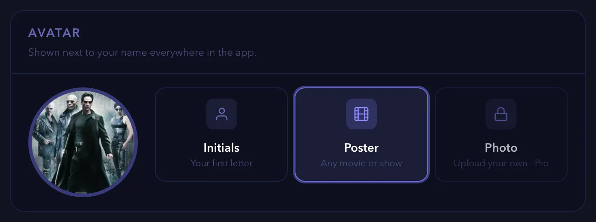

   - **Initials** shows the first letter of your username.
   - **Poster** shows the poster of any movie or show. Select **Poster**, enter a title in the search field and select the result.
   - **Photo** shows a picture that you upload.

   > [!NOTE]
   > **Photo** needs a Pro plan. On other plans, the option is locked and shows "Upload your own · Pro". Select it to open the plans page.

2. If you chose **Photo**, select a JPEG, PNG or WebP file of 8 MB or less.
3. Move the **Zoom** slider to crop the picture.
4. Select **Save avatar**.

   > [!NOTE]
   > A larger file or a different file type shows an error message.

### Setting your favorite titles

You can set up to five favorites. They appear on your profile and on your profile card.

1. In the **Favourites** section, select an empty slot. A **Pick a title** window opens.
2. Enter the name of a movie or show and select it in the results.

   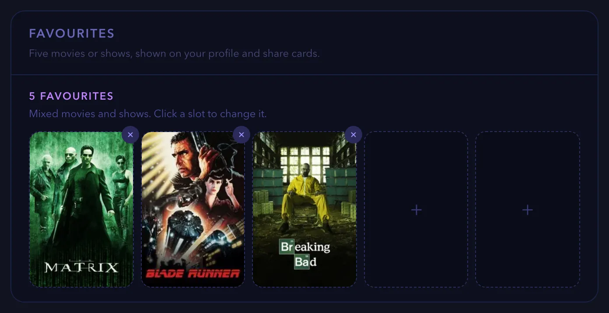

   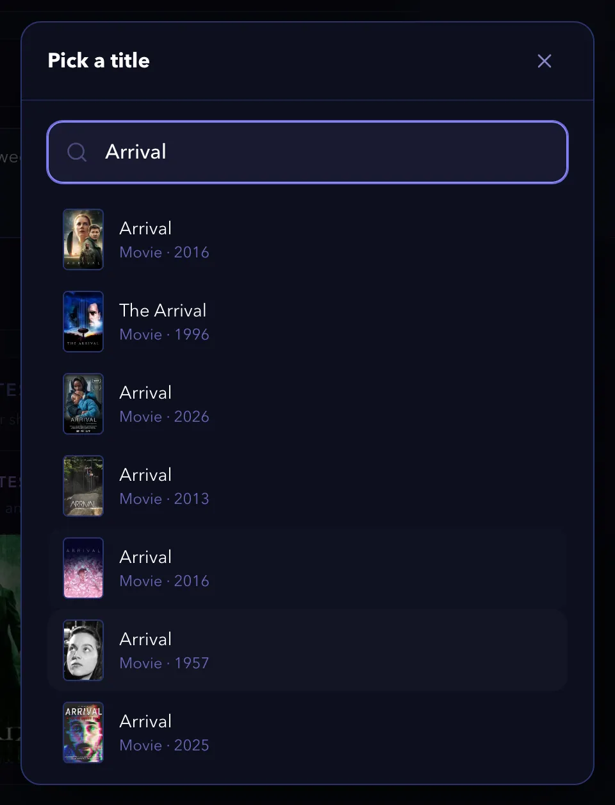

3. To replace a favorite, select its slot and pick another title.
4. To remove a favorite, select the **×** at the corner of its poster.

   > [!NOTE]
   > You can mix movies and shows.

### Choosing your profile banner

1. In the **Profile banner** section, choose where the banner artwork comes from. Select **Auto** to use your first favorite, or select the poster of another favorite.
2. To change the crop, select **Crop**.
3. Move the **Zoom** slider.
4. Select **Save banner**.

   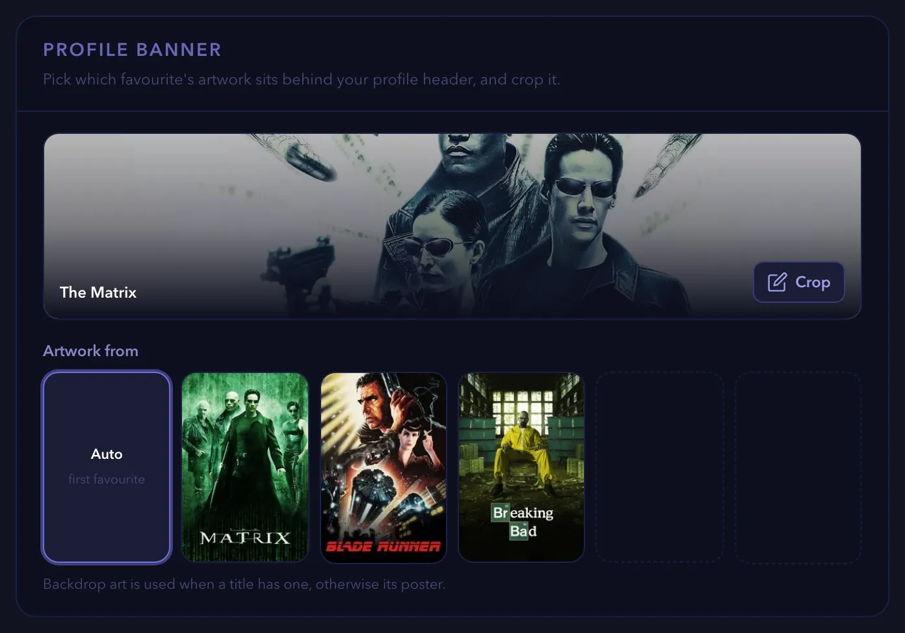

   > [!NOTE]
   > If you have no favorites yet, the section shows "Add a favourite first". Complete [Setting your favorite titles](#setting-your-favorite-titles) first.

### Writing your bio

1. In the **Bio** section, enter a short text of up to 200 characters. A counter shows how many characters you used.
2. Select **Save bio**. The button briefly reads **Saved**.

   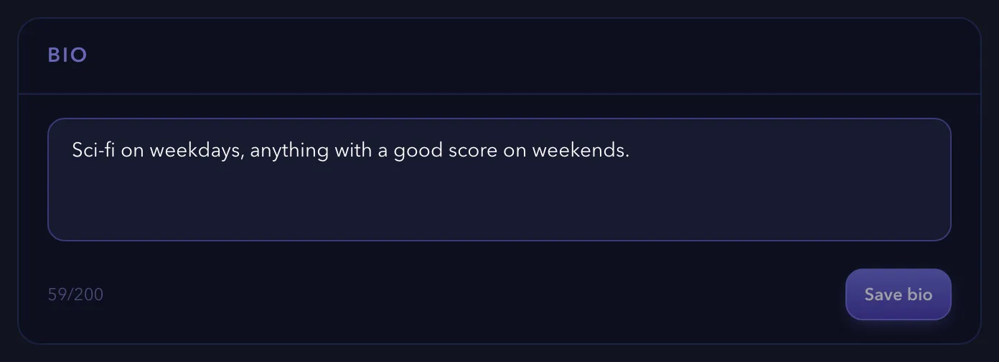

3. To see the result, select **Back to profile**.

### Changing your username

1. Select your avatar and then **Settings**.
2. In the **Profile** section, select **Change** next to **Username**.
3. Enter the new username and select **Save**.

   > [!NOTE]
   > You can change your username only once every 90 days. After a change, the hint shows the date of your next change.

   > [!NOTE]
   > If another person uses the name already, the form shows "Username already taken." Choose another name.

### Summary

Congratulations. Your profile now shows your avatar, banner, bio and favorite titles. Changes save when you select the save button of a section, or at once for avatar, favorites and banner.

### Next steps

- [Share your profile card](#sharing-a-title-or-a-profile-card)
- [Make your account private](#making-your-account-private-or-blocking-a-user)

(<a href="#how-to-guides">back to top</a>)

---

## Deleting your account

Deleting your account removes your profile, ratings, watchlists and follows. This guide shows you how to download a copy of your data first and then delete the account. It does not cover signing out.

> [!IMPORTANT]
> Deleting an account cannot be undone.

### Before you begin

- Sign in to watchpapa.tv.
- Decide whether you want a copy of your data. The copy is optional.

### Steps

1. Select your avatar and then **Settings**.
2. Optional: download a copy of your data. In the **Your data** section, select **Download CSV** next to **Export**. The file contains your movie ratings and your movie watchlist items.

   > [!NOTE]
   > The export covers movies only. Ratings and watchlist entries for shows are not in the file.

3. In the list of sections, select **Account**. It appears in red.
4. Select **Delete my account**.

   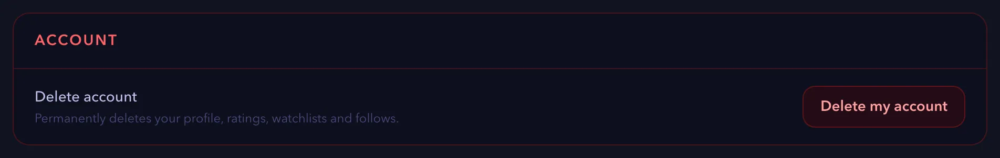

5. Read the message in the **Delete your account?** window. It says "This permanently deletes all your data. There is no undo."
6. Select **Yes, delete everything**.

   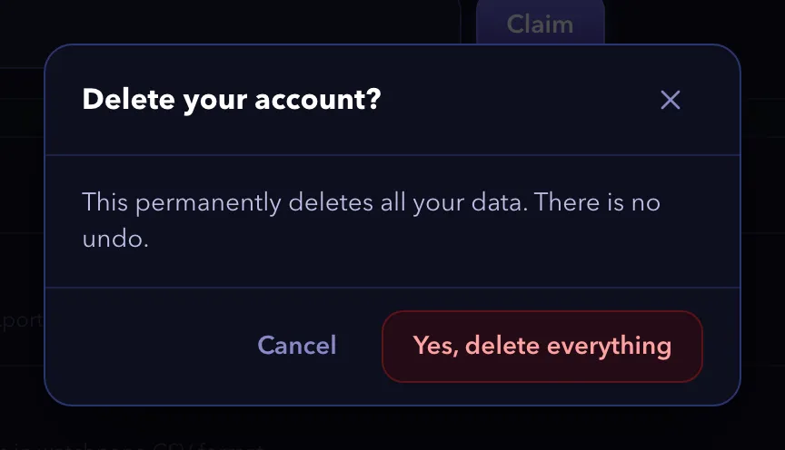

   > [!NOTE]
   > To keep your account, select **Cancel** or close the window.

   > [!NOTE]
   > If the deletion fails, the window shows an error message. Try again later, or write to us through the [contact page](https://watchpapa.tv/contact).

7. Read the **Account deleted** message and select **OK**. The sign-in page opens.

The message says "Your remaining data will be permanently removed within 30 days." The delay covers encrypted backups.

> [!TIP]
> If you want fewer emails, not a deleted account, turn off **Product updates & announcements** in the **Preferences** section of Settings.

### Summary

You deleted your account. watchpapa.tv no longer shows your profile, and your data leaves the backups within 30 days.

### Next steps

- [Create a new account](#creating-an-account)

(<a href="#how-to-guides">back to top</a>)

---

## Following a show or movie and reading the releases calendar

When you follow a show or a movie, its upcoming releases appear on your releases calendar. This guide shows you how to follow a show or a movie, read the calendar and unfollow a title. It does not cover importing a watch history.

### Before you begin

- Sign in to watchpapa.tv. If you have no account, read [Creating an account](#creating-an-account).
- Know the name of a show that is still releasing episodes, or of a movie that is not released yet.

> [!NOTE]
> The Free plan lets you follow three shows and one movie. The Premium plan allows 10 follows in total. The Pro plan allows 100 shows and 100 movies.

### Following a show or a movie

1. Select the search field at the top of the page. On a smaller screen, select the search icon at the top or the **Search** tab at the bottom.
2. Enter the name of the show or movie, such as "Grey's Anatomy". Matching titles appear as you type.
3. Select the show or movie in the list.

   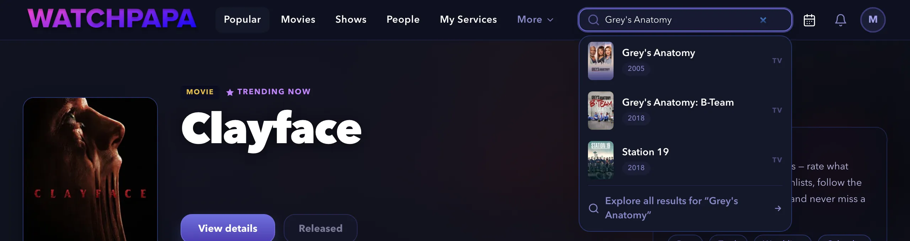

4. On the show or movie page, select **Follow**.

   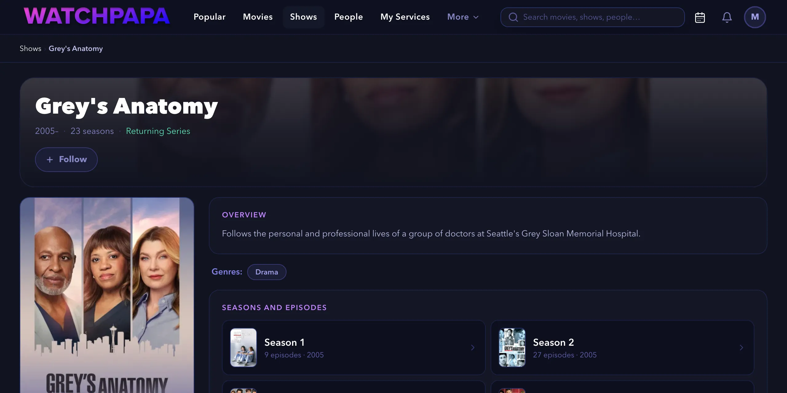

   The button changes to **Following** and shows a check mark.

   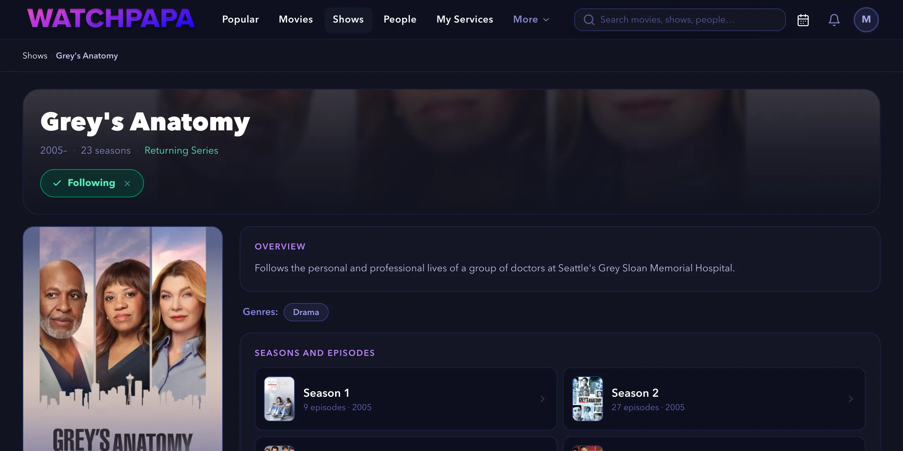

   > [!NOTE]
   > You can also select **Follow** on a title card in lists such as **Popular**. This works for shows and movies.

   > [!NOTE]
   > If you are not signed in, **Follow** opens a prompt to create an account or sign in.

   > [!NOTE]
   > You cannot start following a show that has ended or a movie that is already released. A follow tracks only upcoming releases. In that case, the button is locked and shows **Ended**, **Canceled** or **Released**. Choose a show that is still running or a movie that is not released yet.
   >
   > 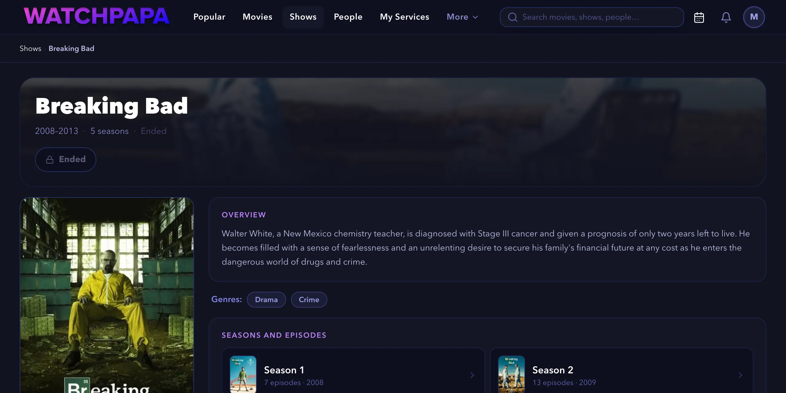

   > [!NOTE]
   > If you reach the limit of your plan, a message tells you so and the follow does not save. Unfollow a title that you no longer need, or read the **Plan & rewards** page.

### Reading the releases calendar

1. Select the calendar icon at the top right to open **Releases Radar**. On a narrow window, open your account menu and select **Releases Radar**. On a phone, select the **Radar** tab at the bottom of the screen.
2. Find your show or movie on the calendar. Each episode appears on its air date with a code such as `S2E3`, which means season two, episode three. A movie appears in the same way, under the movie title. Today is highlighted.

   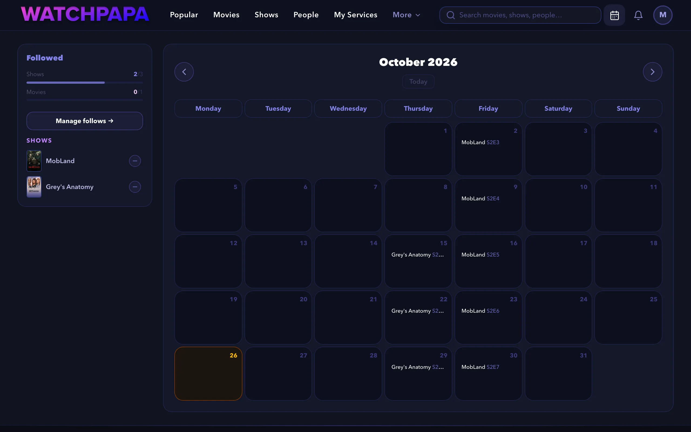

3. Select an entry to open its page.
4. Select the arrows next to the month name to see earlier or later months. Select **Today** to return to the current month.

   > [!NOTE]
   > On a phone, the calendar shows a list. Select **Week** to see one week at a time, and select **List** to go back.

   > [!NOTE]
   > If a show releases two or more episodes of one season on the same day, the calendar shows one entry named **Season** and the season number. Select it to open the season page.

   > [!NOTE]
   > If you follow more titles than your plan allows, the calendar shows "You're over your follow limit" and stays blocked. Select **Manage follows** and unfollow titles until you are under the limit. This can happen after a temporary upgrade ends.

### Checking your follow limit

1. Check the **Followed** panel at the left of the calendar. The bars show how many follows you have used. For example, **2/3** next to **Shows** means two of three.

### Unfollowing a title

1. In the **Followed** panel at the left of the calendar, select the minus button next to the name of the show or movie. The title stays visible for five seconds with an **Undo** button. After that, the unfollow is final.

   > [!TIP]
   > You can also unfollow from the title page. Select **Following** to turn it back to **Follow**.

### Summary

Congratulations. You followed a show or a movie, found its upcoming releases on the releases calendar and learned how to unfollow. The calendar updates whenever you follow or unfollow a title.

### Next steps

- [Rate a title and log a watch](#rating-a-title-and-logging-a-watch)
- Open **Follows** in your account menu to manage all your follows in one place.

(<a href="#how-to-guides">back to top</a>)

---

## Rating a title and logging a watch

A rating records what you think of a title. A watch log records when you saw it. This guide shows you how to rate a movie or a show, change or clear the rating, and log more than one watch. It does not cover watchlists or sharing.

### Before you begin

- Sign in to watchpapa.tv. If you have no account, read [Creating an account](#creating-an-account).
- Choose a title that is already released. For a title that is not released yet, the page shows **Not yet released** instead of the hearts.

### Rating a title

1. Open a title page. Search for the title, as in steps one to three of [Following a show or movie and reading the releases calendar](#following-a-show-or-movie-and-reading-the-releases-calendar). This guide uses *The Matrix*.
2. Find the **Your activity** card on the page. Before you rate, it shows five empty hearts and the label **Rate this movie**.

   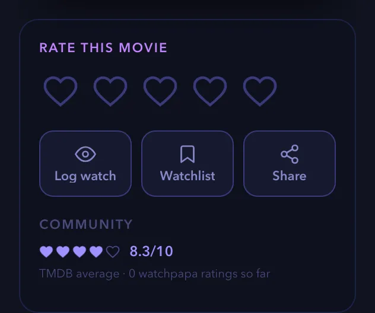

   > [!NOTE]
   > Shows work the same way, with the label **Rate this show**. Season and episode pages show the hearts only. They have no **Log watch**, **Watchlist** or **Share** buttons.

3. Move the pointer over the hearts. A score appears at the top right of the card. Each heart has two halves. The left half sets an odd score and the right half sets an even score, so the five hearts cover every score from one to 10. On a phone, tap a heart instead.
4. Select the half heart that matches your score. For 7 out of 10, select the left half of the fourth heart.

   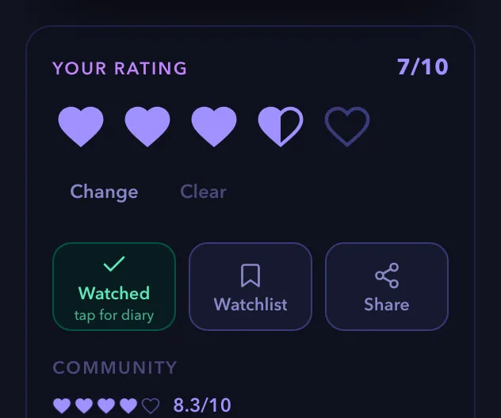

   > [!NOTE]
   > Your first rating also logs a first watch with today's date. It also removes the title from your watchlists.

   > [!NOTE]
   > If you are not signed in, selecting a heart opens a prompt to create an account.

### Changing or clearing a rating

Once you rate a title, the hearts lock so that a stray tap cannot replace your score.

1. Open the title page and find the **Your activity** card.
2. To change the rating, select **Change** and then select a new score. To cancel the change, select **Cancel**.
3. To remove the rating, select **Clear**.

### Logging a watch

1. Open the title page and find the **Your activity** card.
2. Select **Log watch**. The button logs today's date and changes to **Watched**.

### Logging another watch

1. On the title page, select **Watched**. On a computer, the **Rewatch diary** opens as a panel. On a phone, it opens from the bottom of the screen.
2. Under **Log another watch**, choose the date that you watched the title. You cannot choose a future date.
3. Select **Log**. The button now reads **Watched** followed by the number of watches, for example **Watched · 2×**.

   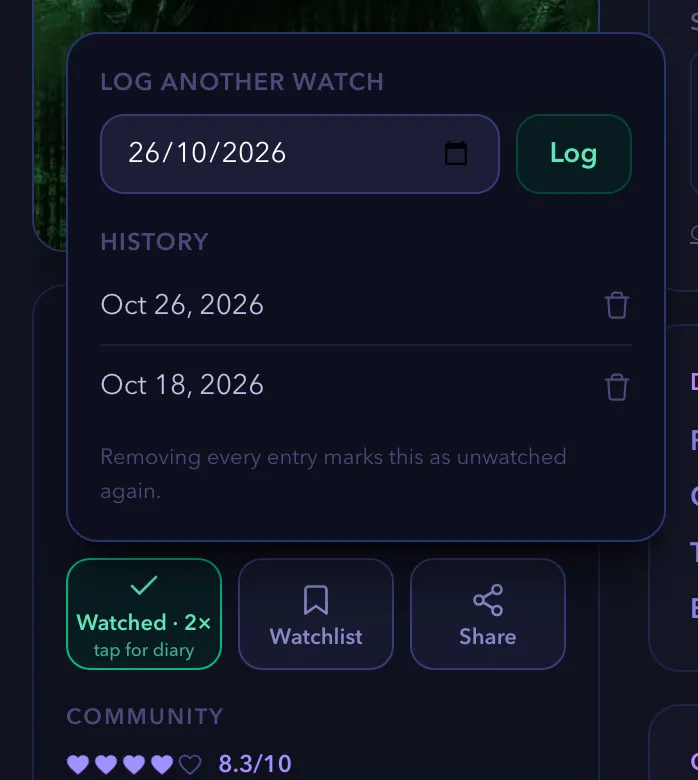

### Removing a watch

1. On the title page, select **Watched** to open the **Rewatch diary**.
2. Select the trash can next to the date in the **History** list.

   > [!NOTE]
   > If you remove every entry, the title counts as unwatched again. Logging a watch also removes the title from any watchlist that holds it.

### Summary

Congratulations. You rated a title, logged your first watch and added a rewatch. watchpapa.tv saves both to your account, and every change to a rating keeps a history.

### Next steps

- [Create a watchlist for titles you plan to watch](#creating-and-using-watchlists)
- [Get recommendations based on your ratings](#getting-recommendations)
- [Follow a show or movie and read the releases calendar](#following-a-show-or-movie-and-reading-the-releases-calendar)

(<a href="#how-to-guides">back to top</a>)

---

## Creating and using watchlists

A watchlist holds titles that you plan to watch. This guide shows you how to add a title to a list, create more lists, and sort, rename and delete them. It does not cover recommendations or following titles.

### Before you begin

- Sign in to watchpapa.tv.
- Know your plan's limit. The Free plan allows one watchlist, Premium allows three, and Pro and Pro+ allow 10.

### Steps

1. Open the page of a movie or a show, as in [Following a show or movie and reading the releases calendar](#following-a-show-or-movie-and-reading-the-releases-calendar).
2. In the **Your activity** card, select **Watchlist**.

   If you have no list yet, watchpapa.tv creates a list named **My Watchlist** and adds the title. If you already have lists, it adds the title to your first list. A bar shows the name of the list and the words "on your watchlist". The button changes to **Watchlisted**.

   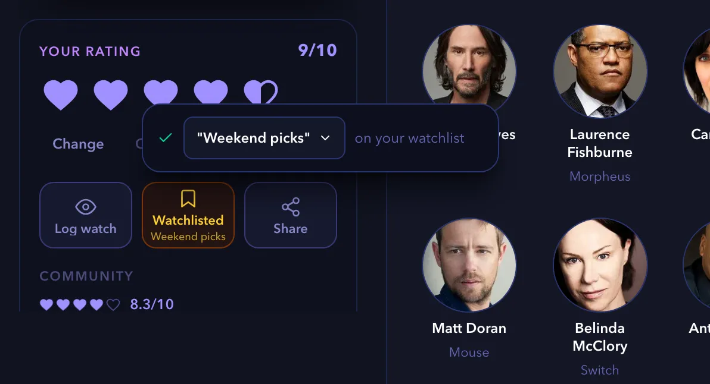

   > [!NOTE]
   > If you have more than one list, select the list name in the bar to open the list of your watchlists. Select a list to add or remove the title. A title can be on several lists. On a phone, the lists open in a sheet from the bottom.

   > [!NOTE]
   > To remove a title from a list, select **Watchlisted**. In the bar that appears, select the list name and then select the list to clear its check mark.

   > [!NOTE]
   > If you are not signed in, **Watchlist** opens a prompt to create an account.

3. To open your lists, select your avatar and then **Watchlists**. On a phone, select the **You** tab first. The **My Watchlists** page shows one tab for each list.

   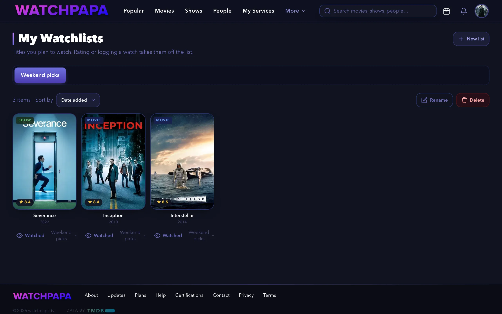

4. To create another list, select **New list**.
5. Enter a name of up to 60 characters.
6. Select **Create**.

   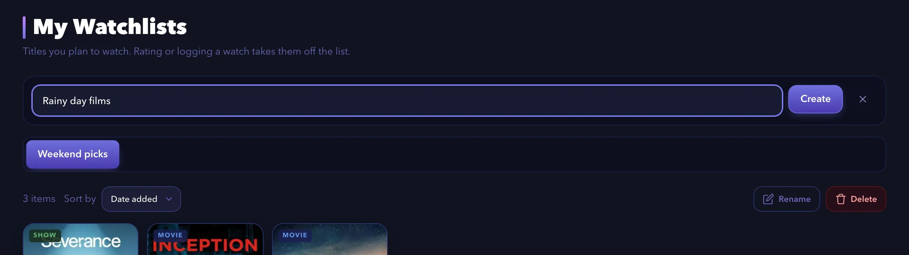

   > [!NOTE]
   > If you reached the limit of your plan, a message tells you how many watchlists your plan allows. Delete a list that you no longer need, or read the **Plan & rewards** page.

7. To change the order of the titles, select **Sort by** and choose **Date added** or **Rating**.
8. To mark a title as seen, select **Watched** below its poster. watchpapa.tv logs a watch and takes the title off the list.
9. To remove a title without logging a watch, point to its poster and select the trash can. Then select **Remove**. On a touch screen, the trash can is always visible.
10. To rename a list, select **Rename**, enter the new name and select **Save**.
11. To delete a list, select **Delete**. Then confirm in the **Delete this watchlist?** window.

    > [!NOTE]
    > Deleting a list removes the list and its entries. Your ratings and watch history stay.

### Summary

Congratulations. You added a title to a watchlist and learned how to manage your lists. Rating a title or logging a watch takes it off the list automatically.

### Next steps

- [Rate a title and log a watch](#rating-a-title-and-logging-a-watch)
- [Find where to stream a title](#finding-where-to-stream-a-title)

(<a href="#how-to-guides">back to top</a>)

---

## Finding where to stream a title

The **Where to watch** panel shows which services stream, rent or sell a title in your countries. This guide shows you how to read the panel, compare countries and choose your own watch regions. It does not cover buying a plan for a streaming service.

### Before you begin

- Choose a movie or a show. You do not need an account to read the panel.

### Steps

1. Open the page of a movie or a show.
2. Scroll down to the **Where to watch** panel.
3. Read the groups. Each group lists services with their logos.
   - **Stream** lists services that include the title in their subscription.
   - **Free** and **Free with ads** list services that cost nothing.
   - **Rent** and **Buy** list services that charge for the title.

   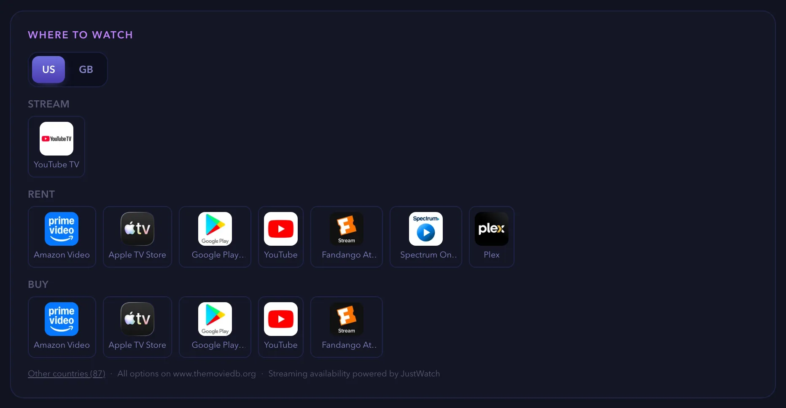

4. Select a country tab, such as **US** or **GB**, to compare services in another country.

   > [!NOTE]
   > If you have not chosen any watch regions, the panel shows a **Region** list instead of tabs. Choose a country in the list. Without an account, the panel remembers your choice during the visit.

   > [!NOTE]
   > If the title is not available in your regions, the panel shows "Not available in" and the names of your regions. Select **See where it's available** to see the countries that have it.

5. To look at other countries, select **Other countries** below the panel. The **Available in other countries** window opens.
6. Enter a country name in the search field, or use the arrows to move from one country to the next.

   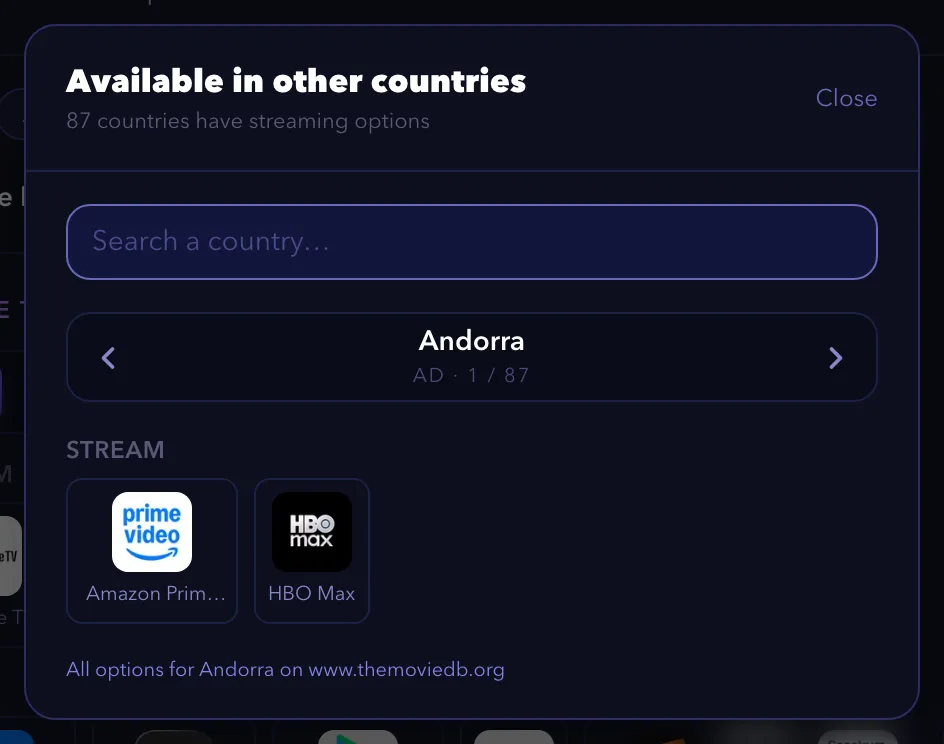

7. To choose your own regions, select your avatar and then **Settings**. In the **Streaming** section, find **Watch regions**.
8. Select **+ Add a region** and choose a country. Repeat for up to five countries.

   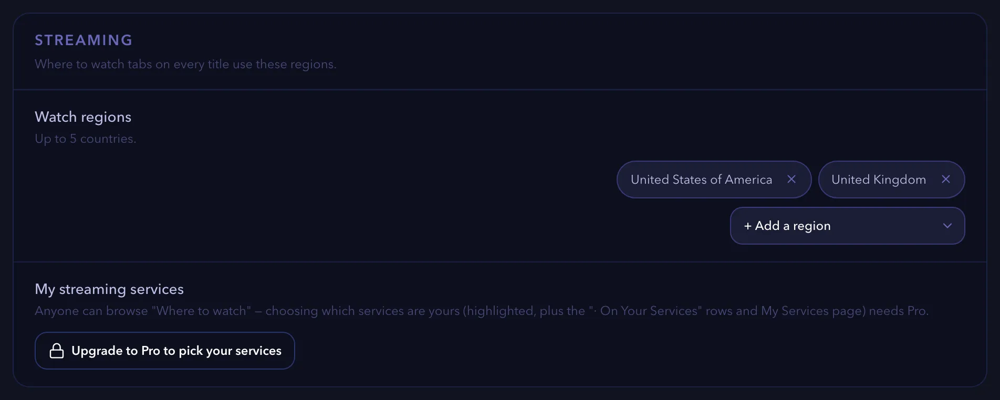

   > [!NOTE]
   > To remove a region, select the **×** on its label.

   > [!NOTE]
   > If you set a **Country** in the **Content & region** section, watchpapa.tv uses it as your default streaming region.

   > [!NOTE]
   > With a Pro plan, you can also choose your own streaming services under **My streaming services**. watchpapa.tv then highlights them on every title and fills the **My Services** page. On other plans, the section shows **Upgrade to Pro to pick your services**.

### Summary

Congratulations. You can now see where a title streams in your countries. The data comes from JustWatch through TMDB, so availability can change.

### Next steps

- [Change your language and region](#changing-your-language-and-region)
- [Create a watchlist](#creating-and-using-watchlists)

(<a href="#how-to-guides">back to top</a>)

---

## Getting recommendations

The **Suggested For You** row on the home page shows titles that match your taste. This guide shows you how to make the row appear and how to improve it. It does not cover the **Popular** row, which shows trending titles.

### Before you begin

- Sign in to watchpapa.tv.
- Rate at least a few titles. Read [Rating a title and logging a watch](#rating-a-title-and-logging-a-watch).

### Steps

1. Rate movies and shows that you like. Give each at least 6 out of 10. watchpapa.tv uses up to 10 of these titles as the starting point for suggestions.

   > [!NOTE]
   > Titles that you rated 5 or lower do not shape the suggestions. Ratings of seasons and episodes do not count either.

   > [!NOTE]
   > A title that you marked as watched on a watchlist, without a rating, also counts as a starting point. watchpapa.tv uses up to 10 of them.

2. Select **Popular** in the top navigation to open the home page. On a phone, select the **Home** tab.
3. Scroll to the **Suggested For You** row.

   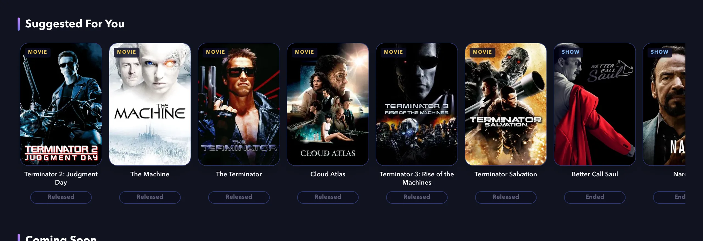

4. Scroll the row sideways. Select the arrow at the right end to load more titles.
5. Select a title to open its page. From there you can follow it, rate it or add it to a watchlist.

   > [!NOTE]
   > watchpapa.tv never suggests a title that you already rated, put on a watchlist or followed.

   > [!NOTE]
   > If the row does not appear, you have not rated any title with 6 out of 10 or more yet. The row also disappears when you hide it. To bring it back, select **Hidden** next to **Suggested For You** in the **Home page** section of Settings.

   > [!NOTE]
   > With a Pro plan and chosen streaming services, a second row named **Suggested For You · On Your Services** shows only titles on your services.

   > [!NOTE]
   > If you turned on **Show adult content** in Settings, suggestions can include adult titles.

### Summary

Congratulations. Your home page now suggests titles based on what you rated. The row changes as you rate more titles.

### Next steps

- [Customize the home page](#customizing-the-home-page)
- [Find where to stream a suggested title](#finding-where-to-stream-a-title)

(<a href="#how-to-guides">back to top</a>)

---

## Changing your language and region

## Customizing the home page

## Observing other people

## Making your account private or blocking a user

## Inviting friends and claiming a reward code

## Sharing a title or a profile card

