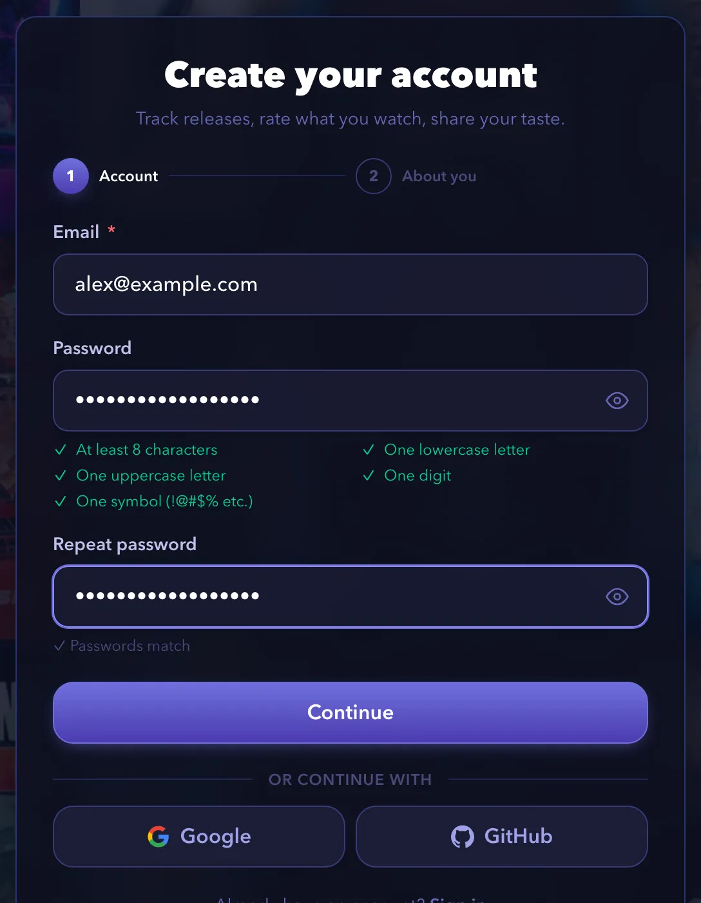
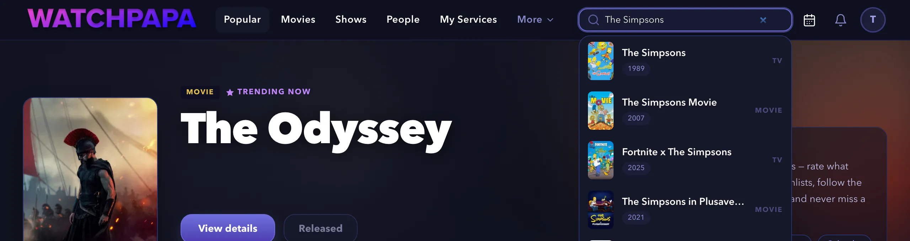
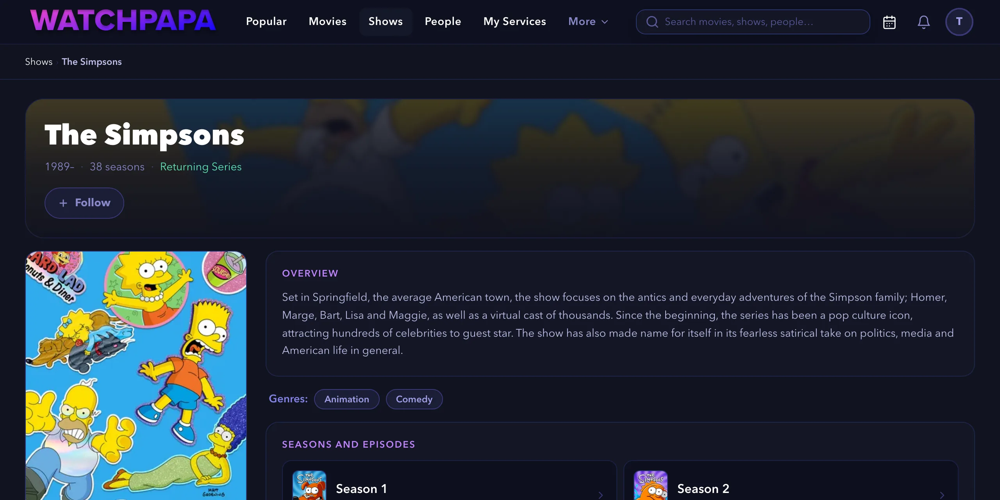
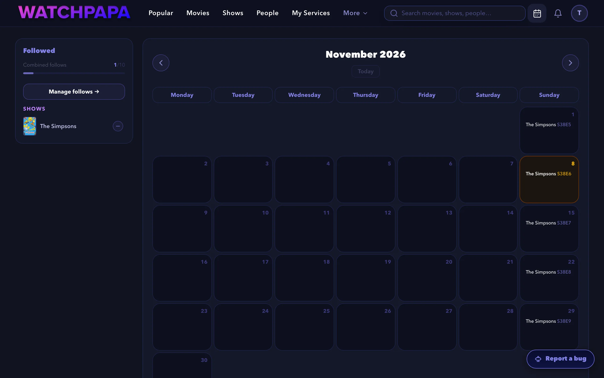
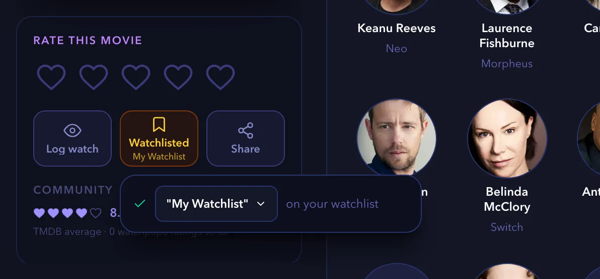
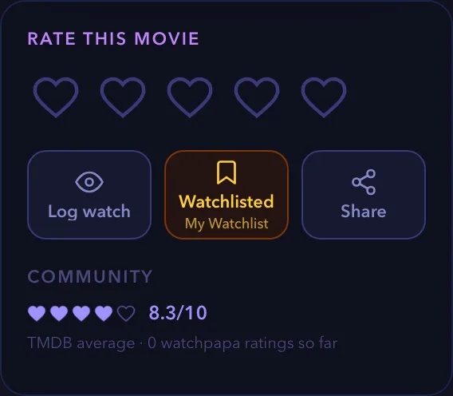
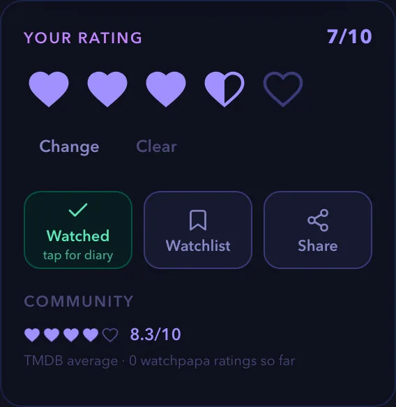
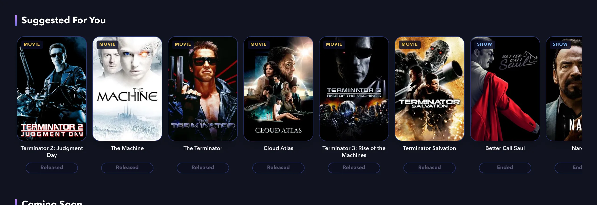

# Tutorial: Track what you watch with watchpapa.tv

watchpapa.tv is a website that helps you keep track of movies and TV shows. It keeps three lists for you: what is coming soon, what you plan to watch and what you already watched.

In this tutorial, you start with no account and finish with a working watch tracker. You follow a show and see its episodes on a calendar. You save a movie to a watchlist and then rate it. Last, you get recommendations that match your taste. Along the way, you learn how following, watchlists and ratings work together.

This tutorial takes about 20 minutes. It teaches the main ideas of the site. It does not cover every option. When you need to solve one specific problem later, use the [how-to guides](how-to.md).

## Prerequisites

- A web browser on a computer or a phone. This tutorial uses the computer layout and names the phone differences.
- An email address that you can open right now. watchpapa.tv sends you a code to verify it.
- An age of at least 16 years.

You need no earlier knowledge of the site. The Free plan covers every step.

## 1. Create your account

An account stores your follows, watchlists and ratings. Without one, the site cannot remember them.

1. Open [watchpapa.tv](https://watchpapa.tv). If a banner asks about session storage, select **Accept cookies**. This keeps you signed in when you close the tab.
2. Select **Register** at the top right. On a phone, open the menu first and then select **Register**.
3. Enter your email address.
4. Enter a password. A checklist under the field shows five rules, and each rule turns green when you meet it.
5. Enter the same password in **Repeat password**.
6. Select **Continue**.

   

7. Enter a username and your date of birth.
8. Select the checkbox next to **I agree to the Terms and Privacy Policy**. Leave the two optional fields, the referral code and the product updates, as they are.
9. Select **Create account**.
10. Open your email inbox and find the message from watchpapa.tv. Enter the six-digit code on the **Check your inbox** page.
11. Select **Verify email**.

The home page opens, and a circle with the first letter of your username appears at the top right. You now have a verified account on the Free plan. This plan lets you follow three shows and one movie, and it gives you one watchlist.

## 2. Follow a show

A follow tells watchpapa.tv that you want to know when new episodes arrive. Each followed show then appears on your personal calendar.

1. Select the search field at the top of the page. On a phone, select the **Search** tab at the bottom.
2. Enter "The Simpsons". Matching titles appear as you type.
3. Select the first result, which has the label **TV**. The list also shows a movie, so check the label.

   

4. On the show page, select **Follow**.

   

The button changes to **Following** and shows a check mark.

> [!NOTE]
> A follow tracks only upcoming releases. You cannot follow a show that has ended, and its button is locked.

## 3. Read your releases calendar

The releases calendar collects the upcoming episodes of every title that you follow. You do not need to remember air dates.

1. Select the calendar icon at the top right to open **Releases Radar**. On a phone, select the **Radar** tab at the bottom of the screen.
2. Find The Simpsons on the calendar. The show releases one episode a week, on Sundays. Each episode appears on its air date with a code such as `S38E6`, which means season 38, episode 6. Today is highlighted.

   

3. Select the arrows next to the month name to look at earlier or later months. Select **Today** to return to the current month.
4. Look at the **Followed** panel at the left of the calendar. It lists your followed show. The bar shows how many follows you have used out of the number that your plan allows.

The calendar stays empty until you follow a title. Every show that you follow later adds its episodes here.

## 4. Save a movie to your watchlist

A watchlist holds titles that you plan to watch. It differs from a follow. A follow waits for something that is not released yet, and a watchlist holds something that you can watch today.

1. Search for "The Matrix", as in step two, and select the movie.
2. Find the card with the heading **Rate this movie**. It sits below the poster and holds the buttons **Log watch**, **Watchlist** and **Share**.
3. Select **Watchlist**.

   

The button changes to **Watchlisted** and shows the name of your list. A bar also shows the list name and the words "on your watchlist". watchpapa.tv created the list for you, and it is named **My Watchlist**.

4. Select your avatar at the top right and then **Watchlists**. On a phone, select the **You** tab first.

The **My Watchlists** page shows **My Watchlist** with *The Matrix* on it.

## 5. Rate the movie

A rating records what you think of a title. It also feeds your recommendations in the next step.

1. Go back to the page of *The Matrix* and find the card with the heading **Rate this movie**. Before you rate, it shows five empty hearts.

   

2. Move the pointer over the hearts. A score appears at the top right of the card. Each heart has two halves. The left half sets an odd score and the right half sets an even score, so the five hearts cover every score from one to 10. On a phone, tap a heart instead.
3. Select the left half of the fourth heart. This gives the movie a score of 7 out of 10.

   

The heading changes to **Your rating**, the score appears, and the **Watched** button turns green. Your first rating also logs a first watch with today's date.

4. Open **Watchlists** again, as in step four.

The page shows "This list is empty". *The Matrix* is gone from your watchlist. A rating means that you watched the title, so it no longer belongs on a list of things that you plan to watch.

## 6. Get recommendations

watchpapa.tv uses the titles that you rated 6 or higher to suggest more titles that you may like. Your rating of 7 is enough to start.

1. Select **Popular** in the top navigation to open the home page. On a phone, select the **Home** tab.
2. Scroll to the **Suggested For You** row.

   

3. Select a title to open its page. From there you can follow it, rate it or add it to your watchlist.

The row never suggests a title that you already rated, put on a watchlist or followed. To improve the suggestions, rate more titles that you like with at least 6 out of 10. The row changes as you rate more titles.

## Recap

## What's next

